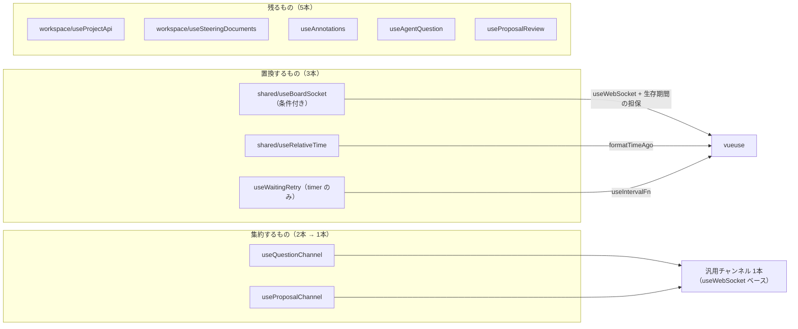

# composables ライブラリ代替可否

`app/composables/` の現状の実態と、ライブラリ置換の軸への対応。

軸は **vueuse (@vueuse/core 14.4.0) / @nuxt/ui (4.10.0) / Nuxt 標準機能で代替できるものは置き換える**。あわせて、同型の重複は**1本の composable へ集約する**。

- 棚卸しの本体は `docs/specs/core/file-composables.md`。ここは置換・集約の可否だけを扱う
- 別軸（責務分離 `separate-composable-responsibilities`・平置き `flatten-composables`）はこの評価に持ち込まない
- 記述は実装と node_modules の実物（型定義・dist ソース）から抽出した事実に限る

ここでの「置換」は、**composable の廃止ではなく、内部の自前機構をライブラリ部品で組み直すこと**。公開インターフェースと参照元は変えない。純粋な一対一の差し替えに近いのは `useRelativeTime` のみ。

## 残るもの — 据置5本

軸を適用した後も自前実装のまま残る一覧。中身がドメインロジックであり、ライブラリで置き換える対象が無い。

| 関心 | composable | 据置の理由 |
| --- | --- | --- |
| プロジェクトの読み書き | `useProjectApi`（192行） | 既に Nuxt 標準（`useFetch` / `$fetch`）の上。エラー文言変換・パス解釈はドメインロジック |
| ステアリングの読み書き | `useSteeringDocuments`（50行） | 定数と `computed` の組み立てのみ |
| 注釈 | `useAnnotations`（178行） | ドメイン状態と4層ペイロードの組み立て。色定数の件は `flatten-composables` の軸 |
| 問いの往復 | `useAgentQuestion`（132行） | 全体がオーケストレーション。`statusOf` / `messageOf` の重複は責務分離の軸 |
| proposal のレビュー | `useProposalReview`（412行） | この軸単独で完結する置換は無い。モーダル開閉の `useOverlay` 化は component 側と不可分のため `realign-component-composable-boundaries` へ委譲 |



## Nuxt plugin について

今回の10本に、Nuxt plugin（`app/plugins/`）として提供し直すべきものは無い。唯一のアプリ全体シングルトン `useBoardSocket` も、後述の (a)(b) いずれかで composable のままの呼び出し形を保てる（plugin 化は呼び出し形が変わるぶん差分が大きい）。

---

# 集約するもの — 2本 → 1本

## useQuestionChannel.ts / useProposalChannel.ts（各24行）

2本は**構造が完全に同型**。`useWebSocket` + `autoReconnect` で購読し、最後に届いた1件で上書きして保持するだけ。URL 組み立て（scheme/host の判定）も逐語で重複している。

| | `useQuestionChannel`（W1） | `useProposalChannel`（W2） |
| --- | --- | --- |
| 購読先 | `/ws/question` | `/ws/proposal` |
| 届くもの・型 | 今の1問（`Question`） | proposal と名前候補（`ProposalMessage`） |
| 返り値の名前 | `{ question }` | `{ message }` |
| 使う側 | 画面1、`useAgentQuestion` | `useProposalReview` |

違いは「どのチャンネルを聴くか」と「届く中身の型」だけ。**これこそ composable として集約するべき内容**であり、パスと型を引数に取る汎用チャンネル1本（`useWebSocket` ベース、型引数で `Question` / `ProposalMessage` を渡す）に畳む。

- 呼び出し形（薄いラッパ2本を残すか、呼び出し側がパスを渡すか）は実装時の design で確定する
- 挙動は現行と同じ: 最後の1件のみ保持・`autoReconnect`・接続時のサーバ側現在分配信で初期値が入る

---

# 置換するもの — 3本

| composable | 判定 | 組み直しの内容 |
| --- | --- | --- |
| `useBoardSocket`（85行） | 置換可（条件付き: 生存期間の担保） | 内部のトランスポート（生 WS・再接続 timer・シングルトン・ハンドラ Set）を `useWebSocket` +（`createGlobalState` または `createSharedComposable`+常駐購読）+ `createEventHook` で組み直す。公開 IF は維持 |
| `useRelativeTime`（18行） | 置換可 | 関数本体を `formatTimeAgo` に差し替え（`messages` で日本語・`invalid`・`rounding`/`units` 指定）。一対一に最も近い |
| `useWaitingRetry`（48行） | 部分置換 | timer 管理のみ `useIntervalFn` に委譲。`waiting` / `failed` とドメイン判定は自前のまま |

## useBoardSocket.ts — 置換可（条件付き: 接続の生存期間の担保）

生 `WebSocket` を自前で張り、`close` 時に `setTimeout` 2秒で再接続する。モジュール変数 `shared`（20行目）によるアプリ全体シングルトン。

```ts
let shared: BoardSocket | null = null;          // アプリ生存中ずっと保持
socket.addEventListener('close', () => {
  setTimeout(() => connect(...), 2_000);        // 無限に張り直す
});
```

組み直し先は vueuse `useWebSocket`。channel 側が既に採用しており、集約後の汎用チャンネルと合わせて **WS の張り方が同じ書き方に揃う**。

### 条件 — シングルトン性は共有化の方式で決まる

`createSharedComposable` は参照カウント式で、**最後の購読 scope が破棄されると state ごと破棄し、次の呼び出しで再生成する**。現行のモジュール変数はアプリ生存中不変であり、設計要件「接続はアプリ全体で1本だけ張り、画面遷移で張り替えない」（design.md 決定7、ファイル冒頭コメント）がある。

参照元は5箇所（`layouts/portal.vue`、`layouts/workspace.vue`、`pages/index.vue`、`pages/projects/index.vue`、`components/shared/NotificationToaster.vue`）に散在するため、レイアウト切替で購読者ゼロ区間が生じると切断・`notifications` 消失が起き得る。**そのままの `createSharedComposable` 単独では要件を満たさない。**

担保の方式は2案。どちらでも要件は満たせる。方式の確定は実装時の design で行う。

| 案 | 方式 | 生存期間 |
| --- | --- | --- |
| (a) | `createGlobalState` で包む | 破棄されない大域 scope。現行のモジュール変数と同じ |
| (b) | `createSharedComposable` + アプリ常駐の場所（`app.vue` など）で1購読を保持 | 常駐購読が生存を担保 |

### 挙動の差分

| 挙動 | 現状 | 組み直し後 | 揃え方 |
| --- | --- | --- | --- |
| 再接続間隔 | 2000ms 固定 | 既定 1000ms | `autoReconnect: { delay: 2000 }` |
| 再試行回数 | 無限 | `retries` 既定 -1 = 無限 | 未指定のままで一致 |
| SSR の state | モジュール変数がリクエスト横断共有 | (a) なら同じ / (b) は素通し（per-call）で解消 | (b) は改善方向の差分として認識 |

`onNotification` のハンドラ登録（Set + `onScopeDispose` 解除）は、同軸の vueuse `createEventHook`（`on` が scope 破棄時の自動解除を持つ）でも組み直せる。本体の置換に含めてよい。

## useRelativeTime.ts — 置換可

純関数 `formatRelativeTime(iso: string)`。「たった今 / N分前 / N時間前 / N日前」の4段。無効値は `'—'`。丸めは `Math.floor`。

置換先は vueuse `formatTimeAgo`（純関数版）。日本語文言は `messages` オプションで注入する。

### 挙動の差分

| 挙動 | 現状 | vueuse 既定 | 揃え方 |
| --- | --- | --- | --- |
| 単位の刻み | 何日経っても「N日前」 | 週・月・年まで刻む | `units` で day を最大単位にする |
| 丸め | `Math.floor` | `'round'` | `rounding: 'floor'` |
| 無効日付 | `'—'` | `messages.invalid`（既定 `""`） | **`invalid: '—'` を注入すれば直接維持できる（ラッパ不要）** |
| 未来時刻 | 負の elapsed は常に「たった今」 | 1分超の未来は future 文言 | `messages` の future 側も注入して吸収するか、許容するかは実装時に決める |
| 引数 | ISO 文字列 | `Date` | ISO→`Date` 変換の薄いラッパ（もしくは呼び出し側での変換）は要る |

引数の変換は `'—'` の有無とは無関係の、シグネチャの話。

## useWaitingRetry.ts — 部分置換（timer 管理のみ委譲）

`setInterval` の手管理（`stopPolling` / `onScopeDispose` / SSR ガード）と、ドメイン判定（`invocation: failed / idle`）が同居している。

置換するのは **timer 管理のみ**。vueuse `useIntervalFn`（`{ immediate: false }`）に委譲する。

| 現状 | useIntervalFn |
| --- | --- |
| `stopPolling()` | `pause()` |
| 張り直し（`stopPolling` してから `setInterval`） | `resume()`（毎回クリアしてから張り直す = 等価） |
| `onScopeDispose(stopPolling)` | scope 破棄時の自動 `pause`（内蔵） |

残すもの: `waiting` / `failed` の状態と U2 ポーリングのドメイン判定は本体の責務のまま。

**SSR ガードは残す。** `resume()` に client 限定ガードは無く、SSR でも `setInterval` を張り得るため、現行の `import.meta.server` early return は温存する。
