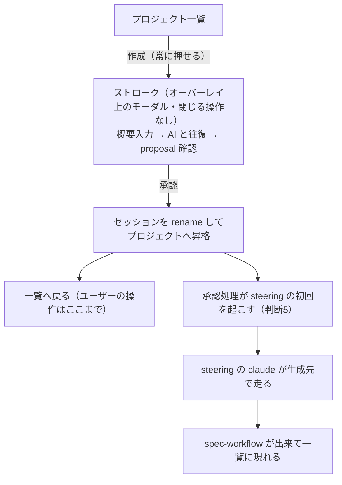
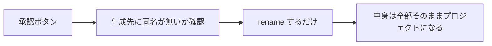
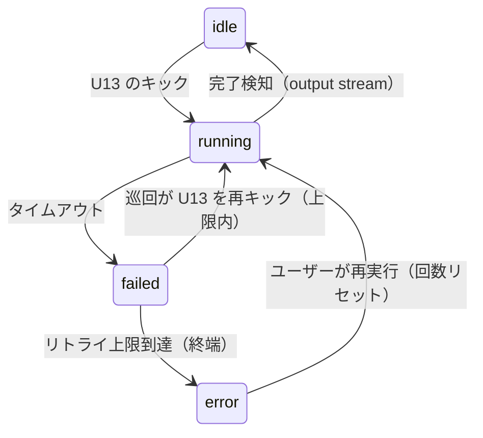

# connect-portal-and-strokes — 入口と出口を繋ぐ

承認済みの設計資料2枚（portal-stroke-entrance / portal-stroke-exit）を仕様と実装計画に落としたもの。

## これからの流れ



## 画面

```
① 一覧                      ② 作成を押す                 ③ 承認して戻る
┌──────────────────┐      ┌──────────────────┐      ┌──────────────────┐
│ memo-app  アクティブ│      │    ストローク      │      │ memo-app  アクティブ│
│ srvgm     未接続   │ ──▶ │  概要を入力…      │ ──▶ │ srvgm     未接続   │
│                  │      │  → 往復 → 承認    │      │ new-one   承認待ち │
│ [登録(灰)] [作成] │      │  ※閉じる操作なし   │      │  ← steering 後に出る│
└──────────────────┘      └──────────────────┘      └──────────────────┘
```

## 仕様として決めたこと

ストローク側の spec を畳み、巡回を新設して6つにする。portal 側の区切り直しはやらない。変更列は差分のみ。

| capability | 畳む元 | 変更（1行1変更） |
|---|---|---|
| `stroke/frontier` | stroke-session ＋ proposal-review | ・作成は常に押せるボタンになる<br/>・3画面はオーバーレイ上のモーダルで開く（閉じる操作なし・リロードで復帰）<br/>・承認は rename 昇格になる<br/>・承認の成功でモーダルを閉じて一覧へ戻る<br/>・承認済みセッションは id ごと消え、開けない |
| `project/generation` | project-generation | ・proposal は claude がセッション時点から `docs/proposal.md` に書く<br/>・サーバーは proposal を書かない |
| `agent/invocation` | ai-invocation | ・起動定義・定型・cwd を内部導出せず引数で受け取る<br/>・`approved` でも `invocation` を記録する<br/>・invokeAi が output stream で完了を検知し、A8 で `idle` にする<br/>・invokeAi がタイムアウトで A8 で `failed` にする<br/>・`invocation` に終端値 `error` を追加する<br/>・リトライ回数は記録側に持ち、上限判定は invokeAi。上限到達は起動せず A8 で `error` にする（判断3） |
| `portal/batch` | （新設） | ・サーバーの巡回を新設する<br/>・U12 の `invocation` が `failed` のものだけ拾う<br/>・その path を cwd に添え、自身の U13 を HTTP で叩く<br/>・他の判定は持たない |
| `api/session` | api の5本（overview・answer・send-back・invoke-agent・session） | ・U 系・W 配信の path を `/api/sessions` 系へ変える（`:id` はセッション id）<br/>・U11 は `DELETE /api/sessions/:id` にする<br/>・承認後のセッションにも U13 を通す<br/>・U12 の各件に path を載せる<br/>・U13 は cwd を引数で受け取る |
| `api/stroke` | agent-api | ・A8 を追加: `invocation` の操作口。値は `running` / `idle` / `failed` / `error`。叩くのは invokeAi だけ（claude は叩かない）<br/>・A7 の受理でサーバーがファイルを書く挙動を廃止 |

`project-directory` からは作成の2要件と可否判定の仕組み（登録の分も）を消す。残り（走査・4列・並び・入場・永続化しない）はそのまま。

### endpoint の対応

capability は使い手で分かれる: 画面・管理（U・W）が `api/session`、エージェント（A）が `api/stroke`。

| # | 今 | 変更後 | capability |
|---|---|---|---|
| U1 | `POST /api/strokes` | `POST /api/sessions` | `api/session` |
| U2 | `GET /api/strokes/:id` | `GET /api/sessions/:id` | `api/session` |
| U3 | `GET /api/strokes/:id/strokes` | `GET /api/sessions/:id/strokes` | `api/session` |
| U7 | `POST /api/strokes/:id/answer` | `POST /api/sessions/:id/answer` | `api/session` |
| U9 | `POST /api/strokes/:id/send-back` | `POST /api/sessions/:id/send-back` | `api/session` |
| U10 | `POST /api/strokes/:id/approve` | `POST /api/sessions/:id/approve` | `api/session` |
| U11 | `POST /api/strokes/:id/delete` | `DELETE /api/sessions/:id` | `api/session` |
| U12 | `GET /api/strokes` | `GET /api/sessions`（各件に path） | `api/session` |
| U13 | `GET /api/strokes/:id/invoke-agent` | `GET /api/sessions/:id/invoke-agent`（cwd を引数で受け取る） | `api/session` |
| W1 | `/api/strokes/:id/ws/question` | `/api/sessions/:id/ws/question` | `api/session` |
| W2 | `/api/strokes/:id/ws/proposal` | `/api/sessions/:id/ws/proposal` | `api/session` |
| A1 | `GET /api/strokes/:id/overview` | 変更なし | `api/stroke` |
| A4 | `GET /api/strokes/:id/send-back` | 変更なし | `api/stroke` |
| A5 | `POST /api/strokes/:id/question` | 変更なし | `api/stroke` |
| A7 | `POST /api/strokes/:id/proposal` | 変更なし | `api/stroke` |
| A8 | （新設） | `POST /api/strokes/:id/submission` | `api/stroke` |

## 承認の中身が変わる



前提は2つ: セッションの保存先とプロジェクトの生成先を同じ親ディレクトリにする（同じ親でないと rename にならない）。proposal は claude が最初から docs/proposal.md に書く。

## 実行の記録 — `invocation` の遷移

記録は `state.json` の `invocation`。変更は3つ: `approved` でも持つ・A8 を操作口にして書き込みを invokeAi に集約・`error` を加えて4値にする。

**U13 の実体は invokeAi。** U13 は invokeAi を起こして即応答を返す口で、`running` 化・起動・完了検知・タイムアウト・上限判定まで処理は全部 invokeAi が担う。



| 遷移 | きっかけ | 操作 |
|---|---|---|
| `idle` → `running` | U13 のキック | invokeAi が A8 で `running` にし、引数の cwd で起動する |
| `running` → `idle` | 子プロセスの作業完了 | invokeAi が output stream で検知し、A8 で `idle` にする |
| `running` → `failed` | タイムアウト | invokeAi が A8 で `failed` にする |
| `failed` → `running` | 巡回の再キック（上限内） | 初回と同じ |
| `failed` → `error` | リトライ上限到達 | invokeAi が起動せず A8 で `error` にする |
| `error` → `running` | ユーザーの再実行（判断6） | U13 のキック。回数をリセットする |

cwd はキック側が渡す: 画面と巡回は U12 の応答の path、承認処理は生成先の path。

判定・操作はすべて API 経由で、ファイルを直接見ない。

| 判定・操作 | API |
|---|---|
| 巡回のリトライ対象 | U12 の応答の `invocation` |
| 再キック | U13（サーバー内から自身へ HTTP） |
| `invocation` の書き込み（4値とも） | A8（叩くのは invokeAi だけ） |

## 巡回が拾うもの

| `invocation` | 扱い |
|---|---|
| `failed` | 拾う。U12 の path を cwd に添えて U13 を叩く |
| `running` | 拾わない。時間切れは invokeAi の責務 |
| `idle` | 拾わない。やり直すものが無い |
| `error` | 拾わない。終端。処理はユーザーに引き渡す（判断6） |

## 実装の対応表

| 場所 | 今 | 変更後 |
|---|---|---|
| 一覧の作成ボタン | サーバーの可否を見て灰色 | ただのボタン。押すとオーバーレイ上のモーダルでストロークが開く |
| 可否判定 | 登録と作成の可否を返す | 仕組みごと廃止（登録も返さない） |
| ストロークの3画面 | 素の独立ページ | 中身のままモーダルで開く。URL は進む（親子ルートにしない） |
| 承認の処理 | ディレクトリを作って proposal を書き出す | 衝突を見て rename し、steering の初回を起こして待たない（判断5） |
| AI の起動 | 起動定義と定型を中で組み立てる | 呼び出し側が渡す。ストロークと steering で同じ口 |
| API の path | U・A とも `/api/strokes/:id` 系 | U・W は `/api/sessions` 系へ。A はそのまま |
| 追加する口 | 無し | A8 と、`failed` を拾う巡回 |
| 設定 | 保存先と生成先が別々の2設定 | `SPEC_WORKFLOW_SHARED_ROOT` の1設定に統一。steering の定型を1件追加 |

## 進め方

| 段階 | 中身 |
|---|---|
| 1 | 設定の改定案を出して承認をもらう（保存先の統一・steering の定型） |
| 2 | 保存先の統一 |
| 3〜4 | 入口（可否判定の撤去・モーダルで開く） |
| 5〜6 | proposal の書き手の移行・承認を rename に |
| 7〜8 | AI 起動の引数化・steering の起動と見届け |
| 9〜12 | 戻り先の画面・テスト・文書の追随・commit |

## 判断をもらいたい点

| # | 論点 | この計画の取り方 |
|---|---|---|
| 1 | モーダルの出し方 | ページ遷移で開く（親子ルートにしない）。復帰は URL が担う |
| 2 | 承認の後戻り | rename なので承認済みセッションは開けない。承認済み表示の画面は無くなる |
| 3 | リトライの歯止め | 上限を設ける。回数は記録側・判定は invokeAi。上限到達で `error`（終端） |
| 4 | 区切りの畳み方 | ストローク側5つ＋`portal/batch` 新設で6つ。portal 側は `project-directory` の削除だけ |
| 5 | steering の初回キック | 承認処理が rename 直後に U13 を cwd＝生成先で叩く（待たない）。mcp-config は cwd から導出 |
| 6 | `error` の処理 | ユーザーに引き渡す。画面が `error` を表示し、再実行（U13。回数リセット）か削除（U11）を選ぶ。「失敗を見せない」原則の例外はこの終端だけ |
