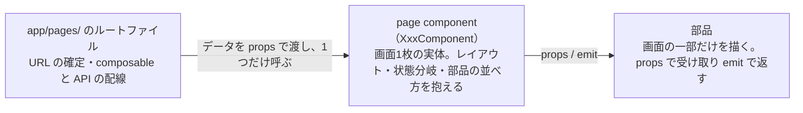
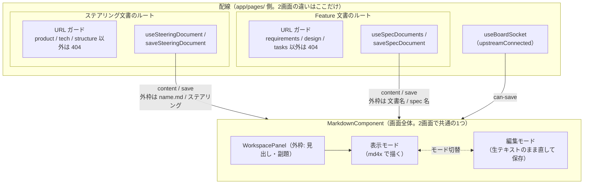
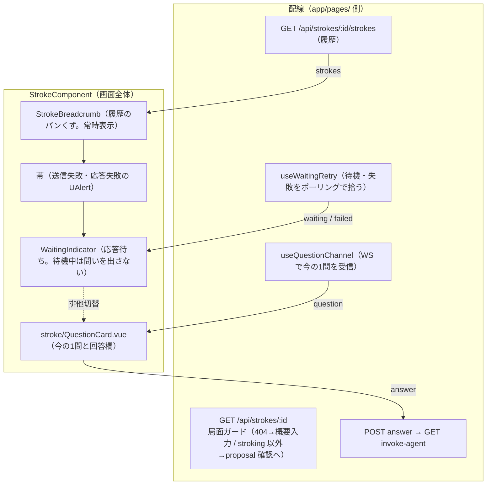
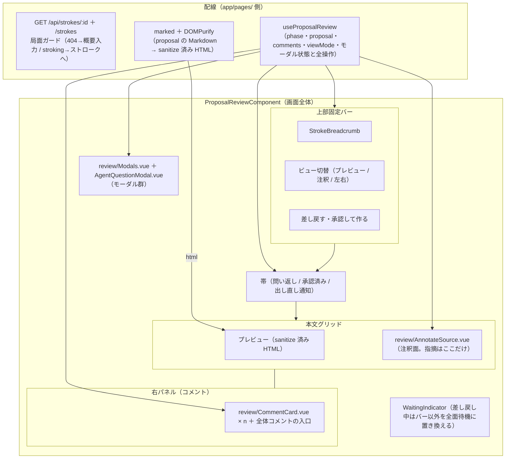

# components の定義（page component を含む）

`app/components/` の定義。component は **page component（画面1枚の実体）** と **部品** の2区分。

## 区分の定義

- **page component** — 画面1枚の実体を描く component。1画面につき1つ、名前は `XxxComponent`。`app/components/` に置く
- **`MarkdownComponent`** — markdown の表示・編集モードを一括で担う page component。文書を markdown で見せる画面は個別の XxxDocumentComponent を立てず、この1つを共用する。画面ごとの違いは配線（`app/pages/` 側）に置く
- **部品** — 画面の一部を描く component。props で受け取り、emit で返す
- `app/pages/` のルートファイルは URL の確定とデータの配線だけを受け持ち、対応する page component を1つ呼ぶ。画面の実体を pages に書かない（`system-structure.md`「pages はただのルーティング。画面の実体は components が持つ」）

3者の関係は1つの形に固定される。

page component と部品の違いは「画面のどの範囲を抱えるか」。page component は画面全体（領域の配置と状態分岐）を抱え、部品は渡されたデータで自分の範囲だけを描く。

## page component の一覧

`system-structure.md` の画面区分（通知 / list / create＝セッション / detail＝specs・steering・tasks・approvals）に沿った15画面。1画面 = 1 page component（文書2画面だけは共通の `MarkdownComponent` を指す）。

| 画面 | page component | 描くもの |
|---|---|---|
| 通知 | `NotificationListComponent` | 通知の表と、0件時の状態文言 |
| プロジェクト一覧 | `ProjectListComponent` | プロジェクトの表・状態文言・作成の入口 |
| プロジェクト概要 | `ProjectDetailComponent` | 概要カードと4タイル（specs / steering / tasks / approvals） |
| Feature 一覧 | `SpecListComponent` | feature の一覧（表は部品 `RecordList`） |
| Feature 概要 | `SpecDetailComponent` | 文書3点の一覧（表は部品 `RecordList`） |
| Feature 文書 | `MarkdownComponent` | 文書画面（ステアリング文書と共通）。構成は図「文書画面」 |
| ステアリング一覧 | `SteeringListComponent` | steering 文書の一覧（表は部品 `RecordList`） |
| ステアリング文書 | `MarkdownComponent` | 文書画面（Feature 文書と共通）。構成は図「文書画面」 |
| タスク一覧 | `TaskListComponent` | spec ごとのタスク進捗の一覧（表は部品 `RecordList`） |
| タスク詳細 | `TaskDetailComponent` | 全体進捗とタスク表 |
| 承認一覧 | `ApprovalListComponent` | ヘッダーカードと承認カードの列（1件は部品 `ApprovalCard`） |
| 承認詳細 | `ApprovalDetailComponent` | メタ表示と状態分岐（本文は部品 `DocumentEditor` / `DocumentView`） |
| 概要入力 | `OverviewInputComponent` | 概要入力フォームと待機・失敗の切替。フォームは既存の `stroke/OverviewForm.vue` が描いている |
| ストローク | `StrokeComponent` | ストローク画面。構成は図「ストローク」 |
| proposal 確認 | `ProposalReviewComponent` | proposal 確認画面。構成は図「proposal 確認」 |

## 画面の構成図

実装（`app/pages/**` が現に描いている画面）を、上の区分に当てはめた図。ルートファイルが持つのは配線、page component が持つのは画面の範囲、部品はその中の一部。

### 文書画面（ステアリング文書・Feature 文書）

2画面が使う page component は共通の `MarkdownComponent` 1つ。外枠 `WorkspacePanel` の中で markdown の表示・編集モードを切り替える画面で、ステアリング / Feature の違い（どの API から文書を取りどこへ保存するか・URL ガード・外枠の見出し）はすべて配線側にある。

### ストローク

履歴（パンくず）は常時見せ、その下は「待機中は `WaitingIndicator`、問いが来たら `QuestionCard`」の排他切替。問い1件の提示・回答は部品 `stroke/QuestionCard.vue` の範囲で、page component はその外側の履歴・帯・切替を抱える。

### proposal 確認

上部固定バー・帯・本文グリッド・右パネル・モーダル群の5領域。状態はすべて `useProposalReview` が1つに束ね、page component は領域の配置と状態分岐（差し戻し中・承認済み・問い返し）を抱える。注釈面・コメントカード・モーダル群が部品。

## 部品の一覧

既存の component 18本は、すべて部品に当たる。

| ファイル（app/components/） | 役割 |
|---|---|
| `StrokeBreadcrumb.vue` | ストローク履歴のパンくず。粒を開くとその往復の全文を出す |
| `WaitingIndicator.vue` | AI 応答待ちの点滅表示。文言は呼ぶ側が渡す |
| `AgentQuestionModal.vue` | AI の問いに答えるモーダル。答えるまで閉じる操作を持たない |
| `stroke/OverviewForm.vue` | 概要入力フォーム。submit で概要文を返す |
| `stroke/QuestionCard.vue` | 問い1件の提示と回答欄。answer で回答を返す |
| `review/AnnotateSource.vue` | 生 Markdown に選択で注釈を付ける面。オフセットで範囲を持つ |
| `review/CommentCard.vue` | コメント1件のカード。編集・削除の口を持つ |
| `review/CommentModal.vue` | 本文コメントの追加・編集モーダル。ハイライト色は5択 |
| `review/Modals.vue` | proposal 確認画面のモーダル一式。`useProposalReview` の戻り値を丸ごと受ける |
| `shared/SbIcon.vue` | prototype 由来のアイコン8種。上層（通知・プロジェクト一覧）で使う |
| `shared/UpstreamIcon.vue` | 本家 spec-workflow-mcp 由来のアイコン12種。下層とトーストで使う |
| `shared/NotificationToaster.vue` | 右上の通知トースト。5秒で自動消滅、押しても遷移しない |
| `workspace/ApprovalCard.vue` | 承認依頼1件のカード。承認・却下の操作を持つ |
| `workspace/DocumentEditor.vue` | 文書の編集・保存。生テキストのまま扱い、未保存の離脱を引き止める |
| `workspace/DocumentView.vue` | Markdown 本文の読み取り表示（md4x で描く） |
| `workspace/EmptyState.vue` | 中身が無いことを示す表示 |
| `workspace/RecordList.vue` | 下層一覧の表。各行が固有 URL を持つ |
| `workspace/WorkspacePanel.vue` | 下層画面の外枠。見出し・副題・actions スロット |

このほか `workspace/MarkdownNodes.ts`（md4x の AST を Vue のノードへ落とす defineComponent。`DocumentView` が使う）がある。
