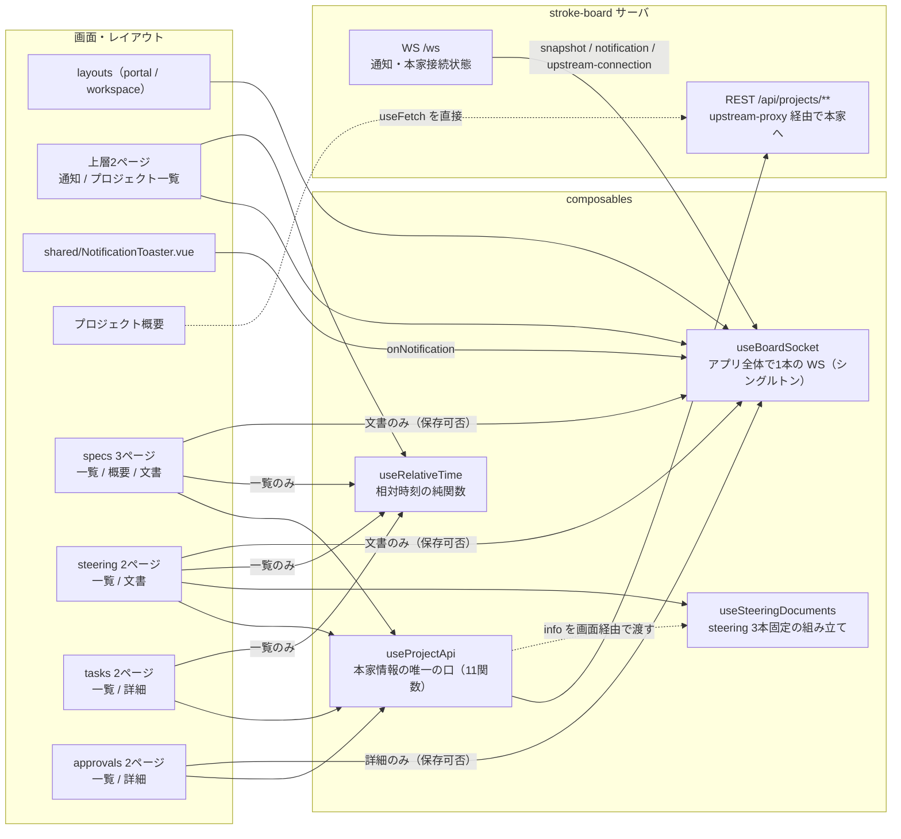
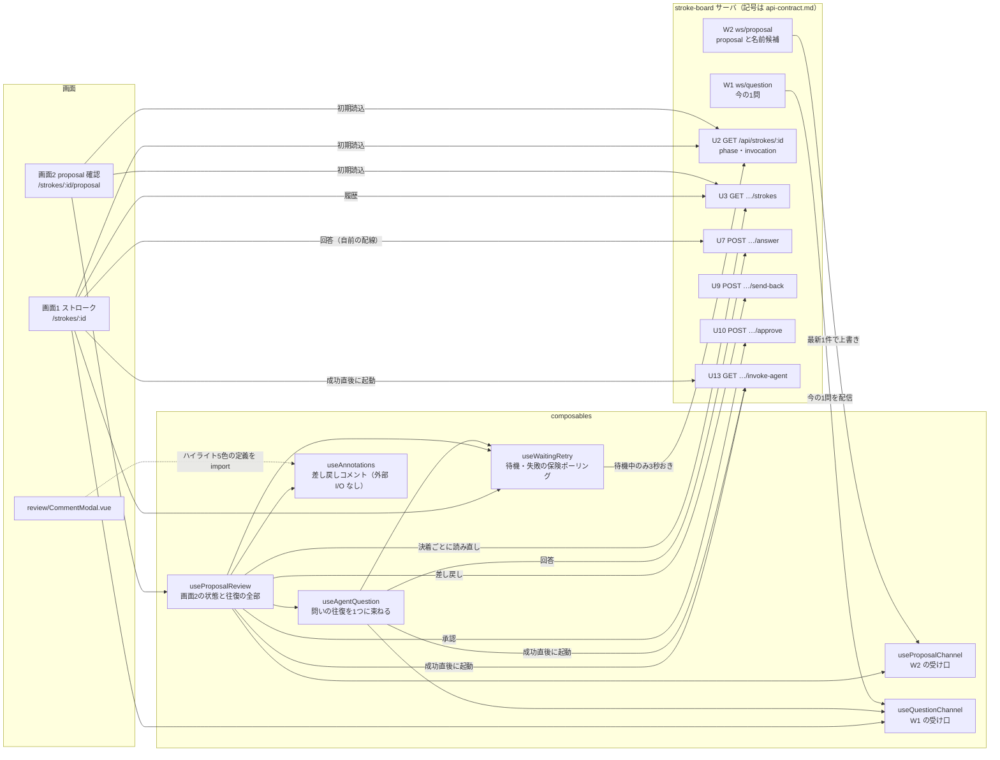

# composables の定義（図＋呼び出し例）

`app/composables/` の全10本。ポータル側4本（`shared/`・`workspace/`）とストローク側6本（直下）の2系統で、合流しない。

## 一覧

| composable | 説明 |
|---|---|
| `shared/useBoardSocket` | 通知と本家接続状態を受ける。アプリ全体で1本の WS（シングルトン） |
| `shared/useRelativeTime` | 一覧の「最終更新」列に出す相対時刻。純関数 `formatRelativeTime` |
| `workspace/useProjectApi` | 下層画面が本家の情報を読む・保存する唯一の口（11関数） |
| `workspace/useSteeringDocuments` | steering 3本固定（product / tech / structure）の有無を `info` から組み立てる |
| `useQuestionChannel` | W1 を購読し、今の1問だけを持つ（最後の1件で上書き） |
| `useProposalChannel` | W2 を購読し、proposal と名前候補の最新1件を持つ |
| `useWaitingRetry` | 送信後の待機。待機中のみ U2 を3秒おきに読み、失敗を拾う保険 |
| `useAgentQuestion` | 問いの往復（W1 購読・回答送信・起動要求・待機）を1つに束ねる |
| `useAnnotations` | 差し戻しコメントを積み、4層ペイロードに組む。外部 I/O なし |
| `useProposalReview` | 画面2の状態と往復の全部。他の composable を束ねる |

## 配線図

どの画面がどの composable を使い、composable が何と話すかの図。REST・WS の記号（U*・W*）は `docs/specs/api/api-contract.md` の endpoint 一覧に従う。矢印は「使う → 使われる」、WS 配信だけサーバ → composable。

### ポータル側

4本。読み書き（`useProjectApi`）と通知（`useBoardSocket`）の2経路は合流しない。



### ストローク側

6本。画面2は `useProposalReview` に全てを束ね、画面1は束ねる composable を持たず自前で配線する。



## 各 composable

10本それぞれに、実際の呼び出し場所を基にした短い呼び出し例と補足を示す。例のコメント中の U*・W* は `docs/specs/api/api-contract.md` の記号。

例は自己完結とする。登場する識別子は、例の中で定義するか import 行（実パス）で出どころを示す。ただし `ref` / `computed` / `watch` / `useRoute` / `useFetch` / `$fetch` / `MaybeRefOrGetter` は Nuxt の auto-import（Vue / ofetch 由来）で、import 行は書かない。ストローク側の実コードは composable 自体も auto-import に任せて import 行を書いていないが、例では出どころを示すため実パスで書く。

### `shared/useBoardSocket`

```ts
// app/components/shared/NotificationToaster.vue — トーストの発火
import { useBoardSocket } from '~/composables/shared/useBoardSocket';
import type { Notification } from '#shared/types';

const toasts = ref<Notification[]>([]);           // この面が積むトースト
const { onNotification } = useBoardSocket();      // 初回呼び出しで WS を張り、以後は同じ実体
onNotification((notification) => {
  toasts.value = [...toasts.value, notification]; // 新着だけ届く。初回スナップショット分は流れない
});
```

ほかに `notifications`（通知一覧・読み取り専用）と `upstreamConnected`（本家接続状態）が返る。layouts・上層2ページの常時表示と、文書画面の保存可否判定（`can-save`）はそちらを分割代入する。

### `shared/useRelativeTime`

```ts
import { formatRelativeTime } from '~/composables/shared/useRelativeTime';

formatRelativeTime('2026-08-24T09:00:00Z', Date.parse('2026-08-24T12:00:00Z')); // → '3時間前'
formatRelativeTime('2026-08-24T11:59:30Z', Date.parse('2026-08-24T12:00:00Z')); // → 'たった今'
formatRelativeTime('(解釈できない時刻)');                                        // → '—'
```

入力は ISO 文字列。1分未満は `たった今`、以後 `n分前` / `n時間前` / `n日前`。第2引数 `now` は省略時 `Date.now()` で、画面では `formatRelativeTime(spec.lastModified)` と1引数で呼ぶ。composable ではなく状態を持たない純関数なので、`{{ formatRelativeTime(row.occurredAt) }}` とテンプレート内でも直接呼べる。

### `workspace/useProjectApi`

```ts
// app/pages/projects/[projectId]/specs/ 配下 — 取得は index.vue、保存は [document].vue から
import { saveSpecDocument, useProjectId, useSpecs } from '~/composables/workspace/useProjectApi';

const projectId = useProjectId();                  // URL の [projectId] を取る
const { data, error } = await useSpecs(projectId); // 取得7本は useFetch を包む（Dto で型付け）
// 保存2本は素の関数。成功なら null、失敗なら理由の文字列（画面はそのまま出す）
const failure = await saveSpecDocument(projectId.value, 'user-auth', 'design', '# 設計…');
```

11関数はすべてこの1ファイルの export（named export で必要な分だけ import する）。ほかに `saveTargetOf(filePath)`（承認対象の保存先を解決。編集を許さない文書は `null` で読むだけになる）を含む。取得先はすべて stroke-board サーバで、ブラウザから本家へは触らない。

### `workspace/useSteeringDocuments`

```ts
// app/pages/projects/[projectId]/steering/index.vue — 一覧の行組み立て
import { useProjectId, useProjectInfo } from '~/composables/workspace/useProjectApi';
import { useSteeringEntries } from '~/composables/workspace/useSteeringDocuments';

const projectId = useProjectId();
const { data: info } = await useProjectInfo(projectId); // 有無の元データは useProjectApi から取る
const entries = useSteeringEntries(info);               // product / tech / structure の3本固定
// entries.value[0] → { name: 'product', label: 'Product', file: 'product.md', exists: true }
```

有無は `info` の `steering.documents` から組む。定数 `STEERING_DOCUMENTS` と判定 `isSteeringName(value)` も同居し、文書ページ（`steering/[name].vue`）が URL の名前検証に使う。

### `useQuestionChannel`

```ts
// app/pages/strokes/[sessionId]/index.vue — 画面1
import { useQuestionChannel } from '~/composables/useQuestionChannel'
import { useWaitingRetry } from '~/composables/useWaitingRetry'

const sessionId = String(useRoute().params.sessionId)
const { question } = useQuestionChannel(sessionId) // W1 を購読。今の1問だけを持つ
const { stopWaiting } = useWaitingRetry(sessionId)
watch(question, (q) => {
  if (q) stopWaiting()                             // 新しい問いが届いたら待機を終える
})
```

`question` は W1 の最後の1件で上書きされ、接続時にも現在の1問が届く。画面2は直接使わず `useAgentQuestion` 経由。

### `useProposalChannel`

```ts
// app/composables/useProposalReview.ts — 画面から直接は呼ばれず、供給元はここだけ
import { useProposalChannel } from '~/composables/useProposalChannel'

export function useProposalReview(sessionId: MaybeRefOrGetter<string> /* … */) {
  const { message } = useProposalChannel(sessionId)              // W2 を購読
  const proposal = computed(() => message.value?.proposal ?? '') // proposal 本文。未着なら ''
  const notice = ref<'revised' | null>(null)
  watch(message, (next, prev) => {
    if (prev !== null && next !== null) notice.value = 'revised' // 出し直しを知らせる
  })
  // …
}
```

`message` は W2 の最新1件で上書きされ、proposal 本文と名前候補（`projectName`）を持つ。

### `useWaitingRetry`

```ts
// app/pages/strokes/[sessionId]/index.vue — 画面1（画面2は useProposalReview 経由）
import { useWaitingRetry } from '~/composables/useWaitingRetry'

const sessionId = String(useRoute().params.sessionId)
const { waiting, failed, startWaiting, stopWaiting } = useWaitingRetry(sessionId)
await $fetch(`/api/strokes/${sessionId}/invoke-agent`) // U13 で起動して…
startWaiting()                                          // …待機に入る。以後 U2 を3秒おきに読む
```

待機中に `invocation` が failed なら `failed` が立ち、idle なら待機だけ下りる。決着は通常 W1 / W2 の配信が先に付き、呼び出し側が `stopWaiting()` する（ポーリングは保険）。

### `useAgentQuestion`

```ts
// app/composables/useProposalReview.ts — 画面2の問い返し（画面1は自前配線で使わない）
import type { Answer } from '#shared/stroke'
import { useAgentQuestion } from '~/composables/useAgentQuestion'

export function useProposalReview(sessionId: MaybeRefOrGetter<string> /* … */) {
  const { question, waiting, failed, error, answered, send } = useAgentQuestion(sessionId)
  async function answerFollowup(answer: Answer): Promise<void> {
    await send(answer) // U7 で受理 → 成功直後に U13 で起動。失敗は throw されず error に載る
  }
  // …
}
```

`question` は内部の `useQuestionChannel` から。次の問いが届くか待機が明けるまで `waiting` が立ち、AI が応答を返さなければ `failed` に出る。送れなかった回答は同じ問いのまま送り直せる。

### `useAnnotations`

```ts
// app/composables/useProposalReview.ts — 画面2の差し戻し
import { defaultHighlightColor, useAnnotations } from '~/composables/useAnnotations'

const a = useAnnotations()
a.addSelection('この段落は根拠が薄い', '引用した本文', 120, 180, defaultHighlightColor) // 選択範囲へ
a.addGeneral('全体に文が長い')                                                          // 全体へ
const payload = a.buildPayload() // response・comments・annotations・nextSteps の4層。U9 の body になる
```

外部 I/O なし。送信は呼び出し側（`useProposalReview.sendBack`）が `payload` を U9 に POST する。ハイライト5色の定数 `highlightColors` / `defaultHighlightColor` は `review/CommentModal.vue` も import する。

### `useProposalReview`

```ts
// app/pages/strokes/[sessionId]/proposal.vue — 画面2専用
import type { Invocation, Phase, Stroke } from '#shared/stroke'
import { useProposalReview } from '~/composables/useProposalReview'

const sessionId = String(useRoute().params.sessionId)
const { data: status } = await useFetch<{ phase: Phase; invocation: Invocation }>(`/api/strokes/${sessionId}`) // U2
const { data: strokesData } = await useFetch<{ strokes: Stroke[] }>(`/api/strokes/${sessionId}/strokes`)       // U3
const review = useProposalReview(sessionId, {
  phase: status.value?.phase ?? 'proposed',    // U2 で読んだ初期値
  strokes: strokesData.value?.strokes ?? [],   // U3 で読んだ初期値
})
const { phase, proposal, projectName, busy } = review // 操作は review.sendBack / review.approve など
```

画面2の状態（モーダル群含む）と操作（`sendBack` / `openApprove` / `approve` / `answerFollowup` など）を1つのオブジェクトで返す。`useAnnotations` / `useAgentQuestion` / `useProposalChannel` / `useWaitingRetry` を束ねる唯一の場所。
