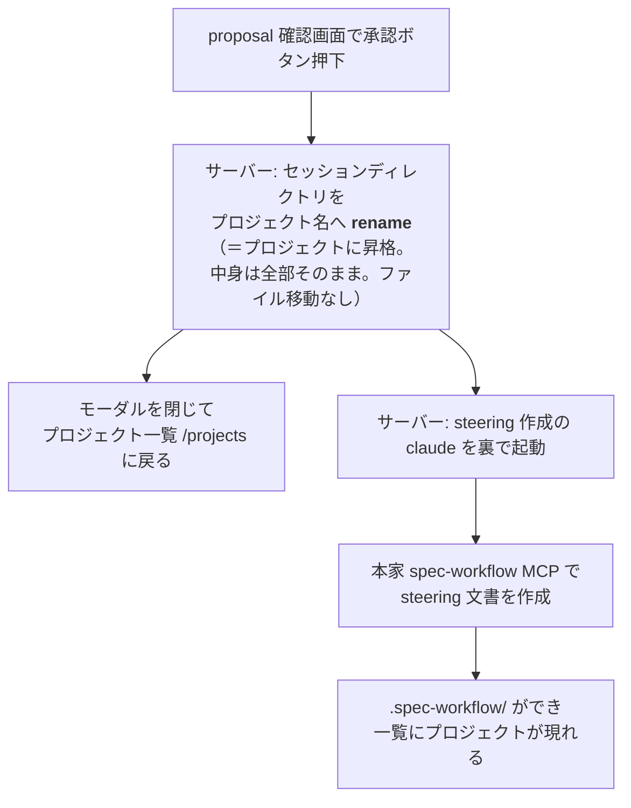
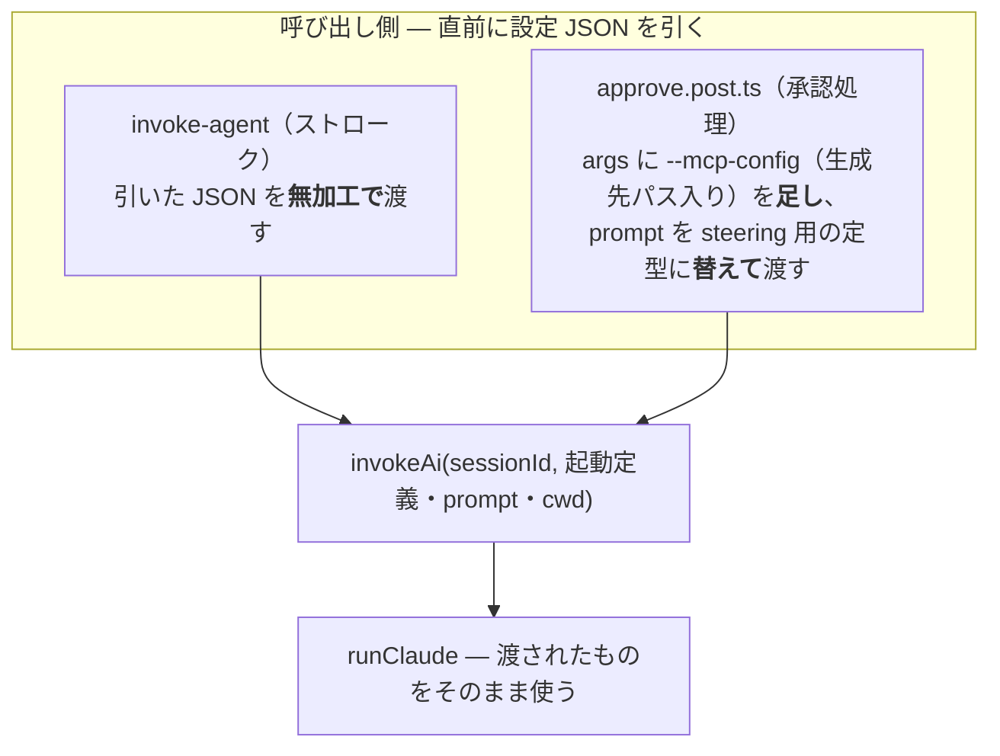
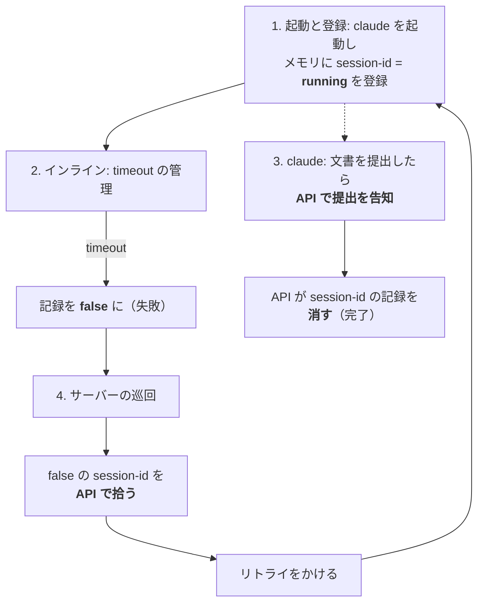
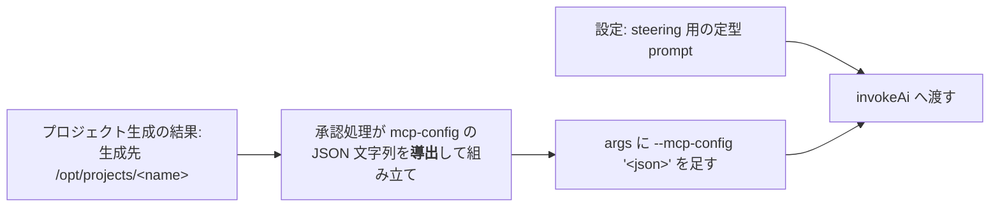

# 出口の接合 — 承認から steering 工程へ

実施: change [`connect-portal-and-strokes`](../../../openspec/changes/connect-portal-and-strokes/) ／ 決定: [ADR-0011](../../adr/0011-steering-stage-follows-approval.md)（承認の次の工程として steering 作成を自動で始める）／ 対: [portal-stroke-entrance.md](./portal-stroke-entrance.md)（入口の接合）

## 承認ボタン → 一覧へ戻る（モーダルの終わり方）

前提: **セッションの置き場とプロジェクトの置き場を `SPEC_WORKFLOW_SHARED_ROOT` に統一する**（その場所をどこにするかは設定の値の話で、ここでは決めない）。

`proposal.md` は**claude 自身がセッションの時点から `docs/` 配下に書く**。サーバーのコードは proposal.md を作らない。これにより、proposal 確認画面で承認を押したときの処理は**セッションディレクトリをプロジェクト名へ rename するだけ**になる——中身は全部そのままプロジェクトに昇格し、ファイルの生成も移動も無い。画面はモーダルを閉じてプロジェクト一覧に戻る。ユーザーの操作はここまでで、steering 作成はサーバーが裏で始める。



※ `proposal.md` は最初から `docs/proposal.md`（セッション中も同じ場所）に、**claude 自身が書く**。サーバーのコードは作らない。

画面のイメージ — 承認でモーダルが終わり、一覧へ。新プロジェクトはすぐには現れず、steering が作られてから一覧に載る:

```
③ 承認を押す（モーダル）        ④ 一覧に戻る                  ⑤ しばらくして
┌────────────────────┐      ┌────────────────────┐      ┌────────────────────┐
│     ストローク       │      │ 通知 │ 一覧         │      │ 通知 │ 一覧         │
│  proposal 確認      │ 承認 │  memo-app  アクティブ│  …   │  memo-app  アクティブ│
│  [承認] [差し戻し]   │ ──▶ │  srvgm     未接続   │      │  srvgm     未接続   │
│                    │      │ （新プロジェクトは    │      │  <name>    承認待ち  │
│                    │      │   まだ現れない）     │      │  ← 現れる           │
└────────────────────┘      └────────────────────┘      └────────────────────┘
```

## 起動は1系統 — invokeAi の構造を変え、引数で渡す

今の `invokeAi(sessionId)` は起動定義・prompt を**中で** `runtimeConfig` から導出している。この構造をやめ、**呼び出し側が直前に設定 JSON を引き、sessionId の後ろに渡す**形にする。`invokeAi`／`runClaude` は渡されたものを使うだけになる。



- **系統は1つ**。`invokeAi` は呼び出し元を区別せず、ストロークと steering の違いは渡す引数の中身だけ
- 承認処理は rename の直後に `invokeAi` を**完了を待たずに**呼び、応答も起動を待たずに返す（画面はすぐ一覧へ戻れる）
- **cwd も呼び出し側が渡す**。ストロークはセッションディレクトリ（今と同じ値）、承認処理は**生成先プロジェクト `/opt/projects/<name>`** を渡す。steering の claude は生成されたプロジェクトの中で働く

## 完了とリトライ

開始点は claude の起動と session-id の登録:

1. **起動と登録**: claude を起動し、サーバーのメモリへ **session-id を running として登録**する
2. **インラインは timeout の管理**: timeout したら、その session-id の記録を **false（失敗）** に変える
3. **提出の告知**: steering 文書を提出し終えた claude が **API 経由で提出を告知**する。**この API が session-id の記録を消す**（＝完了）
4. **リトライ**: サーバーの巡回が **false の session-id を API で拾い、リトライをかける**（→ 1. からやり直し）。巡回に条件判定は持たせない


- **提出告知の口を1つ足す**。既存の提出口（A5 question・A7 proposal）は「承認済みセッションには提出できない」ガードを持つため使えない。受理したら session-id の記録を消すだけの薄い口を agent-api に追加する

## 設定に足すもの

`--mcp-config` は **JSON 文字列を直接受け取れる**（`claude --help` 実機確認: "Load MCP servers from JSON files or strings"）。config ファイルは作らない。



mcp-config は設定に持たない。**生成先パスから導出**して組み立てる。

何に何を追加するか:

| 追加先 | 追加するもの | 使われ方 |
|---|---|---|
| `nuxt.config.ts` の `runtimeConfig.claude`（非公開側。既存の `firstPrompt`/`continuePrompt` と同じ並び） | **steering 用の定型 prompt** 1キー | 承認処理が引いて `invokeAi` に渡す |
| `docs/specs/core/settings-reference.md`（設定の正） | 上記1キーの記載 | ここに無いものは設定ではない（ADR-0004）。改定には change とユーザー承認が要る |

## 実装の想定

手を入れる場所と、今→変更後の対応:

| # | 場所 | ファイル | 今 | 変更後 |
|---|---|---|---|---|
| ❶ | 実行管理 | `server/utils/stroke/ai.ts`・`claude.ts` | 起動定義・prompt・cwd を中で固定・導出 | 起動定義・prompt・cwd を呼び出し側から受け取る。**実行の記録を足す**: 起動時に session-id = running をメモリに記録し、timeout したら false に変える |
| ❷ | ストロークの呼び出し元 | `server/api/strokes/[id]/invoke-agent.get.ts` | `invokeAi(sessionId)` | 直前に設定 JSON を引き、無加工で渡す。cwd はセッションディレクトリ（挙動は不変） |
| ❸ | 承認の処理 | `server/api/strokes/[id]/approve.post.ts`・`server/utils/stroke/project.ts`・`session-store.ts` | サーバーのコードが proposal.md を書いている（A7 提出でサーバーが保存、`generateProject` が `docs/proposal.md` を新規生成。U10） | **サーバーのコードは proposal.md を作らない**。claude 自身がセッション時点から `docs/` 配下に書く。承認は**セッションディレクトリをプロジェクト名へ rename するだけ**（生成もファイル移動も無し）。その後、設定 JSON を引き、`--mcp-config`（生成先パス入り）と steering 用 prompt に差し替え、cwd に生成先を渡して `invokeAi` を**完了を待たずに呼ぶ** |
| ❹ | 提出告知の口 | `server/api/strokes/[id]/` に1つ追加 | 無し（既存 A5/A7 は承認済みを拒否） | claude からの提出の告知を受理し、session-id の記録を消す薄い口 |
| ❺ | retry 対象の口 | `server/api/` に1つ追加 | 無し | retry 対象（false の session-id）一覧を返す |
| ❻ | 巡回 | サーバーの定期処理として登録 | 無し | ❺を拾い、順に起動し直すだけ。条件判定は持たない |
| ❼ | 設定 | `nuxt.config.ts`・`settings-reference.md` | セッションとプロジェクトの置き場は別（`NUXT_SESSIONS_ROOT` / `NUXT_PROJECTS_ROOT`） | **両者を `SPEC_WORKFLOW_SHARED_ROOT` に統一する**。steering 用 prompt の1項目も追加（いずれも ADR-0004 の手続きで） |
| ❽ | proposal 確認画面 | `app/pages/strokes/[sessionId]/proposal.vue` | 承認後も同画面に留まり承認済み表示 | 承認成功でモーダルを閉じて `/projects` に戻る |
| ❾ | テスト | approve・invoke まわりのユニット・E2E | 承認→承認済み表示の期待値 | 承認→一覧に戻る E2E。引数化・提出告知の口・retry 対象の口・巡回のユニット |

## 仕様への影響

- `docs/specs/core/settings-reference.md` — セッションとプロジェクトの置き場を `SPEC_WORKFLOW_SHARED_ROOT` に統一・steering 用 prompt の1項目追加（ADR-0004: change とユーザー承認が要る）
- `openspec/specs/project-generation` — プロジェクトの作り方が「新規生成」から「セッションディレクトリの rename 昇格」に変わる（proposal.md はセッション時点から docs/ 配下に保存）
- `openspec/specs/ai-invocation` — 呼び出しの引数化と、承認処理からの呼び出しが増えること
- `openspec/specs/agent-api` — 提出告知の口・retry 対象一覧の口の追加
- いずれも実装 change `connect-portal-and-strokes` が specs 差分として持つ

## 対象外

- steering 完了後の流れ（承認待ち・通知）— 既存の仕組みに乗るだけで、新設しない
- 入口側（作成ボタン→モーダル）— [portal-stroke-entrance.md](./portal-stroke-entrance.md) が扱う
