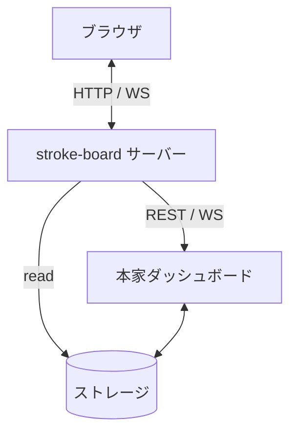

# Technology Stack

## Project Type

Web アプリケーション。spec-workflow-mcp のダッシュボードの上に置く、プロジェクト横断の通知ポータル。本家とは別プロセスで動き、本家に変更を加えない。

## Core Technologies

### Primary Language(s)

- **Language**: TypeScript 5.9 系
- **Runtime**: Node.js。`^22.19.0 || ^24.11.0 || >=26.0.0`（Nuxt 4.5 の要求）
- **Language-specific tools**: yarn 4 系、`vue-tsc` による型チェック

### Key Dependencies/Libraries

- **nuxt** `^4.5`: アプリケーション基盤。SSR を有効にする
- **@nuxt/ui** `^4.10`: UI コンポーネント
- **tailwindcss**: スタイル。Nuxt UI が要求するメジャーバージョンに合わせる
- **vue** `^3.5` / **vue-router** `^4.5`: Nuxt の依存として入る
- **zod**: ブラウザから受け取る入力と、本家から受け取るペイロードの検証
- **vitest**: ユニットテスト
- **@playwright/test**: E2E テスト

### Application Architecture

4つの構成要素からなる。

| 構成要素 | 実体 | 役割 |
|---|---|---|
| ブラウザ | Nuxt の画面 | 通知とプロジェクトを表示する |
| stroke-board サーバー | Nitro | 本家に接続し、ブラウザへ配信する |
| 本家ダッシュボード | spec-workflow-mcp | 仕様・承認・タスクの状態を提供する |
| ストレージ | `.spec-workflow` / `activeProjects.json` | 状態の実体 |

| 経路 | プロトコル | 内容 |
|---|---|---|
| ブラウザ → サーバー | HTTP | 画面の要求（SSR）と REST |
| サーバー → ブラウザ | WebSocket | 通知の配信 |
| サーバー → 本家 | REST | 仕様・承認・タスクの取得 |
| サーバー → 本家 | WebSocket | プロジェクト単位の購読（`?projectId=`） |
| サーバー → ストレージ | ファイル読み取り | プロジェクトの探索、アクティブ判定 |

## Development Environment

### Build & Development Tools

- **Build System**: `nuxt build`。成果物は `.output/` に出て、`node .output/server/index.mjs` で起動する
- **Package Management**: yarn 4 系。lockfile をコミットし、CI と開発環境で同じ解決結果を使う
- **Development workflow**: `nuxt dev` で HMR。本家ダッシュボードは別プロセスで起動しておき、その URL を環境変数で渡す
- **型チェック**: `nuxt typecheck`（`vue-tsc`）をコミット前に通す
- **スクリプト**: `dev` / `build` / `preview` / `typecheck` / `test` / `test:e2e` を `package.json` に置く

### Version Control & Collaboration

- **VCS**: git
- **Branching Strategy**: 作業単位で feature ブランチを切り、main にマージする
- **Code Review Process**: 規定しない

## Deployment & Distribution (if applicable)

- **Target Platform(s)**: Node.js が動く Linux ホスト。Nitro サーバーとして常駐する
- **Distribution Method**: リポジトリを取得し、`yarn install --immutable` → `nuxt build` → `.output/` を配置して起動する
- **Installation Requirements**:
  - Node.js `^22.19.0 || ^24.11.0 || >=26.0.0`
  - 本家 spec-workflow-mcp のダッシュボードが起動していること。その URL を環境変数で渡す
  - 監視する親パスへの読み取り権限
- **Update Mechanism**: リポジトリを更新し、`yarn install --immutable` → `nuxt build` → プロセスを再起動する

## Technical Requirements & Constraints

### Code Quality Standards

- コードベース全体で命名規則を一貫させる（structure.md の Naming Conventions に従う）
- 変数名・関数名で意図が読めるコードを書き、説明のためのコメントに頼らない
- 本家の挙動に依存する箇所には、なぜそう書くかをコメントで残す（ペイロードの形、PID による生存判定など）
- 関数は1つの責務に絞る
- lint / format ツールは規定しない

### API Design Principles

- **API は暗黙の状態分岐を持たない**: 呼び出し側が渡していない内部状態を見て振る舞いを変えない。契約（path と引数）から読み取れない挙動を持たせない
  - 責務の不成立（存在しない id・スキーマ違反）と、引数で制御される分岐は契約に現れるので対象外
  - 例外はユーザーの指示か事前の承認が要る。判断は proposal か grilling の段階で行う

### Performance Requirements

- 本家への WebSocket 接続は監視するプロジェクトごとに1本とし、それ以上張らない
- 本家 REST は画面が要求したときに呼ぶ。定期ポーリングで代替しない
- 前回値の保持はメモリ上に限る。プロセスを再起動したら通知の基準は作り直しになる

### Testing Requirements

- ロジックは Vitest でユニットテストを書く。特に前回値との差分判定は、状態遷移ごとにテストを持つ
- 通知から対象ドキュメントを開く導線は Playwright で E2E テストを書く
- 本家が停止している状態、プロジェクトが0件の状態を含めてテストする
- テスト名は「どの状況で何が起きるか」が読める形にする
- カバレッジの目標値は置かない
- 門番は3つ。`yarn typecheck`（型チェック）・`yarn test`（ユニット）・`yarn test:e2e`（E2E）を通す
- `yarn test:live` は門番に含めず、`yarn test` からも外す（本家の起動を要するため）

### Security Practices

- シークレット・API キー・パスワードをコミットしない
- 本家の URL、監視する親パスは環境変数から読む。ソースに埋めない
- ブラウザから受け取る入力を zod で検証する
- 本家から受け取るペイロードも検証する。形が変わったときに黙って通さない
- 認証・認可は未実装である。書き込み口は本家の API を呼ぶ3つ（承認への応答の `POST`、仕様書とステアリングの文書の保存の `PUT`）があり、いずれも認証を通らない。到達できる者は誰でも本家の文書を書き換えられる
- 現在は開発中で、想定する到達範囲は localhost に限る。到達範囲を広げる段階で、書き込み口の認証・認可を設計に入れる

### Compatibility Requirements

- **Platform Support**: Node.js `^22.19.0 || ^24.11.0 || >=26.0.0`。Linux / macOS。ブラウザは Chromium 系と Firefox の最新
- **Dependency Versions**: 本家 spec-workflow-mcp **v2.2.5** を基準とする。Nuxt は 4.5 以上、Nuxt UI は 4.10 以上
- **Standards Compliance**: HTTP/1.1、WebSocket（RFC 6455）、JSON

依存するのは本家の REST API だけでなく、WebSocket ペイロードの形、registry の構造、PID による生存判定も含む。これらは本家の公開仕様ではないため、バージョンを固定して追随する。

### Scalability & Reliability

- **Expected Load**: 単一利用者。監視対象は数プロジェクト。同時接続はブラウザ1〜2枚
- **Availability Requirements**: 本家が停止していても stroke-board は動き続け、「未接続」と表示する。本家との接続は切れたら再接続を試みる
- **Growth Projections**: 規模の成長を考慮しない

## Technical Decisions & Rationale

### Decision Log

1. **Nuxt4 の SSR を有効にする**: Nitro サーバーが必要なため。本家への接続とブラウザへの配信をここが担う
2. **ブラウザは stroke-board サーバーとだけ話す**: ブラウザから本家 WebSocket へ直結する案を退けた。監視するプロジェクトの数だけブラウザが接続を張ることになり、判定がクライアントに散るため
3. **W3C Push API / Service Worker / VAPID を使わない**: 必要なのは OS 通知ではなく画面内の通知であり、配送機構ごと不要なため
4. **自前のデータストアを持たない**: 通知の履歴も既読未読も永続化しない。表示は本家のデータ状態から導出する
5. **プロジェクト一覧は親パスの走査で作る**: 本家 API は未接続プロジェクトを返さないため、API だけでは一覧が作れない。走査で母集合を作り、アクティブ判定を `activeProjects.json` / 本家 API で重ねる
6. **通知は本家と同じ4種**: タスク完了 / タスク着手 / 全件完了 / 承認依頼の発生
7. **design token は本家 v2.2.5 に準拠する**: 本家と地続きに見えることを優先した
8. **yarn を使う**: 同じ stroke-board 系の既存プロジェクトが yarn 4 で動いており、揃えるため
9. **lint / format を規定しない**: 実装側が必要と判断したときに入れる
10. **前回値との比較は本家の踏襲**: 本家のイベントはスナップショット型で「何が起きたか」を含まず、本家サーバーは `tasks.md` を毎回パースして今の `taskList` を送るだけで前回値を持たない。したがって比較は受け取った側の仕事になる。これは本家フロントエンドが既にやっていることであり、独自に足す加工ではない（ADR-0001）
11. **API は暗黙の状態分岐を持たない**: 同じ口を画面・エージェント・サーバー内部が使う構成で、契約に現れない内部状態で結果が変わると、呼び出し側ごとに例外を覚える必要が出るため。`agent-api` の「承認後のセッションは提出を受け付けない」を撤廃した。詳細は [docs/adr/0013-api-has-no-implicit-state-branching.md](docs/adr/0013-api-has-no-implicit-state-branching.md)

## Known Limitations

- **本家の内部実装に依存している**: ペイロードの形、registry の構造、PID による生存判定に依存する。本家の更新で壊れうる。基準を v2.2.5 と明示し、依存の事実を ADR に残し、本家に触る範囲を接点層に閉じ込めて直す範囲を狭くする
- **ステアリング文書の更新を検出できない**: 本家の payload が変化しないため、通知にできない
- **承認と却下を区別できない**: 本家は pending しか返さず、結果は消滅としてしか観測できない
- **MCP のクラッシュ時に誤表示になる**: 生存確認は本家ダッシュボードの起動時1回だけで、死んだ PID を持つエントリが次の起動まで「アクティブ」として残る。本家の再起動でしか解消しない
- **再起動で通知の基準が失われる**: 前回値をメモリにしか持たないため、プロセスを再起動すると次の変化まで通知が出ない
- **プロジェクト作成の実処理を持たない**: 実処理は接続先の別プロジェクトが担う。接続が無い間は入口を非活性にする
- **Nuxt UI での design token 再現**: 本家の token を Nuxt UI のテーマ機構で再現できることを実装の最初に確認する。再現できない場合は本家準拠の範囲を決め直す

