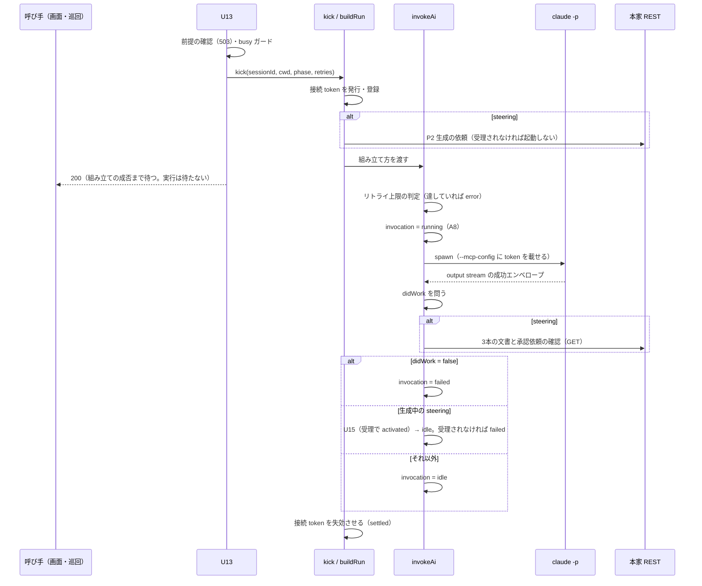
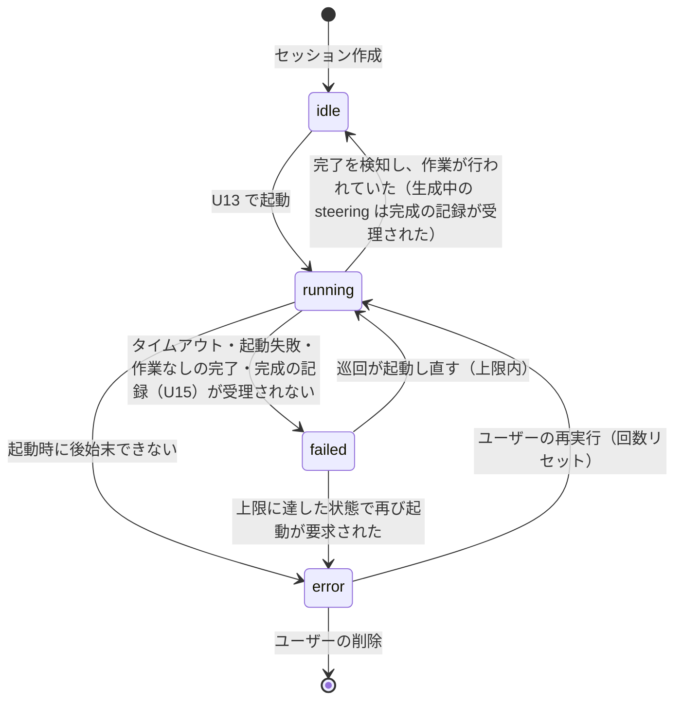

# invoke-agent — AI の起動と実行の管理

**AI（`claude -p`）を起動し、その実行を終わりまで管理する唯一の仕組み。** 起動の要求を受ける endpoint（U13）から、子プロセスの終了を見届けて実行の記録を書くところまでを1つの単位として扱い、ここでは **invoke-agent** と呼ぶ。

endpoint としての契約（入出力・エラー）は [sessions/invoke-agent.md](../api/sessions/invoke-agent.md)、完成の記録の契約は [sessions/activate.md](../api/sessions/activate.md)、MCP ツールとの境界は [mcp/contract.md](../mcp/contract.md)。この資料は、それらの間で invoke-agent が何を受け持ち、何を受け持たないかを定める。

## 位置づけ

```
U13 GET /api/sessions/:id/invoke-agent     受理。前提の確認・busy ガード・cwd の受け取り
  └─ kick                                  接続 token の発行と登録。実行全体の寿命を持つ
       └─ buildRun                         起動の材料を設定から組み立てる（設定を引く端）
            └─ invokeAi                    初回/継続の判定・spawn・完了検知・作業の判定・記録
                 └─ runClaude              子プロセスの起動と output stream の読み取り
```

実体は `server/utils/stroke/invoke.ts`（`kick` / `buildRun`）・`ai.ts`（`invokeAi`）・`claude.ts`（`runClaude`）。**起動処理は1系統で、用途（ストロークの往復 / 承認後の steering）の違いは渡す値の違いだけで表す。** `invokeAi` は呼び出し元を区別せず、設定を引き直さず、何の作業かを判定しない。用途ごとの値を決めるのは `buildRun` で、phase から用途を導くのはここ1箇所である。

起動を要求する呼び手は2つ。画面（U1・U7・U9 の成功応答の直後、および昇格 U14 の成功を見た直後）と、巡回（`invocation` が `failed` の対象を起動し直す）。起動時の後始末（サーバー再起動で宙に浮いた `running`）は起動を要求せず、`failed` を書いて巡回に拾わせるだけである。**受理系の endpoint は起動を持たない。** どの呼び手も cwd を添えて U13 を叩き、endpoint は cwd を自分で導出しない。

## 責務の一覧

**次はすべて invoke-agent の責務であり、他のどこにも置かない。**

| 責務 | 何を材料に | どこで |
|---|---|---|
| 受理の可否 | 前提の有無（503）・同一対象の実行中（busy） | U13 |
| 起動の材料の組み立て | 設定（`runtimeConfig.claude`）と phase | `buildRun` |
| **接続 token の発行・登録・失効** | 起動ごとの一時値。spawn の直前に発行・登録し、実行の終了（正常・異常とも）で失効させる | `kick` |
| 生成の依頼（P2） | steering のみ。起動のたびに、AI を起動する前に依頼する | `kick` の組み立て |
| 初回か継続かの判定 | セッション一覧との符合（ストローク）／覚えている会話 id の有無（steering） | `invokeAi` |
| 実行環境の準備 | 初回のストロークだけ（openspec ルートとスキーマ設定） | `invokeAi` |
| spawn と完了検知 | 子プロセスの output stream（`--output-format json` の成功エンベロープ） | `runClaude` |
| タイムアウトとリトライ上限 | 設定値と、対象の `retries` | `invokeAi` |
| **作業が行われたかの判定（`didWork`）** | 工程ごとに `buildRun` が渡す関数（下の「作業が行われたかの判定」） | `invokeAi` が問う |
| **完成の記録（U15）** | `didWork` が true で、生成中（`approved`）の steering のとき | `invokeAi` |
| 実行の記録（A8） | `running` / `idle` / `failed` / `error` | `invokeAi` だけが書く |
| 会話 id の記憶 | steering の初回に claude が採番した id | `invokeAi` → `state.json` |

**接続 token は常に invoke-agent が担う。** token は「この呼び出しはどの起動から来たか」を MCP サーバーに教えるためのもので、発行も登録も失効も `kick` が行う。MCP ツールは token を読んで接続文脈を解決するだけで、発行・登録・削除・生存の確認のいずれにも関与しない。endpoint も関与しない。

## 起動から終了までの流れ



- **応答は組み立ての成否までで完結する。** `running` 化・起動・完了検知・タイムアウト・上限判定は非同期で、U13 の応答はそれを待たない。組み立てに失敗したときだけは待って 503 を返す
- **完了は output stream で検知する。** 提出（A5・A7・steering 文書）は完了の合図ではなく、AI 自身に完了を告知させない
- **生成の依頼は起動のたびに行う。** 本家の登録は本家の再起動で消えるため、続きの起動でも依頼し直す。受理されなければ起動の材料を組み立てられなかったものとして扱い、AI は起動されない

## 作業が行われたかの判定

プロセスが正常終了しても、何もせずに終わっていることがある。**正常終了だけで `idle` にしてはならない**——空振りを `idle` にすると成功と区別できず、巡回は `failed` だけを拾うので誰も起動し直さない。

判定は工程ごとに `buildRun` が関数として渡し、`invokeAi` は完了を検知した後、**完成の記録より先に**それを問う。判定の材料は工程で違う。

| 工程 | 材料 | 誰が材料を作るか |
|---|---|---|
| ストローク（flontier） | その実行の間に A5（問い）・A7（proposal）が**受理された**か。起動の前に受理の数を控え、終了時と比べる | 受理した endpoint 自身（A5・A7） |
| steering | **終了時点の本家の状態。** invoke-agent がプロセス終了後に本家 REST へ問い合わせる | 本家。stroke-board 側に材料の記録を持たない |

### steering の判定

invoke-agent は、子プロセスの終了を検知した後に本家 REST を呼び、次を確かめる。`projectId` は本家の一覧をパスで照合して解決する。

- **文書**: `GET /api/projects/:projectId/info` の `steering.documents` が product / tech / structure の3本すべてで true
- **承認依頼**: `GET /api/projects/:projectId/approvals` に、`filePath` が `.spec-workflow/steering/<name>.md` かつ `category` が `steering` の依頼が3本ぶん在る

phase によって条件と、true のときの行き先が変わる。

| phase | 条件 | true | false |
|---|---|---|---|
| `approved`（生成中） | 3本の文書 **かつ** 3件の承認依頼 | U15 を叩き、受理されて `activated` になったら `idle`。受理されなければ `failed` | `failed`。U15 は叩かない |
| `activated`（完成済みの起動し直し） | 3本の文書 | `idle`。U15 は叩かない | `failed` |

- **本家に届かない・`projectId` を解決できない・応答の形が違う**、いずれも判定は false で `failed` になる。巡回が起動し直し、本家が戻っていればそのとき判定が通る
- **判定は到達状態で行う。** 「その実行の間に何が起きたか」は問わない。前の実行で3本が揃っていれば、何もしない実行も `idle` で正しい——目的は本家に文書と承認依頼が在ることであり、それが済んでいる対象を起動し直しても失敗にはならない
- **完成済み（`activated`）では承認依頼を条件にしない。** 本家の承認依頼の一覧は pending だけを返し、ユーザーが承認すれば一覧から消える。完成した後の起動し直しは文書の有無だけを見る

**既知の制約。** 本家の承認依頼の一覧は pending だけを返す。生成中のプロジェクトで、プロセスが終わる前にユーザーが3件を承認してしまうと、終了時の確認で承認依頼が見つからず `failed` になり、巡回が起動し直す。確認はプロセス終了の直後に行うので、この窓は狭い。

### 判定が持たないもの

- **MCP ツールは判定の材料を作らない。** `submit-document` は文書を代行先へ登録するだけで、受理されたことを stroke-board のどこにも記録しない（[mcp/contract.md](../mcp/contract.md)）。かつては受理を起動 token に紐づけてメモリに記録し、invoke-agent がそれを読んでいたが、正が本家に在るのに自分のキャッシュを読む形であり、記録する者・消す者・消し忘れの判定を増やすだけだった
- **U15 は判定を持たない。** 完成したかを決めるのは invoke-agent の `didWork` で、U15 は `approved` → `activated` の遷移を記録するだけである
- **ファイルシステムを読まない。** `.spec-workflow/` の有無も中身も見ない。本家に問い合わせる

## 完成の記録（U15）

生成中（`approved`）の steering だけが、`didWork` が true のとき、`idle` を書く前に U15 を叩く。

- 2xx なら `idle`。それ以外（409・404・不達）は `failed`——記録できていないものを完成として `idle` にしない。巡回が起動し直し、続きの実行の完了時にもう一度叩く
- 断られたら phase を読み直し、**既に `activated` なら受理と同じに扱う**。起動時の書き上げと同時に走った実行で、別の書き手が先に記録していることがある。`failed` に倒すと完成済みの対象を起動し直し続ける
- 完成済み（`activated`）の起動し直しとストロークは U15 を叩かない。`didWork` の結果だけで `idle` / `failed` になる

U15 を叩く時点で対象の実行はまだ占有中（`idle` を書く前）なので、U15 は busy を見ない。

## 実行の記録（`invocation`）

`state.json` が4値で持つ。**書き込みは A8 を通し、書くのは invoke-agent だけ。** claude（エージェント）と画面は書かない。`invocation` は実行の記録であって完成の記録ではなく、`idle` は「終わった」であって「できた」ではない。成功の決着を出すのは U15 だけである。



- 昇格後（`approved` / `activated`）の対象も `invocation` を持つ。昇格後は steering の実行が起こる
- リトライ上限（`runtimeConfig.claude.maxRetries`）の判定は invoke-agent。巡回は `failed` だけを拾い、他の判定を持たない
- `error` は終端で、システムは自動では何もしない。回復はユーザーの再実行（`U13?reset=1`。回数のリセットは U13 が行う）か削除だけ
- サーバー再起動で宙に浮いた `running` は、**まずその claude を終了させてから** `failed` へ倒して巡回に拾わせる（`server/plugins/01.reap-running.ts`）。終了させられない場合と、走っているものを調べられない場合は `error` へ倒してユーザーに引き渡す。どのインスタンスが起動したかは見ず、起動の引数の照合で対象を指していると分かれば、このアプリが起動した実行として扱う

## 接続 token の寿命

| 項目 | 内容 |
|---|---|
| 発行 | `kick` が spawn の直前に。暗号学的に推測困難な乱数 |
| 登録 | 発行と同時に、接続文脈（ストロークはセッション id、steering はプロジェクトパス）と共に接続表へ |
| 受け渡し | `--mcp-config` の `x-stroke-token` ヘッダ |
| 失効 | 実行全体の完了（`settled`）で `kick` が削除する。組み立てに失敗した実行も、その記録を書き終えるまでは実行中として扱い、そこで失効させる |
| 再起動 | 接続表は Nitro プロセスのメモリだけに在り、stroke-board の再起動で全エントリが失効する |

失効の後に届いた MCP ツールの呼び出しは、接続表に無い token として 401 で拒否される。**token の生存を見て何かを記録する経路は無い**——記録する者が invoke-agent の外に居ないためである。

## 他が受け持たないこと

| 誰 | 受け持たないこと |
|---|---|
| MCP ツール | 起動・完了検知・作業の判定・判定の材料の記録・phase の遷移・`invocation` の書き込み・token の発行と失効 |
| 受理系の endpoint（U1・U7・U9・U10・U14・U15） | AI の起動。受理と記録で完結し、画面が成功応答の直後に U13 を呼ぶ |
| U15 | 完成したかの判定。成果物・ファイルシステム・本家 REST・`invocation` を受理の可否の材料にしない |
| 巡回 | 起動し直す以外の判定。`failed` を拾って cwd を添えて U13 を叩くだけ |
| 画面 | `invocation` の書き込み。回数のリセットも U13 に頼む |

## 関連

- endpoint の契約 — [sessions/invoke-agent.md](../api/sessions/invoke-agent.md)・[sessions/activate.md](../api/sessions/activate.md)・[strokes/](../api/overview.md)（A8）
- MCP ツールとの境界 — [mcp/contract.md](../mcp/contract.md)・[mcp/tools.md](../mcp/tools.md)
- 起動定義・定型・設定 — [core/settings-reference.md](../core/settings-reference.md)
- 配線と置き場 — [session-workflow.md](./session-workflow.md)
- 承認からの流れ — [plan/portal-stroke-exit.md](../plan/portal-stroke-exit.md)
- 物差し — `openspec/specs/agent/invocation`・`openspec/specs/server/session-management`
