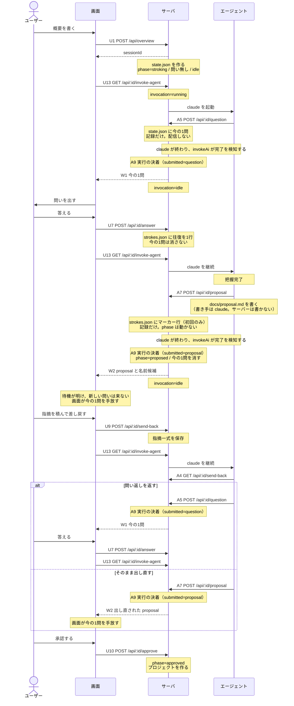
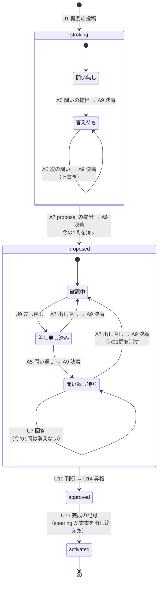
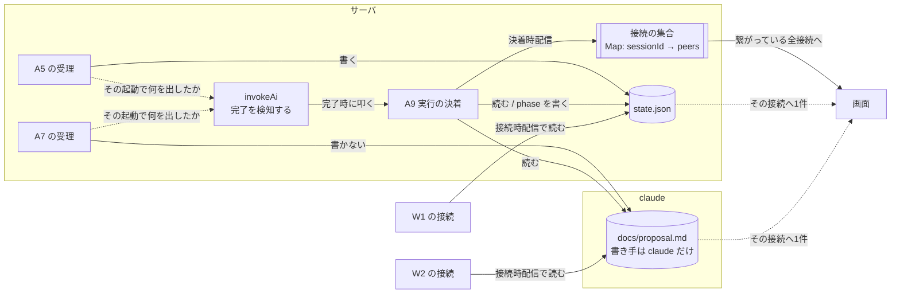

# 問いの往復

ユーザー・画面・サーバ・エージェントの4者が、いつ何を送り、サーバの中身がどう動くかを図で示す。

状態の正はサーバのファイル（`state.json` / `strokes.json`）にある。WS はバッファを持たず、
繋がっている接続へその場で流すだけ。図と実装が食い違ったら実装が正しい。

矢印に付けた番号（U1・U7・U9・U13・A5・A7・A9・W1・W2）は `docs/specs/api/contract.md` の一覧と同じもの。
入れ物の形と検証の規定は `docs/specs/core/schema.md` を参照。

## 並び

概要から承認までの一巡。差し戻しと問い返しを含む。

受理する endpoint（U1・U7・U9）は記録までで完結し、AI を起動しない。起動は U13 だけが行い、
画面が受理の成功応答の直後に呼ぶ。**提出を受ける endpoint（A5・A7）も記録までで完結する**——
局面の切り替えと配信は持たない。結果は、その提出を行った実行が決着した瞬間（A9）に WS で
画面へ届く。承認の操作が現れるのは決着の後なので、承認による改名（U14）が走っている claude と
重なることは無い。

往復が決着したとき、新しい問いが来ていなければ、画面が握っている今の1問を手放す。これは画面側で
起きる。

## 状態

サーバが持つファイルは2つ。今の局面を持つ `state.json` と、済んだ往復を積む `strokes.json`。

**局面が変わるのは提出の受理ではなく決着（A9）の時点である。** 提出（A5・A7）はその材料を
記録するだけで、局面はまだ動かない。

`invocation` は上の局面とは別に動く。U13 で `running`、実行の決着を済ませた後に `idle`、
リトライが尽きたとき `failed`。書くのは invokeAi だけである（A8）。

`strokes.json` は U7 で往復を1行、A7 の**初提出だけ**でマーカー行を1行積む。出し直しでは増えない。

**今の1問は `state.json`、済んだ往復は `strokes.json`。** 回答（U7）は `strokes.json` を増やすが、
`state.json` の今の1問は消さない。消えるのは A5 の上書きか、proposal の決着（A9）のときだけ。

## 配信

W1（今の1問）と W2（proposal）は、どちらも2つの経路で流れる。

**決着時配信**: エージェントの提出を受けた実行が完了し、invokeAi が決着した瞬間、その提出に
応じたものを、そのセッションに繋がっている全接続へ流す。**提出を受理した瞬間には流れない。**

**接続時配信**: 画面が繋いだ瞬間、サーバがファイルを読んでその接続にだけ1件流す。
W1 は `state.json` の今の1問があれば流す。**答え済みかどうかは見ていない。**

W1 が流すのは問いだけで、**問いの取り下げは流れない**。proposal の決着（A9）は `state.json` の
今の1問を消すが、配信するのは W2 だけ。画面はそれを知る手段を持たないため、往復の決着（新しい問いが来ないまま
待機が明けたとき）に、画面側が自分で今の1問を手放している。

接続の集合（`server/utils/ws-channels.ts`）が持つのはセッション id と接続だけで、
内容は保持しない。再送のための待ち行列も無い。

## 関連

- `docs/specs/api/contract.md` — endpoint の一覧と契約
- `docs/specs/core/schema.md` — 入れ物の形と検証の規定
- `docs/specs/reference/stroke-modules.md` — 画面側の使い方
