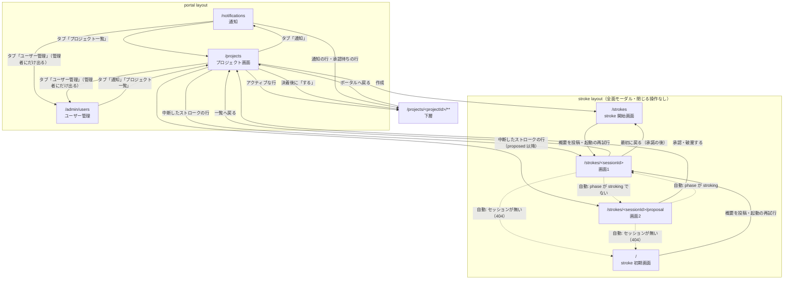

# 画面遷移

URL と画面の対応、各画面の責務、画面と画面をつなぐ遷移の正。どの URL を開いたとき何が出るか、どの操作でどこへ移るか、自動で移る箇所はどこかを、この1ファイルで読めるようにする。

**遷移を変えたときは、同じ change のなかでこの資料を更新する。** 資料と実装を食い違わせたまま残さない。

## 対象範囲

上層（portal）とストロークの画面を扱う。下層（`/projects/<projectId>/**`）の中の遷移は扱わず、上層と下層を行き来する操作だけを書く。

---

## 1. URL と画面

| URL | route | 画面 | 責務 | layout |
| --- | --- | --- | --- | --- |
| `/` | `app/pages/index.vue` | stroke 初期画面 | ストロークを始める。AI との応対の入口 | `stroke` |
| `/strokes` | `app/pages/strokes/index.vue` | stroke 開始画面 | ストロークを始める。プロジェクト一覧の「作成」から入ったときの入口 | `stroke` |
| `/strokes/<sessionId>` | `app/pages/strokes/[sessionId]/index.vue` | 画面1 | AI の問いに答える往復 | `stroke` |
| `/strokes/<sessionId>/proposal` | `app/pages/strokes/[sessionId]/proposal.vue` | 画面2 | proposal の確認・差し戻し・承認 | `stroke` |
| `/projects` | `app/pages/projects/index.vue` | プロジェクト画面 | プロジェクトの一覧と、そのプロジェクトへの入場 | `portal` |
| `/notifications` | `app/pages/notifications/index.vue` | 通知 | プロジェクト横断の通知の一覧 | `portal` |
| `/projects/<projectId>/**` | `app/pages/projects/[projectId]/**` | 下層 | プロジェクトの中（specs / steering / tasks / approvals） | `workspace` |
| `/admin/users` | `app/pages/admin/users.vue` | ユーザー管理 | 利用者ごとに見せるプロジェクトと、管理者の登録を編集する。管理者だけが開ける | `portal` |

- **1つの URL に2つ以上の責務を持たせない。** `/` はストロークの開始だけ、`/projects` はプロジェクトの一覧と入場だけ、`/notifications` は通知の一覧だけを担う
- **上層のどの画面も URL を持つ。** 直接開いても、ブックマークから開いても、再読み込みしても、その URL の画面が出る
- `stroke` layout は画面全体を覆うモーダルで、閉じる操作を持たない。どの場面に居るかは URL が持つので、再読み込みすれば同じ場面がモーダルとして開き直る（`docs/specs/plan/portal-stroke-entrance.md`「決定: ページ遷移で開く（design.md D1）」）
- `portal` layout はヘッダーとタブ bar を持つ。タブは左に「通知」と「プロジェクト一覧」の2つ、右端に離して「ユーザー管理」を置く。「ユーザー管理」は管理者にだけ出る

### `/` と `/strokes` が同じ画面を出す理由

`/` と `/strokes` は**同じ画面を出す**。違いは Nuxt の page routing 上の path だけで、画面の中身・できる操作・そこから進む先は同じである。重複ではないので、片方を消さない。

- `/` はこの product が何から始まるかを示す入口で、AI との応対から始まる
- `/strokes` はプロジェクト一覧の「作成」の飛び先である。`/strokes/<sessionId>` と `/strokes/<sessionId>/proposal` が同じ並びの下に在る。作成の飛び先を `/` にしないのは、どちらの入口から入ったかが URL から読み取れなくなるためである
- 画面の実体は1つで、`app/components/page/Stroke/Start/Container.vue` にある。2つの route はそれを呼ぶだけの薄い route である（`docs/specs/structure/page-structure.md`）。実体が1つなので、片方だけが古くなることが起こらない
- どちらから概要を投稿しても、セッションの作られ方・phase の初期値・AI の起動の仕方は同じである

---

## 2. 遷移の図

実線はユーザーの操作による遷移、点線は自動の遷移である。

---

## 3. 操作による遷移

| 画面 | 操作 | 移る先 |
| --- | --- | --- |
| `portal` layout | タブ「通知」 | `/notifications` |
| `portal` layout | タブ「プロジェクト一覧」 | `/projects` |
| `portal` layout | タブ bar の右端の「ユーザー管理」（管理者にだけ出る） | `/admin/users` |
| `/projects` | 作成 | `/strokes` |
| `/projects` | アクティブな行 | `/projects/<projectId>` |
| `/projects` | 中断したストロークの行 | phase が `stroking` なら `/strokes/<sessionId>`、それ以外は `/strokes/<sessionId>/proposal` |
| `/projects` | 生成の決着後に「する」 | steering への承認依頼が在れば `/projects/<projectId>/approvals/<approvalId>`、無ければ `/projects/<projectId>/approvals` |
| `/notifications` | 通知の行 | `/projects/<projectId>/<target>/<targetId>`（飛び先は通知の種別だけで決まる） |
| `/notifications` | 承認待ちの行（通知が0件のとき） | `/projects/<projectId>/approvals` |
| `/projects/<projectId>/**` | ヘッダー左「ポータルへ戻る」 | `/projects` |
| `/`・`/strokes` | 概要を投稿する | `/strokes/<sessionId>` |
| `/`・`/strokes` | 起動に失敗した後の「もう一度試す」 | `/strokes/<sessionId>` |
| `/`・`/strokes` | 起動に失敗した後の「最初からやり直す」（承諾の後） | 移らない。同じ画面のまま入力からやり直す |
| `/strokes/<sessionId>` | 起動に失敗した後の「一覧へ戻る」（時間を置いて再開する） | `/projects` |
| `/strokes/<sessionId>` | 完全な失敗の後の「最初に戻る」（承諾の後） | `/strokes` |
| `/strokes/<sessionId>/proposal` | 承認 | `/projects`（`docs/specs/plan/portal-stroke-exit.md`「承認ボタン → 一覧へ戻る（モーダルの終わり方）」） |
| `/strokes/<sessionId>/proposal` | 昇格に失敗した後の「破棄する」 | `/projects` |

---

## 4. 自動の遷移

**`/` は他の URL へ自動で移さない。** リダイレクト・middleware・route rule・画面のマウント時の遷移のいずれも持たない。`/` が出すものは、ユーザーが操作するまで変わらない。`nuxt.config.ts` の `routeRules` に `redirect` を置かず、`/` から移す middleware も持たない。

**他の URL から `/projects` へ自動で移さない。** `/projects` へ着くのは、ユーザーがそこへ向かう操作をしたときだけである。

自動で移す箇所は次の4つで、どれもストロークの画面が URL と phase の食い違いを正すためのものである。

| 画面 | 条件 | 移る先 | 理由 |
| --- | --- | --- | --- |
| `/strokes/<sessionId>` | セッションが無い（404） | `/` | 存在しないセッションの画面は出せない。概要入力へ戻す |
| `/strokes/<sessionId>` | phase が `stroking` でない | `/strokes/<sessionId>/proposal` | `proposed` 以降は答える問いが無い。画面2 へ送る |
| `/strokes/<sessionId>/proposal` | セッションが無い（404） | `/`（履歴を置き換える） | 存在しないセッションの画面は出せない。概要入力へ戻す |
| `/strokes/<sessionId>/proposal` | phase が `stroking` | `/strokes/<sessionId>` | URL の直打ち・ブックマークで、proposal がまだ無い局面に来た。画面2 には出すものが無いため画面1 へ戻す |

### 見られない対象の URL は 404

見られない対象の URL を開いたときは、**別の URL へ移さず、その URL のまま 404 の画面を出す**（`openspec/specs/access/permission`・`access/user-management`）。判定は `app/middleware/access.global.ts` が持つ。

| URL | 404 になる条件 |
| --- | --- |
| `/admin/**` | 管理者でない |
| `/projects/<projectId>/**` | プロジェクトは在るが、開いた利用者に許可が無い |
| `/strokes/<sessionId>/**` | ストロークは在るが、開いた利用者が見られない（作成途中なら始めた本人と管理者だけ、昇格後はプロジェクトの許可） |

**対象が無いときは 404 にしない。** 無いときの振る舞いは上の表のまま（`/strokes/<sessionId>` なら `/` へ移す）で、見られないときだけを 404 にする。

---

## 5. 参照

| 資料 | 持つもの |
| --- | --- |
| `docs/specs/plan/portal-stroke-entrance.md` | 作成ボタンからストロークへ入る接合と、全面モーダルで開く決定 |
| `docs/specs/plan/portal-stroke-exit.md` | 承認からプロジェクト一覧へ戻る接合 |
| `docs/specs/structure/page-structure.md` / `page-component-structure.md` | `pages/` と `components/page/` の対応 |
| `docs/specs/architecture/failure.md` | 失敗したときの選択肢（起動の再試行・やり直し） |
