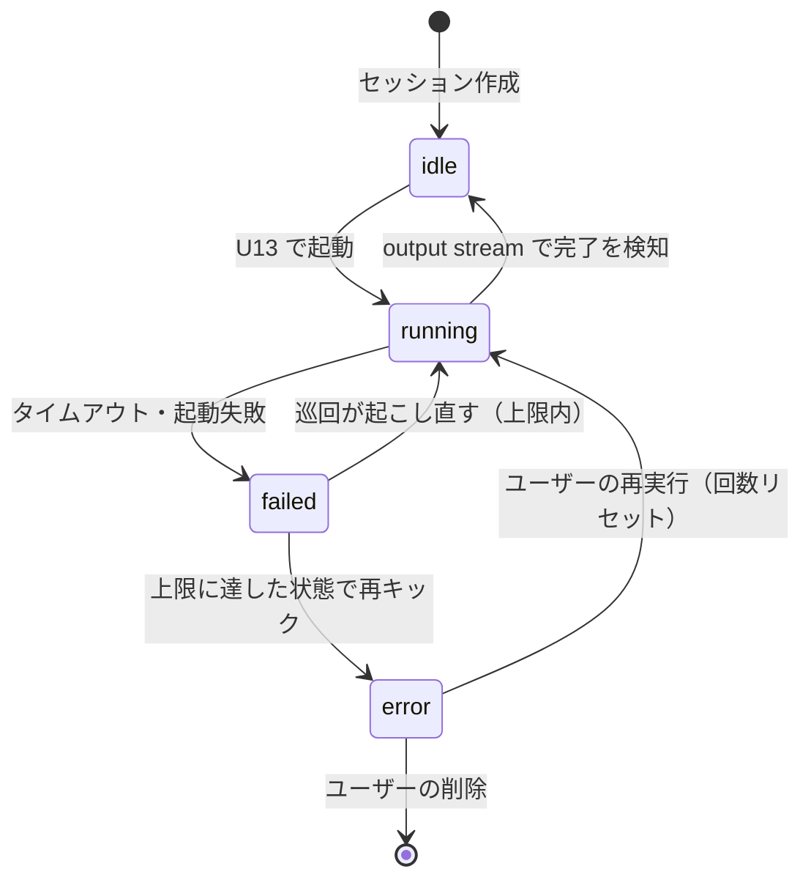

# セッションのワークフロー定義

claude プロセスへの指示は2つに分かれる。**どの成果物を作るか**は openspec のワークフロースキーマにあり、スキーマを編集すればコード変更・再ビルド・再起動なしに次回の呼び出しから反映される（`openspec/specs/workflow-definition/spec.md`）。**どう進めるか**（手順）は MCP の案内ツール（`get-guide` / `get-steering-guide`）が返し、本文はツールのソースが持つ。

操作（取得・提出）の入口は MCP ツールだけである。契約は `docs/specs/api/mcp-tools.md`。

store（マシン共有の登録簿）は使わない。**登録作業は不要**で、旧 `stroke-sessions` の登録が残っていても参照されない（unregister は任意）。

## 置き場

```
~/.local/share/openspec/schemas/flontier-strokeflow/   ワークフロースキーマ（user レベル配置）
├── schema.yaml                 artifact は stroke → proposal の2段
└── templates/{stroke,proposal}.md

/opt/projects/                                         projectShareRoot（設定値。既定値を示す）
├── <uuid>/                                            セッションディレクトリ = openspec ルート
│   ├── openspec/
│   │   ├── config.yaml         schema: flontier-strokeflow（サーバが書く）
│   │   └── changes/                （いま作る者が居ない。下の「openspec ルートの使い手」）
│   ├── docs/proposal.md        claude が書く（サーバーは書かない）
│   └── state.json / strokes.json / overview.txt       アプリが書く状態
└── <name>/                                            承認で <uuid> を改名しただけ
    └── docs/proposal.md        位置は変わらない

server/mcp/tools/                                      MCP ツール8本（ファイル名 = ツール名）
├── get-guide.ts / get-steering-guide.ts               案内（工程の手順）
├── get-overview.ts / get-strokes.ts / get-send-back.ts   取得
├── get-steering.ts                                    取得（本家）
└── send-question.ts / submit-document.ts              提出
```

`assets/.claude/skills/` の旧セッション API スキルはファイルとしては残っているが、**claude には届かない**——`--add-dir` を渡さないので置き場ごと見えない。

セッションに属するものは、セッションディレクトリ1箇所に収まる。**セッションと昇格した
プロジェクトは同じ親（`projectShareRoot`）の下に並ぶ。** 承認はこの親の下での改名だけで
昇格を行うためで、ポータルの一覧もこの親を走査する（`docs/specs/core/settings-reference.md`）。

## 配線

| 何を | どこで | どう届くか |
|---|---|---|
| スキーマ名 | `runtimeConfig.claude.workflowSchema` | セッション作成時に `openspec/config.yaml` へ書かれる |
| 手順の入口 | `runtimeConfig.claude.firstPrompt` ほか | 定型が案内ツール（`get-guide`）の名前を指す。手順の本文は定型に書かない |
| 接続先 | `runtimeConfig.claude.apiBaseUrl` | 起動ごとに組み立てる `--mcp-config` の url（`<apiBaseUrl>/mcp`）。spawn 時の環境変数 `STROKE_BASEURL` としても渡るが、**読み手はもう居ない** |
| どのセッションか | — | `--mcp-config` の `x-stroke-token`。接続表がセッション id へ引き当てる |
| 工程ごとの公開ツール | `server/utils/mcp/exposed-tools.ts` | `--mcp-config` の `x-mcp-tools` |
| 作業場所 | — | cwd だけ。`--add-dir` は渡さない |
| steering の定型 | `runtimeConfig.claude.steeringPrompt` | 承認の直後、cwd＝生成先で起こすときに渡る |

設定は**環境変数から一切読まない**。値は `nuxt.config.ts` と `app/app.config.ts` に書かれた
ものだけで、読み口は `server/utils/stroke/config.ts` の1本である。一覧は
`docs/specs/core/settings-reference.md`。

セッション作成（`server/utils/stroke/session-core.ts`）は「ディレクトリ作成 → `openspec init --tools none` → `config.yaml` 上書き → 状態ファイル書き込み」。**サーバは change を作らない**。

### openspec ルートの使い手

**掘ったルートを使う者が、いまは居ない。** change を作っていた `openspec-ff-change` スキルは実体を持たず、定型からも外した。実測でも、完走したセッションの `openspec/changes` は空で、その実行の `tool_use` に `Bash` は0回だった。

掘る側を据え置いてあるのは、案内を配り直して使い手が戻る余地を残すためである。openspec コマンドの実行は全て cwd = セッションディレクトリで、`--store` はどのコードパスからも使わない。

## 畳み方

- **サーバが動いているとき**: `GET /api/strokes` で一覧し、`POST /api/strokes/<uuid>/delete` で消す（実行中の呼び出しを持つ間は 409）。
- **サーバが動いていないとき**: `yarn session list` / `yarn session delete <uuid>` / `yarn session create "<概要>"`。endpoint と同じ実体（`session-core.ts`）を呼ぶ。実行中判定は `state.json` の `invocation` を材料にする。設定は `nuxt.config.ts` を直接 import して得る（Nitro の外なので `useRuntimeConfig()` は使えない）。

## 実行の記録（`invocation`）

`state.json` が4値で持つ。書き込みは A8（`POST /api/strokes/:id/submission`）経由で
invokeAi だけが行う（`openspec/specs/agent/invocation`）。



- `phase: 'approved'` の対象も `invocation` を持つ。昇格後は steering の実行が起こる
- 上限（`runtimeConfig.claude.maxRetries`）の判定は invokeAi。巡回は `failed` だけを拾う
- サーバー再起動で宙に浮いた `running` は、起動時に `failed` へ倒して巡回に拾わせる
  （`server/plugins/01.reap-running.ts`）

## 実測で確定していること

Claude Code 2.1.236 / openspec 1.9.0 で確認し、1.10.0 で以下を再確認・追加した。

- **schema.yaml は全 artifact に `template` が必須**。省くと `openspec instructions` が落ちる。`templates/<file>` の実体も要る。`apply:` ノードは省略できる
- `openspec init --tools none` の生成物は `openspec/{config.yaml, changes/archive, specs}` のみ（AI ツール連携ファイルは作られない）
- `config.yaml` に `schema:` を書けば、`openspec new change` は `--schema` 無しでそのスキーマを既定に使う（1.10.0 で `flontier-strokeflow` にて再確認）
- **schema の解決元は project（cwd から解決した root）・user（`~/.local/share/openspec/schemas/`）・package（CLI 内蔵）の3系統**。user レベルは cwd にも root にも依存せず効く
- **`--store` 指定時は cwd 側（project）の schema が解決候補から除外される**。schema を store と cwd に分けて持つ構成は成立しない
- `flontier-strokeflow` の `applyRequires` は `["stroke","proposal"]`（`apply:` ノード無しでも空にならない）
- 登録簿に別ワークツリーを指す登録が残っていても、`--store` を使わない実行は登録簿を参照しない
下の3件は claude 側の性質として確かめた事実だが、**いまの配線では使っていない**（`--add-dir` を渡さず、ロードされるスキルが0本のため）。案内を Skill として配り直すときに効いてくる。

- `--add-dir` を複数渡すと、それぞれの `.claude/` からスキルもコマンドも読まれる
- `--session-id` で自前採番した uuid は、スキル内の `${CLAUDE_SESSION_ID}` と一致する
- spawn 時の環境変数はスキルの `!` フェンス事前実行まで届く

## 定義を変えるとき

`~/.local/share/openspec/schemas/flontier-strokeflow/` を編集するだけでよい。サーバは定義を読まずキャッシュも持たないため、**起動済みの呼び出しには影響せず、次回の呼び出しから反映される**。

新しいマシンで動かすには、このスキーマを `~/.local/share/openspec/schemas/` に配置する（`README.md`）。無いままセッションを作ると、claude が指示を取得できず呼び出しが失敗する。
