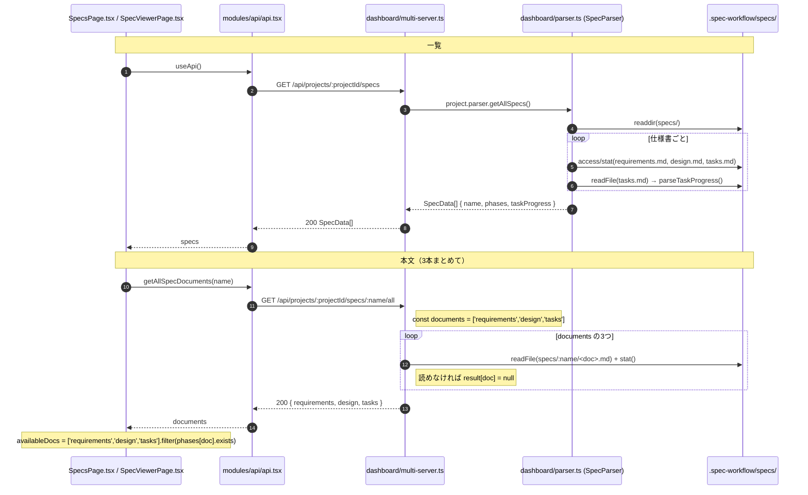
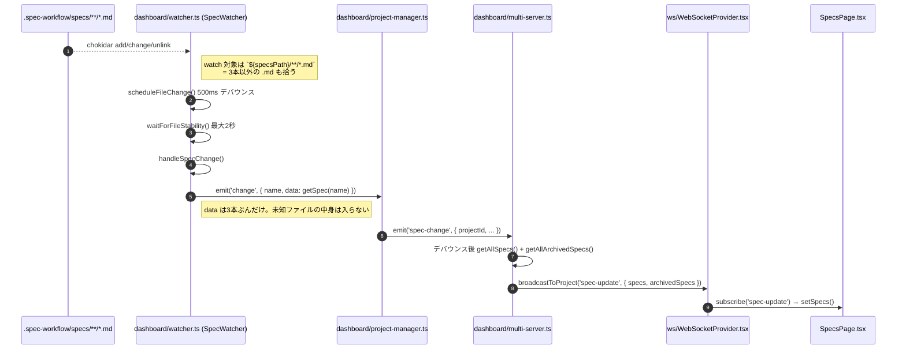
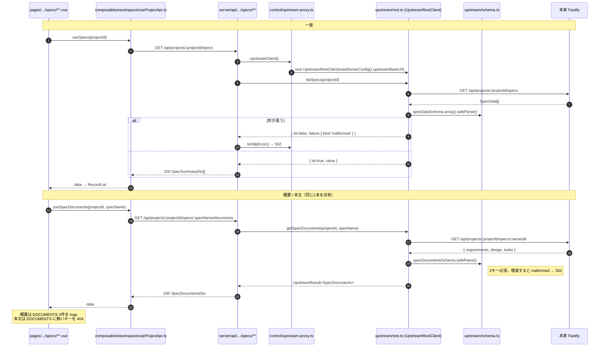
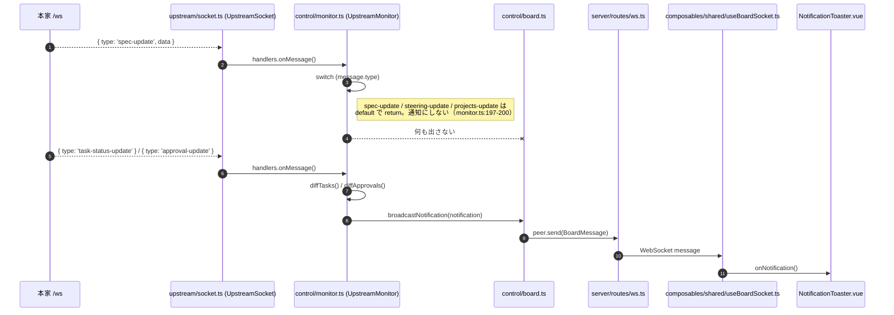

# 仕様書の画面 — 現状の流れ

仕様書の画面が、どこから何を取って何を出しているかを示す資料。**現状の実装だけ**を書く。これから作るものは扱わない（`docs/specs/plan/artifact-extension-plan.md`）。

## 対象範囲

仕様書の画面3つに限る。承認・タスク・ステアリング・プロジェクト一覧は同じ接点層を通るが流れが別なので、ここには入れない。

| 画面 | stroke-board | 本家の対応物 |
| --- | --- | --- |
| 一覧 | `app/pages/projects/[projectId]/specs/index.vue` | `SpecsPage.tsx` |
| 1本の概要 | `app/pages/projects/[projectId]/specs/[specName]/index.vue` | `SpecsPage.tsx` の `SpecModal` |
| 本文 | `app/pages/projects/[projectId]/specs/[specName]/[document].vue` | `SpecViewerPage.tsx` |

## 基準

本家は **spec-workflow-mcp 2.2.7**（ADR-0008）。行番号は `/home/vagrant/work/repo/spec-workflow-mcp` の main を指す。本家が変わればこの資料も古くなる。

---

## 1. 本家 — 仕様書画面の流れ

本家のダッシュボードは、React の SPA が同一プロセスの Fastify（`multi-server.ts`）を叩き、Fastify が `SpecParser` 経由でファイルシステムを読む。

### 1.1 取得（REST）

| # | 位置 |
| --- | --- |
| `useApi()` / `getAllSpecDocuments` | `src/dashboard_frontend/src/modules/api/api.tsx:158, 312` |
| タブとフィルタの3本固定 | `SpecsPage.tsx:23`、`SpecViewerPage.tsx:15,17,57` |
| `GET /specs` | `src/dashboard/multi-server.ts:446` |
| `GET /specs/:name` | `src/dashboard/multi-server.ts:466` |
| `GET /specs/:name/all` | `src/dashboard/multi-server.ts:480-507`（3本固定は `:488`） |
| `SpecParser.getAllSpecs()` / `getSpec()` | `src/dashboard/parser.ts:90-99, 173-182` |
| 3ファイル名指し（MCP 側） | `src/core/parser.ts:43-45` |

**3本固定が決まる場所は2つある。** 一覧が返す `phases` の形（`src/types.ts:69`）と、`/all` のループ配列（`multi-server.ts:488`）。片方だけ見ても全体は分からない。

### 1.2 変化の伝播（WebSocket）

| # | 位置 |
| --- | --- |
| watch パターン | `src/dashboard/watcher.ts:35` |
| デバウンス / 安定待ち | `src/dashboard/watcher.ts:79-95, 99-127` |
| `handleSpecChange()` | `src/dashboard/watcher.ts:155-185` |
| `emit('spec-change')` | `src/dashboard/project-manager.ts:159-161` |
| `spec-update` ブロードキャスト | `src/dashboard/multi-server.ts:318-347` |
| 受信側 | `src/dashboard_frontend/src/modules/api/api.tsx:256` |

**watch は `**/*.md` で、REST は3本固定。**ここに非対称がある。本家が知らない `.md` を置いても中身は読まれないが、保存すれば `spec-update` は流れる。

---

## 2. stroke-board — 仕様書画面の流れ

層は5つ（`docs/specs/core/structure-design.md`）。画面 → API → 制御 → 接点 → 本家、と一方向に進む。

### 2.1 取得（REST）

| # | 位置 |
| --- | --- |
| `useSpecs` / `useSpecDocuments` | `app/composables/workspace/useProjectApi.ts:41, 46` |
| 一覧 API | `server/api/projects/[projectId]/specs/index.get.ts` |
| 本文 API | `server/api/projects/[projectId]/specs/[specName]/documents.get.ts` |
| `upstreamClient()` / `toHttpError()` | `server/utils/control/upstream-proxy.ts:13, 24` |
| `listSpecs()` / `getSpecDocuments()` | `server/utils/upstream/rest.ts:61, 66` |
| 検証と失敗の区別 | `server/utils/upstream/rest.ts:149-174` |
| 3キー必須のスキーマ | `server/utils/upstream/schema.ts:136-140` |
| 画面側の3本固定 | `specs/[specName]/index.vue:19`、`specs/[specName]/[document].vue:11` |

**3本固定が決まる場所は3つある。** 接点層の zod（`schema.ts:136`）、概要画面の `DOCUMENTS` 配列（`index.vue:19`）、本文画面の `DOCUMENTS` オブジェクト（`[document].vue:11`）。本家の2箇所に加えて、こちらにも独立した定義がある。

### 2.2 変化の伝播（WebSocket）

| # | 位置 |
| --- | --- |
| 本家 WS への接続 | `server/utils/upstream/socket.ts:38-90` |
| `spec-update` を捨てる箇所 | `server/utils/control/monitor.ts:197-200` |
| 通知のブロードキャスト | `server/utils/control/board.ts:59-70` |
| ブラウザ側の受け口 | `app/composables/shared/useBoardSocket.ts:22, 46` |

**仕様書の画面に push 起点の再描画経路は無い。** `spec-update` は本家から届くが、`UpstreamMonitor` が「再描画用の同期信号」として捨てている。画面が新しい内容を得るのは `useFetch` が走るとき（遷移・リロード）だけである。

---

## 3. 2つを重ねて見えること

| 観点 | 本家 | stroke-board |
| --- | --- | --- |
| 3本固定の定義箇所 | 2（`types.ts:69` / `multi-server.ts:488`） | 3（`schema.ts:136` / `index.vue:19` / `[document].vue:11`） |
| 未知の `.md` の本文 | REST では取れない | 同じ（本家から取るため） |
| 未知の `.md` の変化 | `spec-update` として流れる | 届くが捨てている |
| ファイルを読む主体 | `SpecParser` と Fastify | 本家のみ（接点層は HTTP だけ） |
