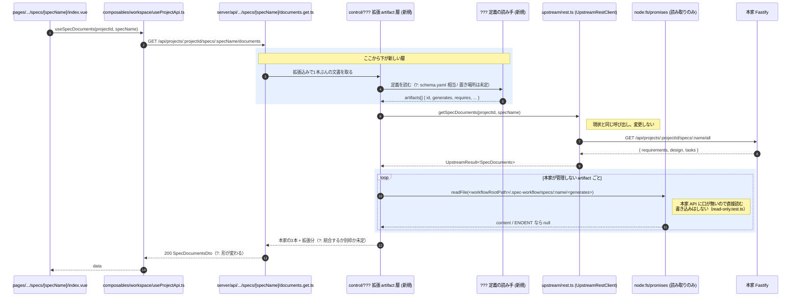
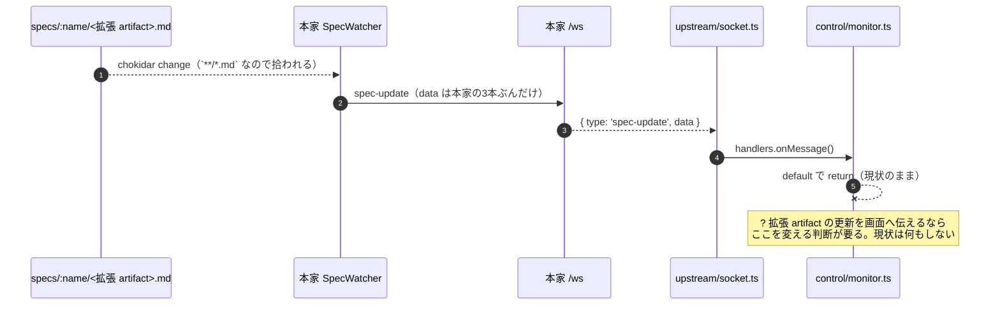

# 拡張 artifact — 検討資料

> **これは未決定の検討資料である。**
> 方式の採否は決まっていない。ここに書いた図は「入れるとしたらどこに何が入るか」を見るためのものであって、実装の合意ではない。
> 現状の事実は `docs/specs/architecture/spec-screen-flow.md` にある。この資料と食い違ったら、事実の側が正しい。

## まだ決まっていないこと

図を読む前に、決まっていない3点を明示しておく。図中では `?` で示す。

1. **定義の中身** — 拡張 artifact を何で規定するか。OpenSpec の `schema.yaml` 相当（`id` / `generates` / `description` / `template` / `instruction` / `requires`）を使う案が出ているが、確定していない
2. **定義の置き場所** — `.spec-workflow/` の中（本家が読まないので同居できる）か、その外か
3. **画面での並べ方** — 本家の3本と拡張分を1列に統合するか、別枠として並置するか。ADR-0005（本家から受け取った情報を勝手に加工・再構成しない）に触れるため、ユーザーの判断が要る

## 何を解こうとしているのか

仕様書の artifact を3本（requirements / design / tasks）から増やしたい。ただし stroke-board は本家互換を原則とし、本家の管理ファイルを直接書かない（ADR-0005、`server/utils/upstream/read-only.test.ts`）。

そこで検討しているのが**併存方式**である。本家が知らないファイルを名前衝突なく同じディレクトリに置き、stroke-board 側に一層挟んでそれを扱う。本家は改造しない。

## 前提として確認済みの本家の挙動

いずれも 2.2.7 のソースを読んで確認したもので、**実機での確認はまだしていない**。

| 挙動 | 根拠 |
| --- | --- |
| 未知の `.md` を読まない | `src/core/parser.ts:43-45` が3ファイルを名指し。`/all` は `multi-server.ts:488` の3要素ループ |
| 未知の `.md` を消さない | 削除は `src/dashboard/job-scheduler.ts:260, 291` の spec ディレクトリ単位のみ |
| archive で一緒に動く | `src/core/archive-service.ts:39, 72` が `fs.rename` でディレクトリごと移動 |
| 未知の `.md` の保存でも `spec-update` が流れる | watch 対象が `src/dashboard/watcher.ts:35` の `${specsPath}/**/*.md` |
| 未知の `.md` の本文を返す口が無い | `/specs/:name/all` は3キー固定。汎用のファイル読み出しエンドポイントは無い |

`specs/<name>/` で本家が予約している名前は `requirements.md` / `design.md` / `tasks.md` と、`Implementation Logs/` ディレクトリ（`src/dashboard/implementation-log-manager.ts:17`）だけである。

## 図 — 拡張 artifact の層を挟んだ形

`docs/specs/architecture/spec-screen-flow.md` 2.1 の現状図をベースにする。**太字の部分だけが新しい**。それ以外の呼び出しは現状と同一である。

### 取得（REST）

### 変化の伝播（WebSocket）

現状は `UpstreamMonitor` が `spec-update` を捨てているため、仕様書画面に push 起点の再描画経路が無い（`server/utils/control/monitor.ts:197-200`）。拡張 artifact を置いても、その保存で本家から `spec-update` は流れてくる。

## この図から読み取れること

1. **本家に触る部分は1行も変わらない。** `UpstreamRestClient.getSpecDocuments()` の呼び出しも、本家の `/all` も現状のまま。新しい層は既存の呼び出しを包むだけである
2. **本家 API から取れないものが1つだけある。** 拡張 artifact の本文で、これはファイルシステムを直接読むしかない。読み取りは `read-only.test.ts` の禁止対象外（禁じているのは `writeFile` / `mkdir` / `rm` などの書き込みと、本家の書き込み API）。`server/utils/upstream/scan.ts` と `registry.ts` に既に前例がある
3. **変わる契約が1つある。** `documents.get.ts` が返す形。3キー固定の `SpecDocumentsDto` を変えると、`[specName]/index.vue` と `[document].vue` の両方に波及する
4. **層の置き場所は制御層になる。** 接点層（`server/utils/upstream/`）は本家の形をそのまま扱う場所で、本家が知らない概念を持ち込めない（`docs/specs/core/system-structure.md` の層の定義）。ただし FS 直読みをどちらに置くかは別途判断が要る

## 決めるべき問い

図にした結果、次の順で決める必要があると分かった。上から順に、下の答えを縛る。

1. 拡張 artifact を何で規定するか（`schema.yaml` 相当の6フィールドで足りるか）
2. その定義をどこに置くか（`.spec-workflow/` 内 / 外）
3. 新しい層をどのモジュールとして置くか（制御層のどこか、FS 読み取りをどちらの層に持たせるか）
4. `documents.get.ts` が返す形をどう変えるか（3キー固定を保ったまま足すか、形ごと変えるか）
5. 画面でどう並べるか（統合 / 別枠）— ADR-0005 に触れるため要判断
6. `spec-update` を再描画に使うかどうか（現状は捨てている）

## 未確認のこと

前提として挙げた本家の挙動は、**すべてソースを読んだだけ**である。ADR-0006 は「本家は観測した挙動を基準にする」としているため、実機で次を確認するまでは確定ではない。

- `specs/<name>/` に未知の `.md` を置いた状態で `/specs/:name` と `/specs/:name/all` のレスポンスが変わらないこと
- そのファイルを保存したときに `spec-update` が流れ、payload に拡張分が入らないこと
- archive / unarchive で未知の `.md` が一緒に移動すること
