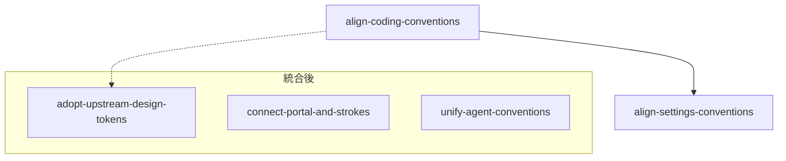

# `stroke-board` への統合

`stroke-board-frontier` を `stroke-board` へ統合する。**単一の Nuxt アプリにする**（`docs/adr/0002-merge-into-stroke-board.md`）。

> **統合は実施済み**（merge `9cef630`、2026-08-24）。終了条件のうち「マージ前に消化する」2本
> （`align-coding-conventions` / `align-settings-conventions` の残タスク）はユーザー判断で
> 統合後へ持ち越した。衝突はコード本体ゼロ・共有ファイル14件のみで、解決の内訳は merge
> commit に記録してある。この資料の以下は統合前の計画の記録であり、「統合後に回す」の
> change 一覧だけが現役である。

この資料は道筋を示すもので、中身は持たない。各 change の内容は `openspec/changes/<id>/proposal.md`、意味の区分と命名・配置の戦略は `design-semantic-structure`、ドメイン用語は `CONTEXT.md` が本体である。**一行を超えた説明が要るときは本体を見に行くこと。**

進捗も持たない。今どこまで来たかは `openspec list` が答える。

## 統合後の姿

2つは1つの流れの前半と後半である。

```
  概要を投げる ──▶ ストローク ──▶ proposal 確認 ──▶ 承認
                    (AI と往復)                        │
                                                       ▼
                                            /opt/projects/<name>/
                                              └── docs/proposal.md
                                                       │
                                                       │  ここが唯一の実接点
                                                       ▼
                                          プロジェクト一覧 ──▶ 通知・承認待ち
```

`/opt/projects` が両者の唯一の接点である。前半がそこにプロジェクトを作り、後半がそこを走査して見張る。コード上の依存はここ以外に無い。

ただし**今のままでは繋がらない**。後半が母集合に入れるのは `.spec-workflow/` を持つディレクトリだけで、前半が作るのはトップのディレクトリと `docs/proposal.md` だけである。この断絶は `surface-generated-projects` が扱う。

## change 一覧

区分の意味は「[区分の基準](#区分の基準)」を参照。

### マージ前に消化する

| id | タイトル | 概要 | 区分 |
|---|---|---|---|
| [align-coding-conventions](../../../openspec/changes/align-coding-conventions/) | コーディング方針の準拠化 | テスト整備・依存の一本化・auto-import 廃止 | A |
| [align-settings-conventions](../../../openspec/changes/align-settings-conventions/) | 設定値運用方針の準拠化 | ビルド時と実行時の境界を引き、直書きを環境変数へ出す | A |

### 統合後に回す

統合を妨げないもの。1つになった実物を見てからやるほうが確実で、先にやっても再調整になる。

| id | タイトル | 概要 |
|---|---|---|
| [connect-portal-and-strokes](../../../openspec/changes/connect-portal-and-strokes/) | 入口と出口を繋ぐ | 入口: 作成ボタンからモーダルでストロークへ（ADR-0009/0010）。出口: 承認＝rename 昇格で steering 作成を自動開始（ADR-0011）。出口の断絶はこれで解ける |
| [adopt-upstream-design-tokens](../../../openspec/changes/adopt-upstream-design-tokens/) | design token の採用 | 1つのアプリの中で見た目が割れないようにする |
| [unify-agent-conventions](../../../openspec/changes/unify-agent-conventions/) | エージェント規約の統合 | 両側にあって食い違う規約を1組にする |

`connect-portal-and-strokes` は区分 B（統合しても目的が立たない）だが、実装先が**マージ先のコード**にあり、統合するまでこのリポジトリに存在しなかったため、統合後に回した。統合後、出口側は ADR-0011 の決定により `start-steering-after-approval` へ一度分離したが、入口と出口は一続きの流れで分けると動く姿にならないため、2026-08-25 に再統合した（経緯は proposal の「吸収した change」）。

## 依存関係

依存の有無だけを示す。なぜその順かは各 proposal の「前提」が持つ。



`connect-portal-and-strokes` は他の change に依存しないが、実装先のコードが統合まで無い（上記）。

archive 済みの2本（`plan-mainline-merge` / `design-semantic-structure`）は載せない。前者が生んだのがこの資料と `docs/adr/0002-*`、後者が生んだのが `docs/specs/core/system-structure.md` で、**成果物のほうが残って前提になっている**。

並走する別ワークツリーの作業は含めない。意味の区分が先に決まっていれば、取り込む時点でその制約に沿わせる調整で足りる。

## この一覧に載らないもの

統合とは別軸で直すべきものも change として起こす。統合をきっかけに見つかっても、統合を待つ理由が無いならこの一覧には混ぜない。

- `scope-storage-requirements` — 置き場への要求の強さが用途ごとに違う件。統合すると読むだけの機能が入るので、書き込み必須の要求が残っていると動かない
- `limit-project-name-numbering` — プロジェクト名の連番採番に終了条件が無い件

## 区分の基準

掻き出したものは、統合との関係で3つに分かれる。次に何かが見つかったときも、この基準で振り分ける。

| | 何が起きているか | 扱い |
|---|---|---|
| **A** 統合できない | 物理的にマージが成立しない。同じ席を奪い合う、設定が共存できない、片方の前提がもう片方を殺す | マージ前に消化する |
| **B** 統合しても目的が立たない | 1つになっても、狙った流れが繋がらない | マージ前に消化する。統合の意味に直結するため |
| **C** 統合して初めて要る | 1つになったことで、それまで無かった期待が生まれる | **統合後に扱う** |

C を統合前に change にすると、まだ動いていないものに対して仕様を書くことになる。統合後の実物を見てから決めるほうが当てが外れない。

## 統合後に扱うもの

2種類ある。混同しないこと。

**すでに change になっているもの**（上の一覧の「統合後に回す」）は、内容が固まっていて、実施の時期だけを後ろにずらしたもの。

**まだ change にしないもの**（以下）は、統合して初めて期待が生まれるため、実物を見てからでないと何を作るべきかが決められないもの。

### 問いの到着が画面外へ届かない

ポータル由来のイベントは、そのプロジェクトの画面に居なくても届く。frontier 由来のイベント（AI からの問いの到着）は、そのセッションの画面に居ないと届かない。

統合前は表面化しなかった。frontier に「他に見るもの」が無く、ユーザーは待機表示の前に留まるしかなかったからである。統合すると待つ間にポータルへ行けるようになり、AI は最大180秒×3試行かかるため、**離席して問いの到着に気付けない**という状態が新しく生まれる。

セッションを複数持てる（一覧を返す口はある）のに束ねて見る画面が無い点も、同じ理由でここに属する。

## 未決の論点

判断材料は揃っているが、今決めても実施時には前提が変わっているもの。**決めないこと自体を記録する。**

### git の繋ぎ方の詳細

手法は `--allow-unrelated-histories` で確定している（ADR 0002）。残るのは細部である。

- どちらのブランチに対して行うか。マージ先は `main` が初期コミット1つで、実体は作業ブランチ側にある
- `yarn.lock` の扱い。両方が数十万行を持ち、手で解く対象ではない。片方を捨てて再生成するのが現実的
- 両方が1つずつ持つ必要のあるファイル（アプリ全体の設定など）をどう畳むか。これは `design-semantic-structure` の結論に依存する
- **`.gitignore` の打ち消し。** マージ先は `.claude/` を全階層で無視していて、こちらの `!assets/.claude/` に相当する打ち消しを持たない。素朴に重ねると、`assets/.claude/skills/template/` の雛形が追跡から外れる。**これは必ず処理する**（未決なのは畳み方であって、要否ではない）。かつてここに在ったセッション API スキル6本は撤去済みで、守る対象は雛形だけに減っている（`adr0016-sub-switch-workflow-to-mcp-tools`）

**いつ決めるか**: マージ前の change が片付き、意味の区分が確定した後。それ以前に決めても前提が動く。

## 終了条件

何が満たされたらマージに着手してよいか。**衝突の数では測らない。**

1. 「マージ前に消化する」に挙げたものが全て片付いていること
2. 意味の区分と命名・配置の戦略が決まり、各 change がそれに沿っていること
3. マージ先の作業中の change が archive されていること
4. 「未決の論点」が全て決まっていること
5. 残る衝突が、事前に把握され、解き方が決まっているものだけであること

「統合後に回す」ものと、統合とは別軸の change（上記）は、この条件に含まれない。

## 衝突の測り方

現状のまま merge して衝突を数える手順は再現できる。

```sh
git clone <stroke-board> /tmp/probe
cd /tmp/probe && git checkout <対象ブランチ>
git remote add frontier <stroke-board-frontier>
git fetch frontier
git merge --allow-unrelated-histories frontier/master
git diff --name-only --diff-filter=U
```

**ここで出た数をこの資料に書かない。目標値にもしない。**

その数は、両者が今この瞬間に持っているファイルの偶然の重なりでしかない。どちらかに1ファイル増えれば変わる。意味の区分が決まれば前提ごと変わる。数字を書けば、それが独り歩きして「あと何件」という測り方が始まり、また個別にファイルを退かす作業へ戻ってしまう。

確認の主役は数ではなく、次の2点である。

1. 両者の意味区分が被っていないか
2. それぞれが自分の命名・配置の戦略に従っているか

**被らないと分かっていれば、数える必要が無い。** 上の手順は、設計が正しかったことを確かめる手段として使う。
