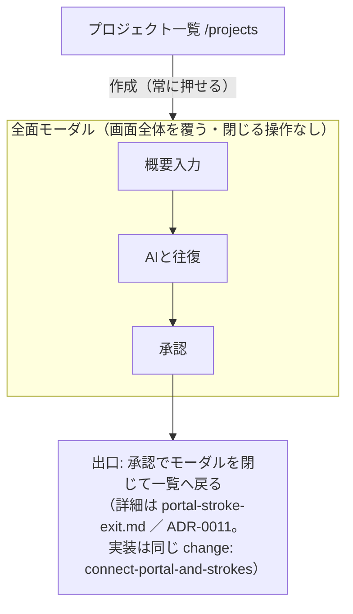
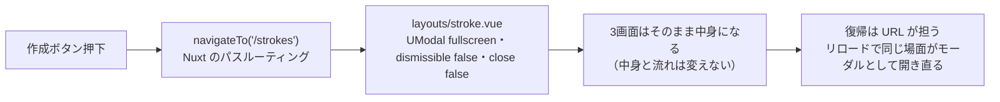
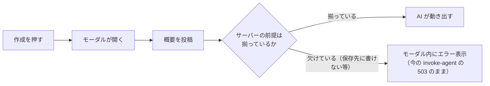
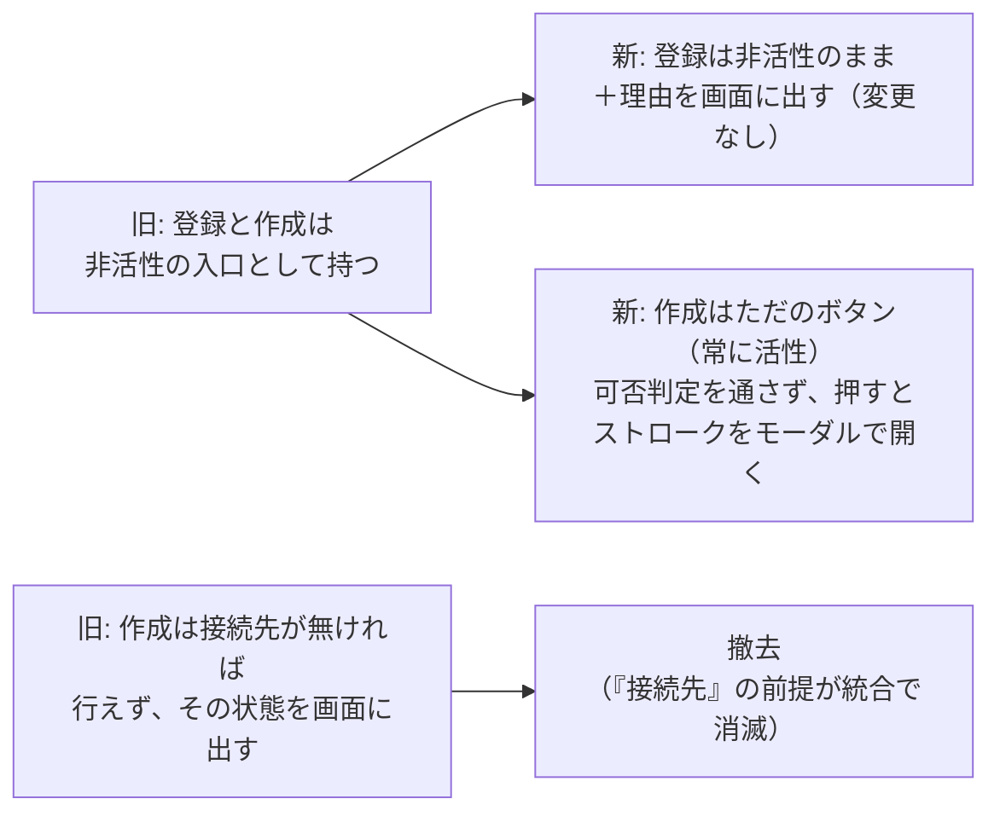

# 入口の接合 — 作成ボタンからストロークへ

実施: change [`connect-portal-and-strokes`](../../../openspec/changes/connect-portal-and-strokes/) ／ 決定: [ADR-0009](../../adr/0009-create-enters-stroke-overview.md)（改訂: モーダル）・[ADR-0010](../../adr/0010-create-button-always-enabled.md)（常に押せる）

## 作成ボタン → 全面モーダルで最後まで

作成を押すと全面モーダルが開き、その中でストローク全体（概要入力 → AI と往復 → 承認）を**最後まで**行う。最初に開くのは概要入力（`/strokes`）。

URL と画面の対応・各画面の責務・遷移の正は [`docs/specs/architecture/screen-flow.md`](../architecture/screen-flow.md) にある。作成の飛び先 `/strokes` と `/` が同じ画面を出すことも、そちらが持つ。この資料が扱うのは、作成ボタンからストロークへ入る接合である。



画面のイメージ — 作成を押すと、モーダルが**画面全体**を覆う。一覧は完全に隠れて見えない:

```
① 押す前（画面全体 = 一覧）        ② 押した後（画面全体 = モーダル）
┌──────────────────────────┐      ┌──────────────────────────┐
│ 通知 │ プロジェクト一覧     │      │        ストローク          │
│ ────────────────────────│      │                          │
│  memo-app     アクティブ   │ 作成 │   概要を入力…             │
│  srvgm        未接続      │ ──▶ │   → AI と往復 → 承認      │
│                          │      │                          │
│ [登録(灰)]  [作成]        │      │   ※閉じるボタンは無い      │
└──────────────────────────┘      └──────────────────────────┘
                                   リロードすると②の途中画面に戻る
```

## モーダルの器 — 自作しない

器は導入済みの **@nuxt/ui `UModal`** をそのまま使い、補助が要れば **VueUse** を使う。専用のモーダル component は新設しない。

- `UModal` の `fullscreen`（画面全体を覆う）と `dismissible`（外側クリック・Esc での閉じを禁止）で、決定済みの挙動（全面・閉じる操作なし）を設定だけで満たせる（props は導入済みパッケージの型定義で確認済み）

### 決定: ページ遷移で開く（design.md D1）

作成ボタンは概要入力のページへ**遷移**し、ページ自身が `UModal` で画面全体を占める。



- **代替案（components 起動）は不採用。** セッション id の保存先を URL とは別に持つことに
  なり、URL が既に持つ情報を二重化する
- 入れ子ルート方式（一覧を親ルート・ストロークを子ルートにして重ねる）も**不採用**
- 器は `app/layouts/stroke.vue` の1枚。3画面は `definePageMeta({ layout: 'stroke' })` を
  置くだけで、中身は触らない
- 既存 ticket `relocate-stroke-routes`（ストロークのルートを `/projects/create/**` へ移す）は
  **据え置き**。パスを動かさなくても開き方の決定は成立する

## エラーの出方（前提が欠けていても押せる）



ボタン側では判定しない。判定を2箇所に持たないため（ADR-0010）。

## 仕様（project-directory）の置き直し



## 実装の想定

手を入れる場所と、今→変更後の対応:

| # | 場所 | ファイル | 今 | 変更後 |
|---|---|---|---|---|
| ❶ | サーバー: 可否の判定 | `server/utils/control/actions.ts` | 登録・作成の両方の可否＋理由を固定値で返す | **作成をこの仕組みから外す**（可否を返さない）。仕組みは本当に未決が残る登録専用になる |
| ❷ | 共有の型 | `shared/types.ts` | `DirectoryActions` に `create` と理由コード「接続先未定」がある | 両方削除する（❶で使われなくなるため） |
| ❸ | 一覧画面の作成ボタン | `app/pages/projects/index.vue` | サーバーの可否を見て灰色・押せない | **ただのボタン**。サーバーに可否を聞かず、押すと概要入力が `UModal`（fullscreen・閉じ操作なし）で開く |
| ❹ | ストロークの3画面 | `app/pages/strokes/**` の3ファイル（概要入力・AIと往復・proposal確認） | 素の独立ページ | `UModal` の中身になる。中身と流れは変えない。配置（ルートのまま/component 化）は開き方の決定に従う |
| ❺ | テスト | `actions.test.ts`・E2E | 「押せない」前提の期待値 | 「押せる」に更新し、作成→モーダルで概要入力が出る E2E を足す |

- ❶❷の根拠は ADR-0010（常に押せる）、❸❹は ADR-0009（全面モーダル・リロードで途中の場面に戻る）

## 対象外

- 登録の中身（未決のまま）
- 出口側（承認後の流れの本体との接合）— [portal-stroke-exit.md](./portal-stroke-exit.md) が扱う（承認でモーダルを閉じて一覧へ戻り、steering 作成はサーバーが裏で始める）
