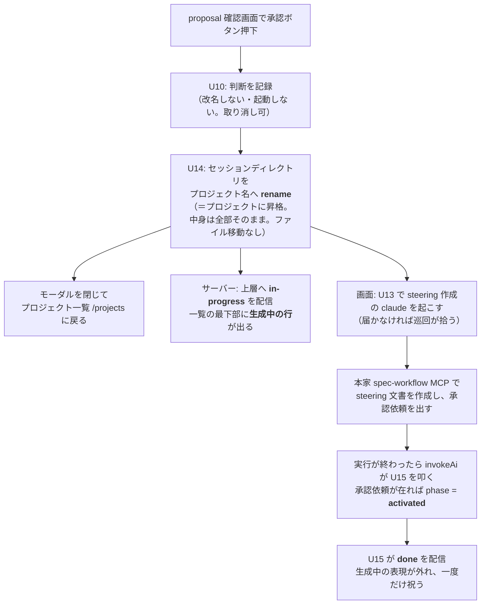
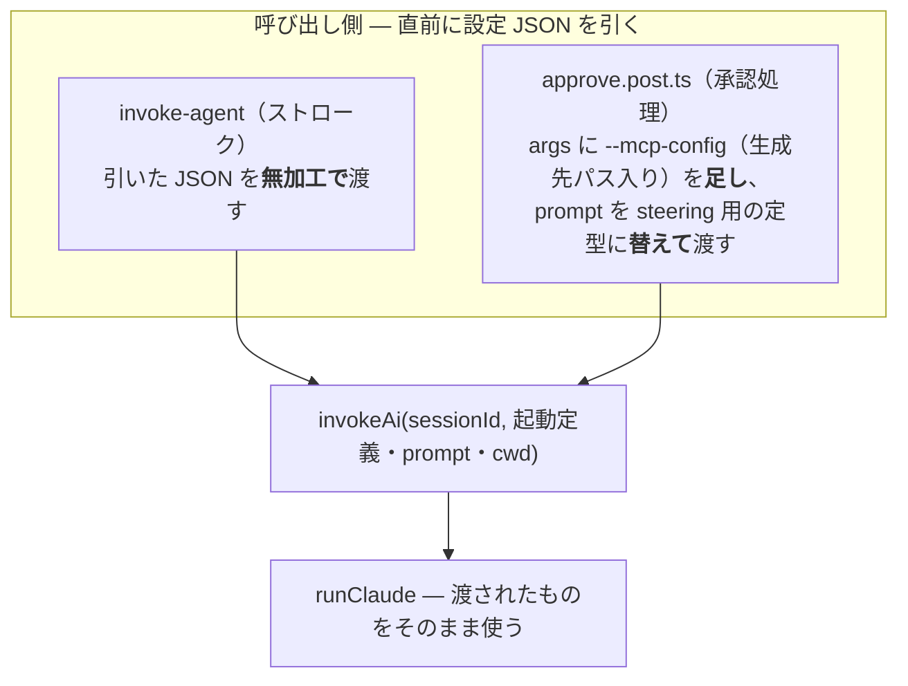
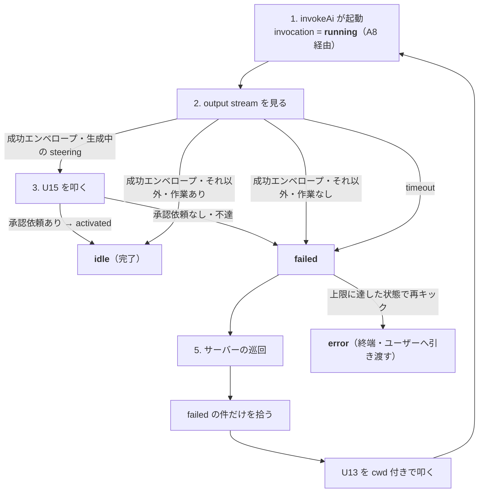
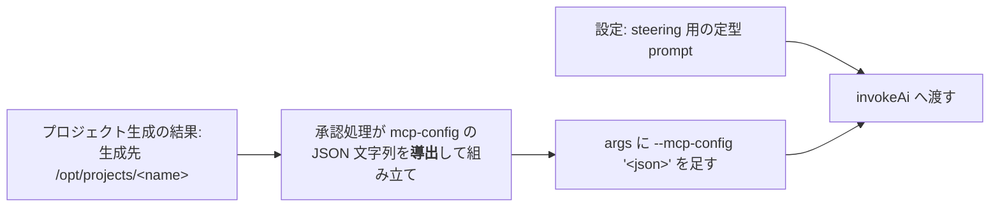

# 出口の接合 — 承認から steering 工程へ

実施: change [`connect-portal-and-strokes`](../../../openspec/changes/connect-portal-and-strokes/) ／ 決定: [ADR-0011](../../adr/0011-steering-stage-follows-approval.md)（承認の次の工程として steering 作成を自動で始める）／ 対: [portal-stroke-entrance.md](./portal-stroke-entrance.md)（入口の接合）

## 承認ボタン → 一覧へ戻る（モーダルの終わり方）

前提: **セッションの置き場とプロジェクトの置き場を `SPEC_WORKFLOW_SHARED_ROOT` に統一する**（その場所をどこにするかは設定の値の話で、ここでは決めない）。

`proposal.md` は**claude 自身がセッションの時点から `docs/` 配下に書く**。サーバーのコードは proposal.md を作らない。承認は3段に分かれる（change `separate-approval-decision-from-promotion`・2026-09-02）——**U10 で判断を記録し、U14 でセッションディレクトリをプロジェクト名へ rename（＝昇格）し、昇格の成功を見た画面が U13 で steering の claude を起こす**。届かなければ巡回が拾って起こす。判断は昇格の前なら取り消せる。中身は全部そのままプロジェクトに昇格し、ファイルの生成も移動も無い。画面はモーダルを閉じてプロジェクト一覧に戻る。steering 作成が自動で始まること自体は変わらない（ADR-0011）。



`.spec-workflow/` は本家 MCP が接続した瞬間にできるので、その有無は完了の根拠にならない（change `add-activated-phase`・2026-09-02）。生成中か完了かは `state.json` の phase（`approved` / `activated`）だけで決まり、行も配信も同じ根拠を見る。

※ `proposal.md` は最初から `docs/proposal.md`（セッション中も同じ場所）に、**claude 自身が書く**。サーバーのコードは作らない。

画面のイメージ — 承認でモーダルが終わり、一覧へ。**新プロジェクトは承認した直後から一覧の最下部に「生成中」として出る**（change [`show-pending-project-in-list`](../../../openspec/changes/show-pending-project-in-list/)）。行の地を変え、フォルダのアイコンの位置でローダーを回して進行中であることを示し、押せない。**行は明滅しない。** 決着すると、知らせる面が出て自ら引き、続けて次を選ばせるモーダルが出る:

```
(3) 承認を押す（モーダル）     (4) 一覧に戻る              (5) 決着すると
+--------------------+      +--------------------+      +--------------------+
|     ストローク      |      | 通知 | 一覧        |      | <name> の作成が     |
|  proposal 確認     | 承認 |  memo-app アクティブ |  …   |   完了しました！     |
|  [承認] [差し戻し]  | ---> |  srvgm    未接続    |      |    （自ら引く）      |
|                    |      |  <name>   生成中    |      +--------------------+
|                    |      |  <- すぐ出る（押せない）|             |
+--------------------+      +--------------------+             v
                                                   +--------------------+
                                                   | レビューしますか？   |
                                                   |   [する] [しない]   |
                                                   |  （選ぶまで閉じない） |
                                                   +--------------------+
```

失敗したときも同じ器で、選択肢が「やり直す / 破棄する」になる。**一覧に「作成に失敗」の行は残らない。**

更新は WS（board の `/ws`）で届く。一覧を開いたままでも再読み込みは要らず、定期取得もしない。

## 起動は1系統 — invokeAi の構造を変え、引数で渡す

今の `invokeAi(sessionId)` は起動定義・prompt を**中で** `runtimeConfig` から導出している。この構造をやめ、**呼び出し側が直前に設定 JSON を引き、sessionId の後ろに渡す**形にする。`invokeAi`／`runClaude` は渡されたものを使うだけになる。



- **系統は1つ**。`invokeAi` は呼び出し元を区別せず、ストロークと steering の違いは渡す引数の中身だけ
- 承認処理は rename の直後に `invokeAi` を**完了を待たずに**呼び、応答も起動を待たずに返す（画面はすぐ一覧へ戻れる）
- **cwd も呼び出し側が渡す**。ストロークはセッションディレクトリ（今と同じ値）、承認処理は**生成先プロジェクト `/opt/projects/<name>`** を渡す。steering の claude は生成されたプロジェクトの中で働く

## 完了とリトライ

> **この節は change の design.md D6 に置き換わった（2026-08-25）。** 当初は「claude 自身が API で提出を告知して完了とする」案だったが、並走している invokeAi が子プロセスの output stream を見れば足り、スキルへの依存が増えるだけなので採らなかった。実装は下の形である。

1. **起動**: invokeAi が claude を起こし、`invocation` を `running` にする（A8 経由）
2. **完了**: invokeAi が子プロセスの **output stream**（`--output-format json` の成功エンベロープ）で検知する。**AI 自身に告知させない**。作業が行われていなければ（提出が無ければ）`failed`
3. **完成の記録**（生成中の steering だけ・change `add-activated-phase`）: `idle` にする前に U15 を叩く。承認依頼が在れば phase が `activated` になり `idle`、無ければ `failed`。この判定が 2 の「作業が行われたか」に代わる（承認依頼が在れば作業は済んでいる）。完成済みの起こし直しとストロークは U15 を叩かず、2 の判定で `idle` / `failed`
4. **時間切れ**: タイムアウトで `failed` に変える
5. **リトライ**: サーバーの巡回が `failed` の件だけを拾い、path を cwd に添えて U13 を叩く。巡回に他の判定は持たせない
6. **終端**: リトライ上限に達したら起動せず `error`。回復はユーザーの再実行か削除だけ



- **提出告知のエンドポイントは足さない。** 完了の検知に AI の協力を要らなくしたため
- **retry 対象一覧のエンドポイントも足さない。** 巡回はセッション一覧（U12）の `invocation` を見れば足りる

## 設定に足すもの

`--mcp-config` は **JSON 文字列を直接受け取れる**（`claude --help` 実機確認: "Load MCP servers from JSON files or strings"）。config ファイルは作らない。



mcp-config は設定に持たない。**生成先パスから導出**して組み立てる。

何に何を追加するか:

| 追加先 | 追加するもの | 使われ方 |
|---|---|---|
| `nuxt.config.ts` の `runtimeConfig.claude`（非公開側。既存の `firstPrompt`/`continuePrompt` と同じ並び） | **steering 用の定型 prompt** 1キー | 承認処理が引いて `invokeAi` に渡す |
| `docs/specs/core/settings-reference.md`（設定の正） | 上記1キーの記載 | ここに無いものは設定ではない（ADR-0004）。改定には change とユーザー承認が要る |

## 実装の想定

手を入れる場所と、今→変更後の対応:

| # | 場所 | ファイル | 今 | 変更後 |
|---|---|---|---|---|
| ❶ | 実行管理 | `server/utils/stroke/ai.ts`・`claude.ts` | 起動定義・prompt・cwd を中で固定・導出 | 起動定義・prompt・cwd を呼び出し側から受け取る。**実行の記録を足す**: 起動時に session-id = running をメモリに記録し、timeout したら false に変える |
| ❷ | ストロークの呼び出し元 | `server/api/strokes/[id]/invoke-agent.get.ts` | `invokeAi(sessionId)` | 直前に設定 JSON を引き、無加工で渡す。cwd はセッションディレクトリ（挙動は不変） |
| ❸ | 承認の処理 | `server/api/strokes/[id]/approve.post.ts`・`server/utils/stroke/project.ts`・`session-store.ts` | サーバーのコードが proposal.md を書いている（A7 提出でサーバーが保存、`generateProject` が `docs/proposal.md` を新規生成。U10） | **サーバーのコードは proposal.md を作らない**。claude 自身がセッション時点から `docs/` 配下に書く。承認は**セッションディレクトリをプロジェクト名へ rename するだけ**（生成もファイル移動も無し）。その後、設定 JSON を引き、`--mcp-config`（生成先パス入り）と steering 用 prompt に差し替え、cwd に生成先を渡して `invokeAi` を**完了を待たずに呼ぶ** |
| ❹ | 提出告知のエンドポイント | `server/api/strokes/[id]/` に1つ追加 | 無し（既存 A5/A7 は承認済みを拒否） | claude からの提出の告知を受理し、session-id の記録を消す薄いエンドポイント |
| ❺ | retry 対象一覧のエンドポイント | `server/api/` に1つ追加 | 無し | retry 対象（false の session-id）一覧を返す |
| ❻ | 巡回 | サーバーの定期処理として登録 | 無し | ❺を拾い、順に起動し直すだけ。条件判定は持たない |
| ❼ | 設定 | `nuxt.config.ts`・`settings-reference.md` | セッションとプロジェクトの置き場は別（`NUXT_SESSIONS_ROOT` / `NUXT_PROJECTS_ROOT`） | **両者を `SPEC_WORKFLOW_SHARED_ROOT` に統一する**。steering 用 prompt の1項目も追加（いずれも ADR-0004 の手続きで） |
| ❽ | proposal 確認画面 | `app/pages/strokes/[sessionId]/proposal.vue` | 承認後も同画面に留まり承認済み表示 | 承認成功でモーダルを閉じて `/projects` に戻る |
| ❾ | テスト | approve・invoke まわりのユニット・E2E | 承認→承認済み表示の期待値 | 承認→一覧に戻る E2E。引数化・提出告知のエンドポイント・retry 対象一覧のエンドポイント・巡回のユニット |

## 仕様への影響

- `docs/specs/core/settings-reference.md` — セッションとプロジェクトの置き場を `SPEC_WORKFLOW_SHARED_ROOT` に統一・steering 用 prompt の1項目追加（ADR-0004: change とユーザー承認が要る）
- `openspec/specs/project-generation` — プロジェクトの作り方が「新規生成」から「セッションディレクトリの rename 昇格」に変わる（proposal.md はセッション時点から docs/ 配下に保存）
- `openspec/specs/ai-invocation` — 呼び出しの引数化と、承認処理からの呼び出しが増えること
- `openspec/specs/agent-api` — 提出告知・retry 対象一覧のエンドポイントの追加
- いずれも実装 change `connect-portal-and-strokes` が specs 差分として持つ

## 対象外

- steering 完了後の流れ（承認待ち・通知）— 既存の仕組みに乗るだけで、新設しない
- 入口側（作成ボタン→モーダル）— [portal-stroke-entrance.md](./portal-stroke-entrance.md) が扱う
