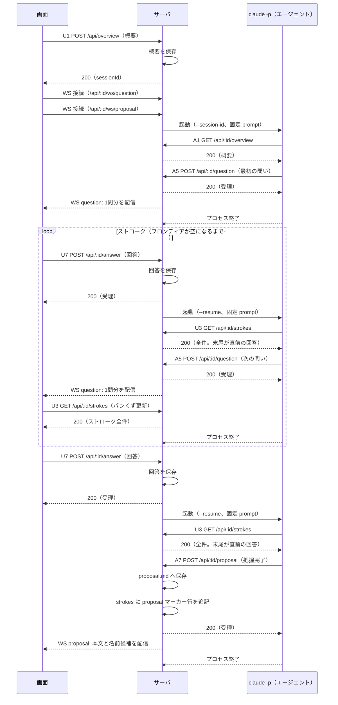
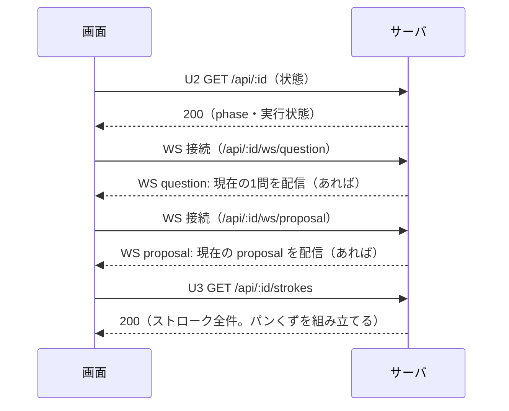

# design — migrate-claude-p-to-api-endpoint

## Context

現行のデータの受け取りは `server/utils/ai.ts` の `readOutcome` に集約されている。問いは標準出力のテキストから JSON 断片を切り出して読み取り（`ai-response.ts`）、proposal は `proposal.md` の mtime を呼び出し前後で比べて検出する（`session-store.ts` の `readProposalStamp`）。prompt は呼び出しのたびにユーザー入力を埋め込んで合成している（`prompt.ts`）。動機は proposal.md の Why を参照。

前提となる制約:

- `claude -p` の起動条件は ADR 0001（`--setting-sources project` 必須、prompt は `--` の後ろの位置引数1本）
- HTTP はステートレス。応答に人間の操作の結果を載せず、何かの完了を待って応答を保留しない。全 endpoint は受理・返却して即完結する
- ユーザーの回答は次の `claude -p` 呼び出し（`--resume`）の往復で渡る。往復の制御は現行どおりシステム側

## Goals / Non-Goals

**Goals:**

- エージェントとのデータのやり取り（入力の取得・成果の提出）を API に一本化する
- 標準出力の解析と mtime 監視を撤去する
- prompt を固定テンプレート化し、システムと claude プロセスを疎結合にする（agent-sdk や API 直叩きへの将来の入れ替えを単純にする）

**Non-Goals:**

- 起動方式・リトライ規定の変更（現行維持）
- 画面レイアウトの変更
- 認証の導入（単一ユーザー・ローカル前提。decisions.md の確定事項）

## Decisions

### 1. 1リソース1パス

リソースはドメインの名詞で切る。書き手は POST で書き、読み手は GET（状態・strokes）または WS 配信（問い・proposal）で読む。`sessions` の段も `/agent/` の段も置かない。`:id` は uuid 形式の検証（既存 `isSessionId`）で静的パス（`/api/overview`）と衝突しない。

### 2. POST は受理だけを返す

応答に結果や次の状態を載せない（使い道が無い）。全 POST が即 200 で完結し、例外は U1（セッション id の発行）だけ。

### 3. 問いと問い返しを区別しない

提出も回答も「今の1問」と「回答」の1組に畳む。区別を消費する者がいないため——配信は W1 に統合され、画面は自分の局面（phase）で扱いを決め、記録は strokes に一様に並ぶ。エージェントは phase もワークフローも一切意識しない。

### 4. endpoint は状況に依らず固定の一機能。応答も固定の一形

- POST 系: スキーマ検証 → 保存（→ WS 配信）。局面によって受理時の動きを変えない
- GET 系: 保存済みのものを返す。無ければ 404。再取得は冪等
- 応答のスキーマは endpoint ごとに1つ。phase や結果の種別で形を変えない
- ガードは 400 / 404 / 409 の拒否のみ（定義は「ガードの語彙」参照）。時刻・順序・呼び出し帰属は一切見ない

### 5. prompt は固定テンプレート。入力はエージェントが GET で取る

prompt にユーザー入力を埋め込む都度合成を廃止する。固定文面（形式と提出・取得先の規定のみ）に、セッション URL の1点だけを差し込む。システム側の動的処理が消え、claude プロセスを agent-sdk 等へ入れ替える際も prompt 合成ロジックの移植が不要になる。

### 6. エージェントの提出は受理の瞬間に WS で画面へ中継する

webhook 型で届く提出（A5・A7）を、サーバは受理した瞬間に該当チャネル（W1・W2）へ1件分そのまま流す。画面は受信を reactive な状態に入れて描画する。ポーリングも応答の保留もしない。切断・リロードは、接続時にそのチャネルの現在分を1件配信することで回収する。リトライを尽くした失敗だけは例外で、待機中の画面が U2 を読み直して拾う（U2 の定義を参照）。

### 7. セッションのファイルはすべてサーバが書く

エージェントによる cwd への直接書き込みをやめ、proposal は endpoint で受けた本文をサーバが `proposal.md` へ書く。strokes の記録もサーバが行う——U7 受理で（今の1問 + 回答）のペア行、A7 の初回受理で proposal マーカー行。書き手が1つになり、mtime 監視が不要になる。セッションディレクトリの構成（decisions.md）は変えない。

### 8. 制約（spec から移記）

ai-invocation の delta で Requirement から外した制約。実装はこれに従う。

- `claude` のセッションログ（トランスクリプトの `.jsonl`）を読み書きしない。画面に出す情報はアプリ自身が書いたファイルだけから組み立てる
- 標準出力をデータの受け取り口にしない。使うのはプロセスの成否の判定のみ
- endpoint は受理・返却して即完結する。何かの完了や人間の操作を待って応答を保留しない

## API 定義

### 一覧

**ユーザー（画面）が操作する endpoint — 6本**

| # | メソッド / パス | 内容 |
|---|---|---|
| U1 | `POST /api/overview` | 概要を投稿する（セッション開始。id を発行して返す） |
| U2 | `GET /api/:id` | セッションの状態（phase・呼び出しの実行状態）を見る |
| U3 | `GET /api/:id/strokes` | 済んだストロークの全件を見る（パンくず・粒開き。エージェントも末尾の回答を読む） |
| U7 | `POST /api/:id/answer` | 今の1問に回答する（ストロークの問い・問い返しの区別なし） |
| U9 | `POST /api/:id/send-back` | 差し戻す（指摘一式を送る） |
| U10 | `POST /api/:id/approve` | 承認する |

**エージェントが操作する endpoint — 4本**

| # | メソッド / パス | 内容 |
|---|---|---|
| A1 | `GET /api/:id/overview` | 概要を取得する |
| A4 | `GET /api/:id/send-back` | 差し戻しの指摘一式を取得する |
| A5 | `POST /api/:id/question` | 今の1問を提出する（ストロークの問い・問い返しの区別なし） |
| A7 | `POST /api/:id/proposal` | proposal を提出する |

対称性: リソースは「書き手 POST ↔ 読み手 GET」の1対。

| リソース | 書く | 読む |
|---|---|---|
| `/overview` | U1 | A1 |
| `/answer` | U7 | U3（strokes の末尾） |
| `/send-back` | U9 | A4 |
| `/question` | A5 | W1（WS 配信） |
| `/proposal` | A7 | W2（WS 配信） |

セッションの状態（U2）と `/strokes`（U3）は読み専用（システムが記録する。U3 は画面とエージェントの両方が読む）、`/approve`（U10）は操作のみ。

### 各 endpoint の入出力

同じ形の表が繰り返し現れるのは、(1) 同じリソースを書き手と読み手の両側から定義しているため、(2) 問い返しが構造上「問い」と同一で、意味だけを口で分けているため。長さ・件数の検証の正は `server/utils/question.ts` の zod スキーマ。

#### U1 `POST /api/overview` — 概要を投稿する

input:

| name | type | comment / eg |
|---|---|---|
| `overview` | string | 作りたいシステムの概要。空・空白のみは 400。eg: `勤怠を Slack で打刻できる社内ツールを作りたい` |

output:

| name | type | comment / eg |
|---|---|---|
| `sessionId` | string | 発行されたセッション uuid。画面遷移（`/s/<uuid>`）と以降の全 endpoint の `:id` に使う。eg: `3f2a8c1e-5b4d-4e2a-9c7d-1a2b3c4d5e6f` |

エラー: 400 概要が空

#### U2 `GET /api/:id` — セッションの状態を見る

リロード時に1回読み、どの画面を出すか（`stroking`=画面1 / `proposed` 以降=画面2）と待機・失敗の表示を決める。`failed` の検知はこれに加えて、**回答や差し戻しを送って待っている間の画面だけ**が数秒おきに読み直す（待機ウィンドウ限定。通常は W1 / W2 の配信が先に届いて待機が終わる）。`failed` のとき、ユーザーの再試行は同じ入力 POST（U7 / U9）の再送。

input: パスの `:id`（uuid）のみ。本文なし。eg: `GET /api/3f2a8c1e-5b4d-4e2a-9c7d-1a2b3c4d5e6f`

output:

| name | type | comment / eg |
|---|---|---|
| `phase` | string | `stroking` / `proposed` / `approved`。eg: `stroking` |
| `invocation` | string | `running`（呼び出し実行中）/ `idle`（何も実行していない）/ `failed`（リトライを尽くして失敗）。eg: `running` |

エラー: 404 セッションなし

#### U3 `GET /api/:id/strokes` — 済んだストロークの全件を見る

input: パスの `:id` のみ。本文なし

読み手は2者。画面はパンくず（粒の並びと proposal の位置）と粒開き（全文）に使い、エージェントは resume 起動時に**末尾要素の `answer`** を直前の回答として読む。記録のタイミングは2つ——回答（U7）を受理した瞬間に（今の1問 + 回答）のペア行を追記し、proposal（A7）を**初めて**受理した瞬間にマーカー行を追記する（出し直しでは増えない）。問い返しの往復も同じペア行として並ぶ。

output:

| name | type | comment / eg |
|---|---|---|
| `strokes` | { &nbsp;&nbsp;proposal: boolean, &nbsp;&nbsp;question: { &nbsp;&nbsp;&nbsp;&nbsp;header: string, &nbsp;&nbsp;&nbsp;&nbsp;detail: string, &nbsp;&nbsp;&nbsp;&nbsp;question: string, &nbsp;&nbsp;&nbsp;&nbsp;options: { &nbsp;&nbsp;&nbsp;&nbsp;&nbsp;&nbsp;label: string, &nbsp;&nbsp;&nbsp;&nbsp;&nbsp;&nbsp;description: string, &nbsp;&nbsp;&nbsp;&nbsp;&nbsp;&nbsp;recommended?: boolean &nbsp;&nbsp;&nbsp;&nbsp;}[] &nbsp;&nbsp;} \| null, &nbsp;&nbsp;answer: { &nbsp;&nbsp;&nbsp;&nbsp;kind: "option" \| "free", &nbsp;&nbsp;&nbsp;&nbsp;value: string &nbsp;&nbsp;} \| null }[] | 済んだ記録。古い順。まだ無ければ `[]`。`proposal: false` の行は問いと回答のペア（question=そのとき提示した問いの全体: header=話題タグ12字以内、detail=詳細説明300字以内、question=問い本文20字以内、options=選択肢1〜5件、label=見出し1〜5語、description=50字以内、recommended=推奨の印。answer=そのとき返した回答: kind=option か free、value=選んだ label か本文）。`proposal: true` の行は proposal 初提出のマーカーで question / answer は null。eg: `[{ "proposal": false, "question": { "header": "認証方式", "detail": "単一ユーザーの社内ツール", "question": "認証はどうする？", "options": [{ "label": "Google OAuth", "description": "Workspace でそのままログインできる", "recommended": true }] }, "answer": { "kind": "option", "value": "Google OAuth" } }, { "proposal": true, "question": null, "answer": null }]` |

エラー: 404 セッションなし

#### U7 `POST /api/:id/answer` — 今の1問に回答する

ストロークの問いへの回答も、問い返しへの回答も、この口で送る。受理の動きは常に同じ——（今の1問 + 回答）のペアを strokes に追記し、次の呼び出しを起動する。

input:

| name | type | comment / eg |
|---|---|---|
| `kind` | string | `option`（選択肢で回答）か `free`（自由入力で回答）。eg: `option` |
| `value` | string | `option` なら選んだ選択肢の `label`、`free` なら書いた本文。非空。eg: `Google OAuth` |

output: 本文なし（200 を返すのみ）

エラー: 400 形式不正 / 404 / 409 busy（実行中の追加送信）/ 409 phase

#### U9 `POST /api/:id/send-back` — 差し戻す

input:

| name | type | comment / eg |
|---|---|---|
| `response` | string | 指摘全体の人間可読の要約。eg: `認証まわりの前提が実態と違うので直してほしい` |
| `comments` | { &nbsp;&nbsp;id: string, &nbsp;&nbsp;type: "general" \| "selection", &nbsp;&nbsp;comment: string, &nbsp;&nbsp;timestamp: string, &nbsp;&nbsp;selectedText: string \| null, &nbsp;&nbsp;startOffset: number \| null, &nbsp;&nbsp;endOffset: number \| null, &nbsp;&nbsp;highlightColor: { &nbsp;&nbsp;&nbsp;&nbsp;name: string, &nbsp;&nbsp;&nbsp;&nbsp;bg: string, &nbsp;&nbsp;&nbsp;&nbsp;border: string &nbsp;&nbsp;} \| null }[] | 指摘の一覧。1件以上（0件は 400）。type=general（全体への指摘）か selection（本文の一部への指摘）。selection のとき selectedText=引用の全文、startOffset / endOffset=生テキストでの位置、highlightColor=色（name は yellow / green / blue / pink / orange）。general ではこれらは null。timestamp=ISO 8601。eg: `[{ "id": "c-01", "type": "selection", "comment": "社内は LDAP のみで SSO は使えない", "timestamp": "2026-08-19T14:32:05+09:00", "selectedText": "Google OAuth を採用する", "startOffset": 120, "endOffset": 131, "highlightColor": { "name": "yellow", "bg": "#fef9c3", "border": "#facc15" } }]` |
| `annotations` | string | 決定の記録（差し戻したという決定・指摘一覧・要約・時刻）を JSON 文字列化したもの。eg: `{"decision":"sent-back","comments":[{"id":"c-01","type":"general","comment":"認証前提を直す","timestamp":"2026-08-19T14:32:05+09:00"}],"summary":"認証前提の修正","timestamp":"2026-08-19T14:32:05+09:00"}` |
| `nextSteps` | string[] | 手続きの文字列の列。対応方法の指示は書かない。eg: `["proposal は差し戻された", "プロジェクトは作られていない", "proposal を出し直す"]` |

output: 本文なし（200 を返すのみ）

エラー: 400 指摘0件・形式不正 / 404 / 409 busy / 409 phase

#### U10 `POST /api/:id/approve` — 承認する

input:

| name | type | comment / eg |
|---|---|---|
| `projectName` | string | 確定するプロジェクト名。kebab-case。eg: `slack-kintai` |

output: 本文なし（200 を返すのみ）

エラー: 400 形式不正 / 404 / 409 name-conflict（同名のプロジェクトが既存）/ 409 phase / 500 生成失敗

#### A1 `GET /api/:id/overview` — 概要を取得する

input: パスの `:id` のみ。本文なし

output:

| name | type | comment / eg |
|---|---|---|
| `overview` | string | U1 で投稿された概要の全文。eg: `勤怠を Slack で打刻できる社内ツールを作りたい` |

エラー: 404 セッションなし

#### A4 `GET /api/:id/send-back` — 指摘一式を取得する

input: パスの `:id` のみ。本文なし

output:

| name | type | comment / eg |
|---|---|---|
| `response` | string | 指摘全体の人間可読の要約。eg: `認証まわりの前提が実態と違うので直してほしい` |
| `comments` | { &nbsp;&nbsp;id: string, &nbsp;&nbsp;type: "general" \| "selection", &nbsp;&nbsp;comment: string, &nbsp;&nbsp;timestamp: string, &nbsp;&nbsp;selectedText: string \| null, &nbsp;&nbsp;startOffset: number \| null, &nbsp;&nbsp;endOffset: number \| null, &nbsp;&nbsp;highlightColor: { &nbsp;&nbsp;&nbsp;&nbsp;name: string, &nbsp;&nbsp;&nbsp;&nbsp;bg: string, &nbsp;&nbsp;&nbsp;&nbsp;border: string &nbsp;&nbsp;} \| null }[] | 指摘の一覧。type=general（全体への指摘）か selection（本文の一部への指摘）。selection のとき selectedText=引用の全文、startOffset / endOffset=生テキストでの位置、highlightColor=色（name は yellow / green / blue / pink / orange）。general ではこれらは null。timestamp=ISO 8601。eg: `[{ "id": "c-01", "type": "selection", "comment": "社内は LDAP のみで SSO は使えない", "timestamp": "2026-08-19T14:32:05+09:00", "selectedText": "Google OAuth を採用する", "startOffset": 120, "endOffset": 131, "highlightColor": { "name": "yellow", "bg": "#fef9c3", "border": "#facc15" } }]` |
| `annotations` | string | 決定の記録（差し戻したという決定・指摘一覧・要約・時刻）の JSON 文字列。eg: `{"decision":"sent-back","comments":[{"id":"c-01","type":"general","comment":"認証前提を直す","timestamp":"2026-08-19T14:32:05+09:00"}],"summary":"認証前提の修正","timestamp":"2026-08-19T14:32:05+09:00"}` |
| `nextSteps` | string[] | 手続きの文字列の列。eg: `["proposal は差し戻された", "プロジェクトは作られていない", "proposal を出し直す"]` |

エラー: 404 セッションなし、または差し戻しがまだ無い

#### A5 `POST /api/:id/question` — 今の1問を提出する

ストロークの問いも差し戻しへの問い返しも、この口で提出する。エージェントは区別を宣言しない（どう扱うかは画面が自分の局面で決める）。

input:

| name | type | comment / eg |
|---|---|---|
| `header` | string | 話題タグ。12字以内。eg: `認証方式` |
| `detail` | string | 問いに関する詳細な説明。300字以内。eg: `単一ユーザーの社内ツール。Google Workspace は導入済みで、LDAP も併用されている` |
| `question` | string | 問い本文。20字以内。eg: `認証はどうする？` |
| `options` | { &nbsp;&nbsp;label: string, &nbsp;&nbsp;description: string, &nbsp;&nbsp;recommended?: boolean }[] | 選択肢。1件以上5件以内。label=見出し（1〜5語、文言で規定・語数の機械検証なし）、description=それを選ぶと何がどうなるか（50字以内）、recommended=省略可・推奨の印（`true` は全体で多くとも1つ）。eg: `[{ "label": "Google OAuth", "description": "Workspace アカウントでそのままログインできる", "recommended": true }]` |

output: 本文なし（200 を返すのみ）

エラー: 400 スキーマ不適合（長さ・件数超過含む）/ 404 / 409 phase

#### A7 `POST /api/:id/proposal` — proposal を提出する

input:

| name | type | comment / eg |
|---|---|---|
| `proposal` | string | proposal 全文（Markdown）。空・空白のみは 400。eg: `## Why\n打刻のたびに勤怠画面を開く手間を無くす。` |
| `projectName` | string | 省略可。kebab-case のプロジェクト名の候補。kebab-case でなければ候補として採用しない（受理は妨げない）。eg: `slack-kintai` |

output: 本文なし（200 を返すのみ）

エラー: 400 本文が空 / 404 / 409 phase

### ガードの語彙

4つだけ。どれも受信時点の現在状態を見る述語で、時刻・順序・どの呼び出しに属する提出かは見ない。

- **404** — セッションが存在しない。GET では対象がまだ保存されていない場合も含む
- **400** — 本文がスキーマを満たさない
- **409 phase** — セッションの現在の phase がその操作を受け付けない
- **409 busy** — そのセッションで呼び出しが実行中のため、画面からの追加送信を受け付けない（多重起動の防止。U7・U9 のみ）

409 phase の対応は次のとおり。

- エージェントの提出（A5・A7）と画面の回答（U7）: `stroking` と `proposed` で受理。`approved` は拒否
- U9 `/send-back` と U10 `/approve`: `proposed` のみ受理

409 は呼び出し元（エージェントまたは画面）に返り、正しい口へ出し直せる。`approved` を全提出で拒否するのは、完結した記録（`proposal.md`）の上書きを防ぐため。中身の判断（proposal を出すのが早すぎる等）は検証しない——回復はワークフロー側（差し戻し・回答・タイムアウト→リトライ）。

### 参考: 実装の型対応

問い = `Question` / `QuestionOption`、回答 = `Answer`、ストローク = `Stroke`、指摘 = `Annotation`、指摘一式 = `SendBackPayload`（`shared/types.ts`）。集約応答を廃止したため、`SessionView` / `StrokeResult` / `ApproveResult` は API から消え、画面は WS 受信と GET を組み合わせて表示を組み立てる形へ実装側の変更が要る。`Stroke` は proposal マーカー行の追加（`proposal` / null 許容の `question`・`answer`）で型の調整が要る。検証の正は `server/utils/question.ts` の zod スキーマ。`projectPath` は応答に置かない（パスの観念を画面に出さない。refine-project-name-display の方針に合わせる）。

## シーケンス（WS 構成）

エージェントの提出をサーバが受理した瞬間、その1件分を WS チャネルでブラウザへ配信し、ブラウザはそれを表示する。概要の投稿から proposal が出るまで。

リロード時:

差し戻しは、画面の入口が U9、エージェントの取得が A4、提出が A5（問い返し）または A7（出し直し）になり、配信が question チャネル（問い返し）または proposal チャネル（出し直し）になるほかは上と同型。問い返しへの回答も U7 で送られて strokes に追記され、エージェントは U3 の末尾で読む。承認（U10）はエージェントが関与しない既存フローのまま。

タイムアウト（起動後、受理された提出が無いまま設定値の時間が過ぎる）の場合は、その呼び出しを失敗として扱い、既存のリトライ（続きを促す再起動）へ流れる。

### WS チャネル定義

チャネルは1本につき1リソース・固定の一形。方向はサーバ→画面のみで、画面からは何も送らない。

#### W1 `/api/:id/ws/question` — 今の1問分

- 配信のタイミング: A5 の提出を受理した瞬間。接続時にも、現在の1問があればそれを1件配信する
- 表示規則: 画面は最後に届いた1件で表示を上書きする

メッセージ（1件分）:

| name | type | comment / eg |
|---|---|---|
| `header` | string | 話題タグ。12字以内。eg: `認証方式` |
| `detail` | string | 問いに関する詳細な説明。300字以内。eg: `単一ユーザーの社内ツール。Google Workspace は導入済みで、LDAP も併用されている` |
| `question` | string | 問い本文。20字以内。eg: `認証はどうする？` |
| `options` | { &nbsp;&nbsp;label: string, &nbsp;&nbsp;description: string, &nbsp;&nbsp;recommended?: boolean }[] | 選択肢。1件以上5件以内。label=見出し（1〜5語、文言で規定）、description=それを選ぶと何がどうなるか（50字以内）、recommended=省略可・推奨の印（`true` は全体で多くとも1つ）。eg: `[{ "label": "Google OAuth", "description": "Workspace アカウントでそのままログインできる", "recommended": true }]` |

#### W2 `/api/:id/ws/proposal` — proposal と名前候補

- 配信のタイミング: A7 の提出を受理した瞬間。接続時にも、現在の proposal があればそれを1件配信する
- 表示規則: 画面は最後に届いた1件で表示を上書きする

メッセージ（1件分）:

| name | type | comment / eg |
|---|---|---|
| `proposal` | string | 最新の proposal 全文（Markdown）。eg: `## Why\n打刻のたびに勤怠画面を開く手間を無くす。` |
| `projectName` | string \| null | プロジェクト名の候補。無ければ null。eg: `slack-kintai` |

## Risks / Trade-offs

- [エージェントが endpoint を叩かない・叩けない（HTTP を発行するツールが許可されていない）] → 起動設定の `allowedTools` で HTTP 発行手段を確保する。叩かれなければタイムアウトで失敗になり、既存のリトライへ流れる
- [エージェントが誤った GET を読んで進む・中身の判断を誤る] → システムは防がない（防ぐ機構を持たない）。差し戻し・回答・リトライというワークフローの回復経路に任せる
- [リトライと提出の交錯で同じセッションに複数の提出が届く] → 受理はファイルへの上書きで、最後に受理・配信されたものが画面に出る。壊れた状態にはならない
- [WS が切れている間に配信が起きる] → 再接続（EventSource 相当の自動再接続は `useWebSocket` に任せる）のたびに、チャネルの現在分が接続時配信で届いて回収される
- [認証が無いため、ローカルの他プロセスから提出できてしまう] → MVP は単一ユーザー・ローカル前提（確定事項）。listen は localhost に限定する

## Migration Plan

1. エージェント向け endpoint（A1・A4・A5・A7）と strokes の記録（ペア行・マーカー行）を追加する（この時点では旧経路と共存）
2. WS チャネル（W1・W2）と受理時の配信・接続時の現在分配信を追加する
3. 画面向けを新構成（U1・U2・U3・U7・U9・U10）へ再編し、WS 受信ベースの描画へ切り替え、`shared/api-contract.md` を更新する
4. prompt を固定テンプレートへ切り替える
5. `readOutcome` を廃し、`parseQuestionResult` / `parseProjectName` / `readProposalStamp` を削除する
6. 一連のストローク→proposal→差し戻し→承認を実機で確認する

ロールバックは手順の逆順。データ形式（`state.json` / `strokes.json`）は変えないため、セッションの互換は保たれる。
