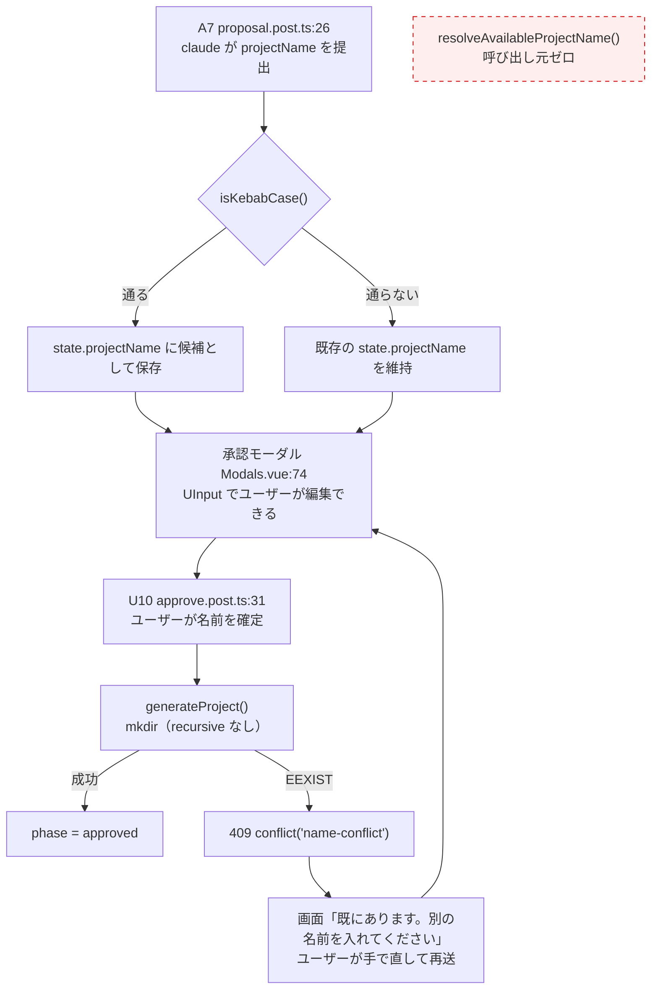

## Why

**`resolveAvailableProjectName()` はどこからも呼ばれていない。**

起票時は「連番採番に終了条件が無い」という前提だったが、事実確認で2点とも崩れた。

**1. 無限ループではない。**

```ts
const existing = new Set(await readdir(resolveProjectsRoot()))   // 有限のスナップショット
for (let n = 2; ; n++) {
  const name = `${candidate}-${n}`                                // すべて相異なる
  if (!existing.has(name)) return name
}
```

`existing` はループ内で変化しない有限集合。生成する名前は相異なるので、`existing` に含まれるものは高々 `|existing|` 個。遅くとも `n = |existing| + 2` で必ず `return` する。**終了条件は既にある**（集合が有限であること）。上限は要らない。

**2. 承認の経路に乗っていない。**



AI が出すのは**候補**、確定するのは**ユーザー**（`CONTEXT.md`「承認」）。衝突は 409 で画面へ返り、ユーザーが手で直す。採番が挟まる余地は今の配線に無い。

**仕様も採番を求めていない。** `openspec/specs/project-generation/spec.md` の「生成の直前に既存名との衝突を確認する」は「既に存在する場合は何も書き込まない／衝突を伝える」だけで、別名への振り替えは求めていない。`openspec/specs/` 全体（18 capability）を「採番 / 連番 / サフィックス」で検索してもヒットは無い。

この関数は**仕様の外にある死蔵コード**である。残す根拠が無い。

## What Changes

**削除する。上限は設けない。**

- `resolveAvailableProjectName()` を削除
- 同関数でのみ使っていた import（`readdir` / `resolveProjectsRoot`）を落とす

衝突時の挙動（409 `name-conflict` → ユーザーが名前を直す）は**変更しない**。仕様どおりで、実装も既にそうなっている。

## Capabilities

### New Capabilities

なし。

### Modified Capabilities

なし。

削除対象に対応する Requirement が `openspec/specs/` に存在しないため、`ADDED` も `REMOVED` も出ない。この削除は仕様を1文字も動かさず、むしろ「仕様に無い機能がコードにある」食い違いを解消する。`.openspec.yaml` に `skip_specs: true` を立てる。

## Impact

- `server/utils/stroke/project.ts` — 関数1つと import 2件の削除のみ

**出どころ**: `docs/known-issues.md` の「プロジェクト名の連番採番に上限が無い」。この記述自体が誤りだった。同資料は既に存在しない。
