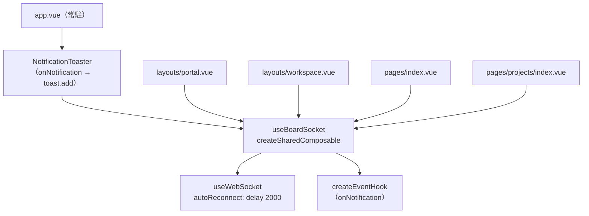
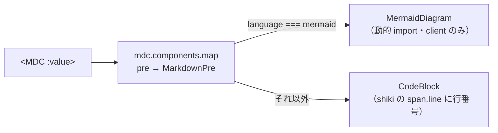
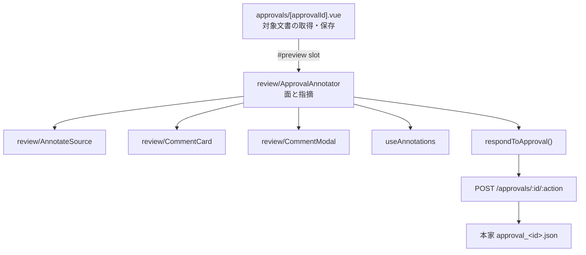
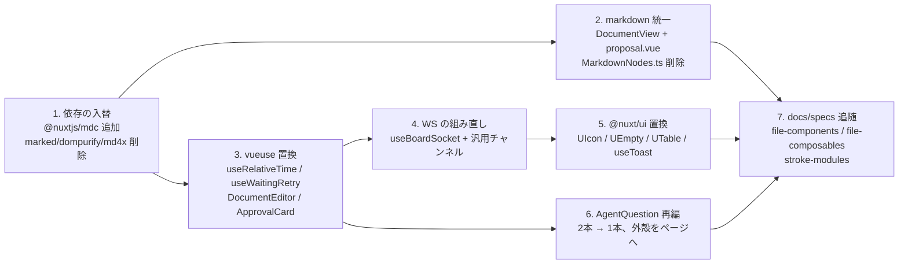

# design — replace-handrolled-with-libraries

## Context

動機と範囲は proposal.md。判定の本体は `docs/specs/plan/composables-library-replacement.md` と `docs/specs/plan/components-library-replacement.md`（spec-workflow 承認済み）。ここでは、その2枚が「実装時の design で確定する」と残した点を決める。

現状のコードで、この change が触る所だけを挙げる。

| 場所 | 今の形 |
| --- | --- |
| `app/composables/shared/useBoardSocket.ts` | モジュール変数 `shared` でシングルトン。生 WS + `close` で 2秒後に再接続。ハンドラは `Set` |
| `app/composables/useQuestionChannel.ts` / `useProposalChannel.ts` | 各24行。`useWebSocket` + `autoReconnect`。URL 組み立てが逐語で重複 |
| `app/components/shared/NotificationToaster.vue` | `app.vue` 直下に常駐。`toasts` ref + `timers` Set を自前管理。`data-testid` は `toaster` / `toast` / `toast-dismiss` |
| `app/components/stroke/QuestionCard.vue` | 画面1に素置き。送信ボタンを本文内に持つ（「送信」`size=lg`） |
| `app/components/AgentQuestionModal.vue` | `UModal` の外殻 + 中身。送信ボタンは footer slot（「答える」） |
| `app/components/workspace/DocumentView.vue` | `await init()` で WASM を待ってから `parseAST` → `MarkdownNodes` |
| `app/pages/strokes/[sessionId]/proposal.vue` | `marked.parse` → `DOMPurify.sanitize` → `v-html` が2箇所 |
| `nuxt.config.ts` | `modules: ['@nuxt/ui']` のみ |

## Goals / Non-Goals

**Goals:**

- 置換の方式を1つに決め、実装が分岐を持たない状態にする
- 検証を「本家と同一」で固定できる形にする（`:ui` 上書き後の描画をテストで押さえる）

**Non-Goals:**

- 公開インターフェースと参照元の変更（`useBoardSocket` の呼び出し形、各 composable の返り値）
- 置き場・責務・境界の切り直し（`flatten-composables` / `separate-composable-responsibilities` / `realign-component-composable-boundaries` / `reorganize-components` の軸）
- `useAgentQuestion` の `base` が `/api/${sessionId}` になっている件（`fix-agent-question-api-path` の範囲。ここでは触らない）

## Decisions

### 決定1: `useBoardSocket` の共有は `createSharedComposable` + `app.vue` 常駐購読（案 b）



`createSharedComposable` は参照カウント式で、購読 scope が全て消えると state を破棄する。単独では「接続はアプリ全体で1本、画面遷移で張り替えない」を満たさない。

**`NotificationToaster` が `app.vue` 直下にあり、`useToast` 化しても `onNotification` → `toast.add()` の変換役として残る**ため、常駐購読の置き場が既に存在する。レイアウト切替で購読者ゼロ区間は生じない。

案 a（`createGlobalState`）を採らない理由: `createGlobalState` はモジュールスコープに state を持つため、**SSR でリクエスト横断の共有が起きる**。現行のモジュール変数と同じ欠陥をそのまま引き継ぐ。案 b は per-call で素通しになり、この欠陥が消える。

### 決定2: 汎用チャンネルは呼び出し側がパスを渡す。ラッパは残さない

`useQuestionChannel` / `useProposalChannel` を削除し、参照元3箇所が `useSessionChannel<T>(sessionId, channel)` を直接呼ぶ。

判定の本体（`docs/specs/plan/composables-library-replacement.md`）は「**2本 → 1本**」と定め、呼び出し形（ラッパを残すか、呼び出し側がパスを渡すか）だけを design に委ねている。ラッパを残すと `useSessionChannel` + ラッパ2本で**3ファイルに増え**、「2本 → 1本」に合わない。

ラッパを採らない理由: ラッパの中身は**返り値に名前を付け直すことだけ**で、購読先と型は `'question'` / `<Question>` という**ただの引数**にすぎない。8行のファイルを2本置く理由がない。

参照元の変更は3箇所に閉じる。

| 参照元 | 変更後 |
| --- | --- |
| `pages/strokes/[sessionId]/index.vue` | `const question = useSessionChannel<Question>(sessionId, 'question')` |
| `useAgentQuestion.ts` | 同上 |
| `useProposalReview.ts` | `const proposalMessage = useSessionChannel<ProposalMessage>(sessionId, 'proposal')` |

W1 / W2 という契約の名前は、`useSessionChannel` の冒頭コメントと呼び出し行のコメントで保つ。

### 決定3: 送信ボタンは `AgentQuestion` の中に置き、文言だけ props で受ける

```
画面1（index.vue）:
  <AgentQuestion :question :waiting submit-label="送信" @answer="answer" />

画面2（proposal.vue）:
  <UModal v-model:open="followupOpen" :dismissible="false" :close="false">
    <template #body>
      <AgentQuestion :question :waiting :answered submit-label="答える" @answer="…" />
    </template>
    <template #footer>
      <span class="text-xs text-muted">答えると、AI がさらに聞いてくることがあります</span>
    </template>
  </UModal>
```

選択・自由入力・排他・notice・送信判定が全て component に閉じ、親は `@answer` を受けるだけ。現行の `QuestionCard` と同じ形になる。

ボタンを外に出す案（`defineExpose` / `v-model`）を採らない理由:

- `defineExpose` は親が子のメソッドを叩く形になる
- `v-model` で回答の下書きを親へ出すと、描画に要る `picked` / `free` は子に残るため状態が二重になる。加えて自由入力を全部消したとき `draft` は `null → null` で変化せず、**親の watch では notice をクリアできない**（現行は `writeFree('')` で消える）

画面2の見た目の差分は、`UModal` の `content` が持つ `divide-y divide-default` による**区切り線がボタンの上から消える**こと（footer には注記だけが残る）。実装して画面2を確認し、収まりが悪ければ footer に戻す（tasks 6.7）。

### 決定4: 内部の寸法はモーダル側（`text-lg` / `p-3` / `rows=2`）に揃える

統合すると1本になるので、どちらかに決めるしかない。分岐（`size` props）を作らない。

モーダル側を採る理由: 画面2は `UModal` の `max-w-2xl` に収める必要があり、大きい寸法だと縦に伸びてスクロールが要る。画面1は素置きで幅の制約がなく、小さい寸法でも成立する。**制約が厳しい側に合わせれば両方成立する。**

画面1の見た目は変わる（問い本文 `text-2xl` → `text-lg` ほか）。振る舞いは変わらない。

### 決定5: `formatTimeAgo` の未来時刻は現行の挙動を維持する

`messages` の future 側にも「たった今」相当を注入し、負の elapsed が future 文言に変わらないようにする。この change は振る舞いを変えない前提のため、許容側は採らない。

あわせて `invalid: '—'`・`rounding: 'floor'`・`units` で day を最大単位に指定する。ISO 文字列 → `Date` の変換は `useRelativeTime` の中に残す（シグネチャを変えない）。

### 決定6: mermaid の後段を入れ、`pre` の受け口を自前に差し替える（2026-08-25 改訂）

**当初は「後段を入れない」と決めていた。** 理由は「入れれば新しい振る舞いが増え、振る舞いを変えない純粋なリファクタという性格（`skip_specs: true` の根拠）が崩れる」だった。

これを覆す。proposal が置いた方針の序列は **本家に近づけるを最大限優先**（検証基準は「現行と同一」ではなく「本家と同一」）→ 制約記述を據置理由にしない → 自前実装の禁止、である。本家（spec-workflow-mcp）は `mermaidPlugin.tsx` で mermaid を描いており、**「現行と同一」を守るために本家との差を残すのは、この序列の上位を下位で覆すことになる**。序列に従い、後段を入れる。



- 受け口は `app/components/global/MarkdownPre.vue`。**`global/` に置くのは必須**で、MDC は map の値を `resolveComponent(名前)` で引くため、`app.component()` 登録される `components/global/` 以外では名前が解けない（実測）
- `MarkdownPre` は props を宣言せず `$attrs` で受ける。宣言すると属性として出ず、`CodeBlock` に shiki のクラスが届かない
- `MermaidDiagram` は `import('mermaid')` の動的 import で、`import.meta.client` ガードの内側に置く。**mermaid は `getBBox` などの DOM 計測を使うため Nitro では動かない**。SSR とハイドレーション直後は「Loading diagram...」の枠を出して両者を一致させ、`onMounted` 以降に SVG へ差し替える（`DocumentView` の SSR 前提を壊さない）
- テーマ変数は本家 `hooks/useMDXEditorTheme.ts` の `mermaidThemeVariables` の写し。値を足したり寄せたりしない

#### `v-html` は mermaid の SVG に対して残る

proposal は「markdown 処理・サニタイズ・v-html がアプリのコードから全て消える」と書いたが、**`MermaidDiagram` は mermaid が組み立てた SVG を `v-html` で差し込む**。本家も同じ（`dangerouslySetInnerHTML`）。文書由来の生 HTML を描く経路（`rehype-raw`）は切ったままで、ここに入るのは mermaid 自身の出力に限られる。

#### `skip_specs: true` の根拠が変わる

旧決定6 は `skip_specs: true` の根拠に紐づいていた。後段を入れることで、**この change は「振る舞いを変えない純粋なリファクタ」ではなくなる**（mermaid フェンスの描画という振る舞いが増える）。`.openspec.yaml` の `skip_specs` を維持するか、`document-editing` などへ delta spec を起こすかの判断が要る。

### 決定7: `DocumentView` の `await init()` は廃止する

`<MDC :value>` は SSR で描けるため、WASM の初期化待ちが不要になる。`<script setup>` 直下の `await` が消え、ページの Suspense 待ちも1つ減る。`EmptyState` フォールバックは残す。

### 決定8: トーストのテスト用属性は `useToast` 移行後の実体に張り直す

`NotificationToaster` の markup が `UToast` に替わるため、`data-testid="toaster"` / `"toast"` / `"toast-dismiss"` と `data-tone` は現行の要素ごと消える。E2E は `UToast` が出す構造に対して張り直す。**この張り直しは「本家と同一」の検証タスクそのもの**で、置換の条件（`notification-toast` の Requirement を満たすか）をここで固定する。

### 決定9: 承認への応答に差し戻しと注釈を持たせる（2026-08-25 追加）

`project-workspace` は「差し戻し（`needs-revision`）は持たない。本家のそれは注釈コメントを前提にした流れで、stroke-board はコメントを持たないため」と定めていた。**前提だった「コメントを持たない」が成り立たなくなった**ので、この記述を覆す。



- 面の構成（`preview` / `annotate` / `side-by-side`）と指摘の持ち方（生テキストへの文字オフセット + 引用）は、**ストローク側の画面2 と同じ**。`review/` の部品（`AnnotateSource` / `CommentCard` / `CommentModal`）と `useAnnotations` をそのまま使う
- **`preview` の中身は `ApprovalAnnotator` が決めない。** 承認画面は対象文書をその場で直せる（`document-editing`）ため、そこに何を置くかは呼ぶ側が `#preview` スロットで渡す。スロットは面を切り替えても外さない（外すと編集の直しかけが黙って消える）
- 承認・却下は `ApprovalCard`（承認一覧）が持ち続ける。指摘を運ぶのは差し戻しだけなので、指摘の面には承認・却下を置かない

#### 3つのフィールドに分けて渡す

`response`（人間可読の要約）・`annotations`（JSON 化した記録）・`comments`（構造化配列）の3つを別々に送る。1本のテキストに畳むと**箇所と指摘の対応が失われる**。本家 `ApprovalsPage.tsx` が組む形（`decision` / `comments` / `summary` / `timestamp`）に合わせる。

`response` の上限は 2000 → 200000 に上げた。差し戻しの `response` は人が書いた文ではなく**コメントから組み立てた要約**で、件数に比例して伸びるためである。上限は action ごとに変えず、一番長くなる差し戻しに合わせて1本で持つ。

#### 境界で弾くもの

zod のスキーマを緩めて素通しにしない。書くのは本家でも、**何を書かせるかを決めているのはこの口**である。

| 条件 | `statusMessage` |
| --- | --- |
| 差し戻しでコメントが0件 | `revision-needs-comments` |
| 却下で理由が空 | `reject-needs-reason` |
| 承認・却下に注釈が付いている | `annotations-need-revision` |

失敗の理由は保存（`reasonOf`）と混ぜず、承認用の `approvalReasonOf` を別に持つ。同じ `statusMessage` でも意味が違う（「見つからない」は保存では文書、承認では承認依頼そのものを指す）。

## Risks / Trade-offs

| リスク | 対処 |
| --- | --- |
| `UTable` で `sb-datatable` の様式（行頭 40px タイル・2段テキスト・目のアイコン）を再現できない | 5本の中で最も再現コストが高い。`:ui` と cell slot で再現できるかを最初に検証し、**満たせなければこの1本だけ据置に戻す**（他の置換は独立に成立する） |
| `UIcon` + `customCollections` で描画属性（stroke-width / linecap / fill）が変わる | 現行の SVG パスをそのまま IconifyJSON body として登録する。絵は変えない。`SbIcon` 冒頭の「アイコンセットを勝手に選ばない」との関係は、**別セットの選定ではなく現行パスの登録**である旨を実装前にユーザーへ確認する |
| `useToast` で右上固定・本家の Tailwind 階調（`*-50/-200/-800`・ダーク `*-900/20`）を再現できない | `duration: 5000`・`progress: false`・本体クリック無反応は実測で適合済み。位置と階調は `:ui` 上書きで検証し、満たせなければ採らない |
| MDC が正常リンクに `rel="nofollow"` を自動付与する | 本家との差分として認識する。spec の Requirement には抵触しない |
| MDC の AST payload（`__NUXT_DATA__`）に script の本文文字列が残存する | 実行はされない（ProseScript が本番で何も描画しない）。実測確認済み |
| 案 b で `NotificationToaster` を `app.vue` から外すと接続が切れる | `app.vue` 直下に置き続けることが決定1の前提。移動は `reorganize-components` の軸でも行わない |
| `justSaved` の残留（`useTimeoutFn` の `stop()` は timer 停止のみ） | 呼び出し箇所に `justSaved.value = false` を残す。残さないと保存後3秒以内の文書切替でチップが残る |

## Migration Plan



3・6 は他と独立で、先に倒せる。4 は 5 の `useToast`（`NotificationToaster` の常駐購読）と接するため 5 の前に置く。2 は 1 に続けて倒す。

ロールバックは段ごと。各段は他段に依存せず戻せる（`UTable` だけ据置に戻す、が成立するのはこのため）。
