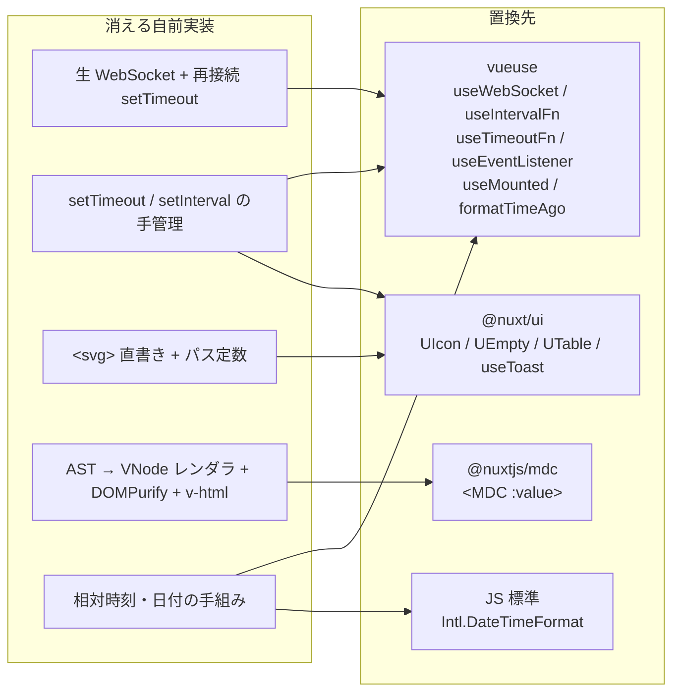

# proposal — replace-handrolled-with-libraries

## Why

`app/composables/` と `app/components/` に、vueuse / @nuxt/ui / Nuxt 標準で置き換えられる自前実装が残っている。生 WebSocket の張り直し、`setTimeout` / `setInterval` の手管理、`<svg>` の直書き、AST → VNode の自前レンダラ、markdown 描画の2系統併存。いずれも**本家 spec-workflow-mcp に近づけるうえで持つ理由がない**うえ、サニタイズのような安全策まで自前で抱えている。

置換対象は composables と components にまたがり、`useBoardSocket` の組み直しは `NotificationToaster` と、`AgentQuestion` の再編は `useAgentQuestion` と不可分。分割すると自前実装とライブラリが混在する中間状態が生まれるため1本で行う（2026-08-25 合意）。

判定は `docs/specs/plan/composables-library-replacement.md` と `docs/specs/plan/components-library-replacement.md` で確定済み（spec-workflow 承認済み）。本 change はそれを実装へ落とす。

## What Changes

方針の序列: **本家に近づけるを最大限優先**（検証基準は「現行と同一」ではなく「本家と同一」）→ 制約記述を據置理由にしない → **自前実装の禁止**。

### composables — 置換3・集約2→1・据置5

- `useBoardSocket`: トランスポートを `useWebSocket` + `createEventHook` で組み直す。**接続はアプリ全体で1本**の要件を満たすため、`createGlobalState`（案 a）か `createSharedComposable` + 常駐購読（案 b）のどちらかを design で確定する。再接続間隔は `autoReconnect: { delay: 2000 }` で現行に揃える
- `useRelativeTime`: `formatTimeAgo` に差し替え（`messages` で日本語、`invalid: '—'`、`rounding: 'floor'`、`units` で day を最大単位に）
- `useWaitingRetry`: timer 管理のみ `useIntervalFn` に委譲。SSR ガードは温存する
- `useQuestionChannel` + `useProposalChannel`: 同型の2本を、パスと型を引数に取る**汎用チャンネル1本**へ集約
- 据置5本（`useProjectApi` / `useSteeringDocuments` / `useAnnotations` / `useAgentQuestion` / `useProposalReview`）は消える自前実装が無い

### components — 置換5・部分置換3・再編2→1・削除1・据置8

- `SbIcon` / `UpstreamIcon` → `UIcon` + `customCollections`。**現行の SVG パスをそのまま IconifyJSON として登録し、絵は1ピクセルも変えない**。出どころ2系統はコレクション名（`sb:` / `upstream:`）で保つ
- `EmptyState` → `UEmpty`、`RecordList` → `UTable`（いずれも `:ui` 上書きで本家の様式を再現）
- `NotificationToaster` → `useToast`（`UApp` の toaster）。`duration: 5000`・`progress: false`・本体クリック無反応は実測で適合確認済み
- `DocumentEditor`: `beforeunload` を `useEventListener`、`savedNotice` を `useTimeoutFn`、`mounted` を `useMounted` へ。**`justSaved.value = false` は状態機械側の責務として呼び出し箇所に残す**
- `ApprovalCard`: `formatDate` を `Intl.DateTimeFormat('ja-JP', { month: 'long', ... , hourCycle: 'h23' })` へ
- `DocumentView`: 描画経路を `<MDC :value>` へ
- `QuestionCard` + `AgentQuestionModal` → **`AgentQuestion` 1本**。外殻（`UModal`）はページ側へ畳む
- **削除**: `MarkdownNodes.ts`（役割は MDC の parse 時フィルタと Prose コンポーネントが引き受ける）

### markdown 描画の統一

- 全画面を `@nuxtjs/mdc`（`<MDC :value>` + `headings.anchorLinks: false`）の1方式に統一。**markdown 処理・サニタイズ・v-html がアプリのコードから全て消える**
- 依存: `marked` / `isomorphic-dompurify` / `md4x` を削除、`@nuxtjs/mdc` を追加（3 → 1）
- 正常リンクへの `rel="nofollow"` 自動付与は本家との差分として認識する
- mermaid の後段（SVG 化）を入れるかは design で確定する

### 追随して直すもの

- `docs/specs/core/file-components.md`（`question/` 区分に2本が載っている）
- `docs/specs/reference/stroke-modules.md`（`AgentQuestionModal` の規定）
- `docs/specs/core/file-composables.md`（集約後の一覧）

## Capabilities

**当初は `skip_specs: true`（振る舞いを変えない純粋なリファクタ）としていた。2026-08-25 に取り下げた。** 範囲に2つの振る舞いの増分が入ったためである。

- design 決定6 の改訂で、**mermaid のフェンスを図として描く**ようになった（それまでどの経路でも描画されていなかった）
- 承認画面に**注釈と差し戻し（`needs-revision`）**が入り、サーバ API の受け口が変わった（action の追加、`annotations` / `comments` フィールドの追加、`response` の上限 2000 → 200000）

置換そのもの（vueuse / @nuxt/ui / MDC への載せ替え）については当初の判断のままで、Requirement は変わらない。関連する既存 spec（`notification-toast` / `agent-question` / `document-editing` / `proposal-review` / `notification-feed` / `app-structure`）は置換の前後で満たされ続けることが要件であり、検証を通すために Requirement を作らない。

### New Capabilities

- `markdown-rendering`: markdown の描画。生 HTML を要素にしないこと、mermaid のフェンスを図として描くこと、それ以外のフェンスをコードブロックとして描くこと
- `project/ui`: `project-workspace` を `project/` 名前空間へ立て直したもの。下層4画面の仕様に加えて、「下層で状態を変えられるのは承認への応答だけ」から**差し戻しを持たない**という記述を外して差し戻しが注釈コメントを運ぶことを定め、承認対象の文書に箇所を指した指摘を付けられること、指摘を3つのフィールドに分けて本家へ渡すことを加える

### Modified Capabilities

- `project-workspace`: 全要件を `project/ui` へ移して廃止する（**BREAKING**: capability のパスが変わる）
- `document-editing`: 「承認依頼から対象文書を開く」を**整形した本文で開く**に改める。承認画面では指摘を付けられるようになり、指摘を付けられるのは生テキストの面だけなので、開いた瞬間に入力欄にすると「読む」「指摘する」「直す」が同じ面に重なる

改定が要るのは上記の3つに限る。それ以外で直すのは `docs/specs/` 配下の**定義としての specs**（上記「追随して直すもの」）であって、`openspec/specs/` の機能的 specs ではない。

## Impact

**コード**

| 範囲 | 内容 |
| --- | --- |
| `app/composables/` | 置換3・集約2→1。公開インターフェースと参照元は変えない |
| `app/components/` | 置換5・部分置換3・再編2→1・削除1 |
| `app/pages/strokes/[sessionId]/index.vue` / `proposal.vue` | `AgentQuestion` の外殻をページへ。プレビューを `<MDC>` へ |
| `app/layouts/` / `app/pages/` / `app/components/` の `useBoardSocket` 参照8箇所 | 共有化の方式（案 a / b）によっては常駐購読の追加 |
| `nuxt.config.ts` | `@nuxtjs/mdc` の登録、`headings.anchorLinks: false`、`customCollections` |

**依存**

- 追加: `@nuxtjs/mdc`
- 削除: `marked` / `isomorphic-dompurify` / `md4x`

**検証**

- 置換可（条件付き）5本は、条件＝検証タスク。**スクリーンショット比較ではなくテストで**本家と同一であることを固定する
- `SbIcon` 冒頭の「アイコンセットを勝手に選ばない」との衝突は、customCollections が現行パスの登録であって別セットの選定ではない、という解釈で進めてよいかを実装前に確認する

**変えないもの**

- 各 composable / component の公開インターフェースと参照元
- 別軸の change（`flatten-composables` / `separate-composable-responsibilities` / `realign-component-composable-boundaries` / `reorganize-components`）が扱う置き場・責務・境界
