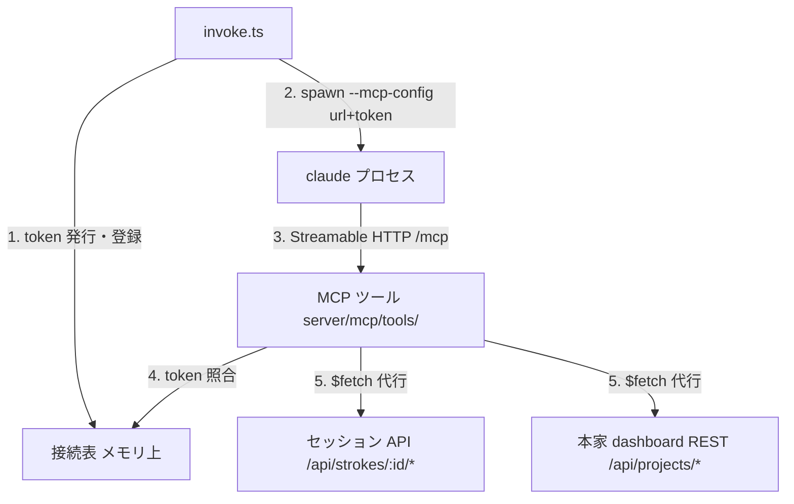

# provide-operations-via-mcp Design

## Context

- claude の起動は invokeAi の1系統で、呼び出し側がフラグを足す構造になっている（`openspec/specs/agent/invocation`）。steering 工程は既に `--mcp-config` へ本家 MCP を JSON 文字列で直渡ししている（`server/utils/stroke/invoke.ts` の `mcpConfigFor`、ADR-0011）
- セッション API（`/api/strokes/:id/*`）と本家 dashboard REST（`/api/projects/*`）は稼働済みで、契約は `openspec/specs/api/**` と本家 2.2.7（ADR-0008）に固定されている
- 動機と範囲は proposal.md を参照。specs は `specs/mcp/**` と `specs/server/session-management` にある
- 用語: 「MCP サーバー」= stroke-board 自身が `/mcp` で提供する MCP endpoint。「invoke.ts」= claude を spawn する処理（`server/utils/stroke/invoke.ts`）。「本家 dashboard」= 本家 spec-workflow の dashboard。単に「サーバー」とは書かない

## Goals / Non-Goals

**Goals:**

- 現行操作の代行ツール一式を MCP として提供し、両工程の spawn に配線する（`--mcp-config` と MCP ツール分の `--allowedTools` の両方。claude が実際に呼べる状態までを「提供」とする）
- ツール定義をモジュールの規約に載せ、後続 change（実処理化）がハンドラの差し替えだけで済む形にする
- 接続を起動時発行の一時 token で担保し、invoke.ts が起動した claude だけがツールを使える状態にする

**Non-Goals:**

- ワークフロースキーマ側の instruction の作り直し・スキル相当の手順書の整備（`adr0016-sub-switch-workflow-to-mcp-tools`）。MCP ツール分の allowedTools の追加・curl / jq の削除・`--add-dir` の撤去・prompt の向き先変更（取得・提出を Skill に投げている記述と、実体の無いスラッシュコマンドの起動）は、提供したツールで往復が成立するために要るので本 change に含む
- ツールの実処理化・transport の変更（`adr0016-sub-implement-mcp-operations`）
- `docs/` の変更（`adr0016-sub-document-mcp-operations`）

## MCP 提供の全体設計

### 全体像

stroke-board（Nitro）の中に「ツール定義（口）」と「接続の担保（判断）」の2層を足す。ツールは既存 endpoint への HTTP 発行のみで代行し、検証・状態遷移の正は endpoint 側に残す。



### ツールと代行先の対応

| ファイル（=ツール名） | 内容 | 代行先 |
|---|---|---|
| `get-overview.ts` | 概要の取得 | A1 `GET /api/strokes/:id/overview` |
| `get-strokes.ts` | ストローク記録の取得 | U3 `GET /api/strokes/:id/strokes` |
| `get-send-back.ts` | 差し戻しの取得 | A4 `GET /api/strokes/:id/send-back` |
| `send-question.ts` | 問いの提出（構造化引数） | A5 `POST /api/strokes/:id/question` |
| `submit-document.ts` | 文書の提出（種別 flontier / steering） | A7 `POST /api/strokes/:id/proposal` / 本家 `PUT /api/projects/:projectId/steering/:name` |
| `get-steering.ts` | steering 文書の取得（有無 `exists` を結果で告知。値は本家の文書状況から） | 本家 `GET /api/projects/:projectId/steering/:name` / 本家 `GET /api/projects/:projectId/info` |

ツールファイルの形（定義はモジュールの `defineMcpTool` を直接使わず、自前ラッパ `defineStrokeTool` を通す。理由は Decision を参照。ハンドラは `(args, extra)` を受け、token は `extra.requestInfo?.headers` から取る）:

```ts
// server/mcp/tools/get-overview.ts — A1 への代行
import { z } from 'zod'
import { defineStrokeTool } from '../../utils/mcp/define-tool'

import { resolveConnection } from '../../utils/mcp/connection-table'
import { readFetchFailure } from '../../utils/mcp/fetch-failure'
import { resolveConnectionSessionId } from '../../utils/mcp/require-connection'

export default defineStrokeTool({
  description: '概要（ユーザーが最初に投げた、作りたいシステムの説明）を取得する',
  inputSchema: {},
  outputSchema: {
    status: z.number(),
    overview: z.string().optional(),
    errorCode: z.string().optional(),
    error: z.string().optional(),
  },
  handler: async (_args, extra) => {
    // token の欠落・不一致も、工程の食い違いも throw しない。例外はモジュールが
    // `isError` のテキストへ畳み、status を持たない結果になる（結果の形の SHALL を破る）
    const resolved = resolveConnection(extra.requestInfo?.headers ?? {})
    if (!resolved.ok) {
      return { status: resolved.status, errorCode: resolved.errorCode, error: resolved.error }
    }

    const connected = resolveConnectionSessionId(resolved.context)
    if (!connected.ok) {
      return { status: connected.status, errorCode: connected.errorCode, error: connected.error }
    }

    try {
      // `.raw` を使うのは、代行先の実ステータスを保持するため（定数を置かない）
      const response = await $fetch.raw<{ overview: string }>(
        `/api/strokes/${encodeURIComponent(connected.sessionId)}/overview`,
      )
      return { status: response.status, overview: response._data?.overview }
    } catch (error) {
      const failure = readFetchFailure(error)
      if (failure.status !== 404) {
        return { status: failure.status, errorCode: 'unexpected_status', error: failure.message }
      }
      // A1 はセッション無しと概要無しをどちらも 404 で返す。文言でしか区別できない。
      // **既知のどれでもない 404 は契約に載せた状況へ寄せない**（`?? 'unexpected_status'`）
      // ——寄せると受け手は存在しない原因を直そうとする（specs `mcp/server` の MUST NOT）
      const errorCode = ERROR_CODE_BY_404_MESSAGE[failure.message] ?? 'unexpected_status'
      return { status: 404, errorCode, error: failure.message }
    }
  },
})
```

**throw しないこと・`.raw` で実ステータスを持つこと・同じ状況に同じ `errorCode` を割り当てること**の3つが、6ツールに共通する形である。

### 接続の担保（token と接続表）

1. invoke.ts が spawn の直前に一時 token（暗号学的に推測困難な乱数）を生成する
2. 接続表に「token → 接続文脈」を登録する
3. mcp-config `{ "type": "http", "url": "<apiBaseUrl>/mcp", "headers": { "x-stroke-token": <token> } }` を組み立てて claude を起動する
4. ツール呼び出しごとに、ヘッダの token を接続表と突き合わせて接続文脈を解決する
5. token の欠落・表に無い token は 401 で拒否し、既定値で補わない（ADR-0014）

接続表のエントリと持ち方:

| 項目 | 内容 |
|---|---|
| token | 照合キー。`x-stroke-token` ヘッダと突き合わせる |
| sessionId | 対象のセッション id |
| projectPath | 対象のプロジェクトパス |

登録は spawn の直前、削除は invokeAi の実行終了時（正常・異常とも）。Nitro プロセス内のメモリのみに保持し永続化しないため、stroke-board 再起動で全エントリが失効し、再起動をまたいで有効な資格情報を作らない。

### 結果の形

各ツールの結果は1階層のフラットな形に統一し、種類の列挙（成功/エラー/不達の排他形）にはしない。項目は次のとおり。

| 項目 | いつ持つか | 意味 |
|---|---|---|
| `status` | 常に | 呼び出しの結果を表す HTTP ステータスコード（endpoint の応答の値を保持する） |
| `errorCode` | 失敗時のみ | 機械可読の失敗種別。endpoint のエラーは応答から導出し、本家 dashboard に到達できない場合は `unreachable` |
| `error` | 失敗時のみ | endpoint が返したエラー本文。書き換え・省略・追加をしない |
| 結果スキーマの項目 | 成功時のみ | 例: `get-overview` は `overview: string` |

## Decisions

### Decision: `@nuxtjs/mcp-toolkit` を採用し、stroke-board 自身が MCP サーバーになる

MCP は Nuxt アプリの route `/mcp`（Streamable HTTP）で提供し、別プロセス・stdio・バンドル配布は行わない。ツール定義の自動発見・zod スキーマ・Nuxt DevTools の MCP Inspector が揃い、実装量が最小になる（nuxt-modules 公式 v0.19.0）。0.x のため lockfile でバージョンを固定し、更新は change として扱う。モジュール調査と採用はユーザー指示（2026-08-27）。代替の自前 stdio サーバー・SDK 手組みは不採用。

### Decision: ツール定義はモジュールの規定配置 `server/mcp/tools/` に置く

`dir` オプションは既定 `'mcp'`（server ディレクトリ基準）のまま変更しない。モジュールが前提とする標準配置に沿い、設定の上書きを持たない（ユーザー判断 2026-08-27「規定に沿う」）。リポジトリ直下への分離（`dir: '../mcp'`）は不採用。

### Decision: 定義は自前ラッパ `defineStrokeTool` を通し、結果を入口1箇所で `structuredContent` に包む

モジュールの `defineMcpTool` を直接使うと、`outputSchema` を宣言したツールは1本も動かない。モジュールの `normalizeToolResult`（`@nuxtjs/mcp-toolkit/dist/runtime/server/mcp/definitions/results.js`）は、CallToolResult でない素のオブジェクトを `content`（テキスト）だけに包み `structuredContent` を付けないため、MCP SDK が `Output validation error: Tool get-overview has an output schema but no structured content was provided` で弾く（実測 2026-08-27。ブラウザ操作の往復で6ツールすべてがこのエラーで失敗した）。そこで `defineMcpTool` の薄い包み `defineStrokeTool`（`server/utils/mcp/define-tool.ts`）を挟み、ハンドラが返した素のオブジェクトを `structuredContent` として返す形に整える。型は `defineMcpTool` のものをそのまま引き継ぎ、`inputSchema` から `args` が推論される性質を保つ。

ツールごとの `return` で包む案は不採用——包む箇所が19に増え、1箇所でも忘れるとそのツールだけ静かに壊れる。定義の入口1箇所で包めば漏れが構造的に起きない。`outputSchema` の宣言をやめて素の結果のまま返す案も不採用——結果の形（`status` / `errorCode` / 結果スキーマの項目）が呼び出し側へ伝わらなくなり、「結果の形」の統一が口の上で表現できなくなる。

### Decision: 公開するツールは接続ごとに工程で絞る

`--mcp-config` の `headers` に `x-mcp-tools`（`,` 区切りのツール名）を載せ、flontier 工程には `get-overview` / `get-strokes` / `get-send-back` / `send-question` / `submit-document` を、steering 工程には `get-steering` / `submit-document` を公開する。一覧は `server/utils/mcp/exposed-tools.ts` の1箇所に持ち、`invoke.ts` の `mcpToolServerEntry` が工程を受けて値を組み立てる。モジュールは request ごとに `config.tools` を差し替えるので、`tools/list` にも `tools/call` にも効く（`@nuxtjs/mcp-toolkit` の `filter-tools-header.js` / `utils.js` を読んで確認）。

絞らずに全6本を見せ、ツール側で工程を判定して拒否する形は不採用——実測でその形が破綻していた（2026-08-30。デバッグログ18本で `get-steering` が51回呼ばれ、うち48回が `[500] この接続は steering 工程向けではない。`）。呼べないものが一覧に出ていれば呼び手は呼ぶし、判別できるのは失敗した後になる。加えて、その拒否は `createError` の throw なのでモジュールが `isError` のテキストに畳んでしまい、「結果は status と errorCode のフラットな形」（specs `mcp/server`）を満たせない。

工程ごとに route を分ける案も不採用——モジュールの規定配置（route は既定 `/mcp`）から外れ、設定の上書きが増える。ツール側の工程判定（`require-connection.ts` の 500）は多重防御として残すが、正常の経路では到達しない。

### Decision: ハンドラは既存 endpoint への HTTP 発行のみで代行する

対応する既存 endpoint へ `$fetch` を発行し、その応答だけから結果を作る。セッションディレクトリ・プロジェクトディレクトリのファイルは読み書きしない。検証・状態遷移の正は endpoint 側にあり（ADR-0014）、MCP 層に第2の実装を作らない。同一プロセスでも endpoint を経由するのは busy ガード・前提チェックを通すため（invoke.ts の U13 経由と同じ判断）。

### Decision: 応答の形を検証するのは本家向けの代行だけにする

本家 dashboard の応答は zod スキーマで検証し、2xx でも形が違えば `upstream_malformed` を返す（`server/utils/mcp/upstream-fetch.ts` と `server/utils/upstream/rest.ts` の `read`）。stroke-board 自身の endpoint への代行は検証しない。

分けるのは**追随を保証できるかが違う**ため。自前の endpoint は同じリポジトリにあり、応答は `session-store.ts` が zod を通した値しか返さない。ここに第2の検証を置くと、同じ形の定義が2箇所になり片方だけが古くなる（ADR-0014「第2の実装を作らない」と同じ理由）。本家は別プロセス・別バージョンで、こちらの都合と無関係に形が変わりうる。実際、検証が無かった間は本家の 2xx で形が違う応答が「文書がまだ無い（空の本文）」と見分けの付かない成功として返っていた（santa-method レビュー指摘 3周目 2026-08-30）。

両方を検証する案は不採用——上の複製が生じる。両方を検証しない案も不採用——本家側でその欠陥が実際に出ていた。

### Decision: 接続は起動時発行の一時 token で担保する

invoke.ts が起動した claude だけが接続できる担保と「どの claude か」の特定を、1つの token で行う。セッション id の直渡しは不採用——特定できるのは flontier 工程だけで steering 工程の文脈はプロジェクトパスとなりヘッダの意味が工程で変わるうえ、id は画面 URL（`/strokes/<uuid>`）に現れる値で担保にならない。永続 token（設定値）も不採用——全 claude で共有になり、漏れても失効できない。

### Decision: 接続表はメモリ上の層とし、capability `server/session-management` で契約を定める

接続の担保はツール個別でなく全ツール共通の関心なので、独立した層にし、契約を capability `server/session-management` に定める（spec は承認済み）。ファイル・DB への永続化は不採用——失効管理が必要になり、漏洩面も増える。

### Decision: 入力の上限・許容値は `inputSchema` の `.describe()` に契約の説明として書く

長さ・件数の上限と許容値を `.describe()` で書き、エージェントが何を守ればよいかを口の上で読めるようにする。適用先は `send-question`（header 12 / detail 300 / question 20 / options 1〜5・description 50）・`submit-document`（name は product / tech / structure、document は本文そのもの）・`get-steering`（同）。

書いていなかった間、`send-question` の `inputSchema` は上限を一切表現しておらず、エージェントは上限を知る手立てが無いまま A5 の「問いの構造として読み取れない。」だけを受け取り、形を探り続けていた（実測 2026-08-27: `send-question` 13回中8回が 400 `validation_error`。内容のある問いが弾かれ、通ったのは「テスト」のような短い問いだけだった）。

`.max()` で弾く形は不採用——検証の正は代行先の endpoint に置いたままにする（ADR-0014。MCP サーバー側に第2の検証を作らない）。

**ただしこれは緩和であって、根本の修正ではない。** 上限を伝えても、実際に超えたときに受け口が違反箇所を返さなければ、送り手はどこを削ればよいか分からない。根本は別 change `adr0016-sub-define-request-validation-messages` で直し、修正後は 400 が 5件 → 1件に減り、その1件も理由が届いて次で通った。

### Decision: 結果は status と errorCode のフラットな形に統一する

すべての結果は1階層で、常に `status`（HTTP ステータスコード）を持つ。失敗はさらに `errorCode`（機械可読の失敗種別）と `error`（endpoint が返したエラー本文。書き換え・省略・追加をしない）を持ち、成功はツールの結果スキーマの項目を持つ。種類の列挙（成功/エラー/不達の排他3形）にはしない（レビュー指示 2026-08-27）。「相手が拒否した」（内容を直して出し直せる）と「相手に届かない」（出し直しても無駄、環境の問題）の区別は `errorCode` で表し、後者は `unreachable` とする。`unreachable` を定めるのは本家 dashboard 向け操作だけ——stroke-board 自身が spawn 元で、停止中にツールが実行される状況が成立しないため（specs `mcp/server`）。MCP サーバー側の事前検証・独自分岐は入れない（ADR-0014）。入れ子の構造化エラーは不採用。

### Decision: MCP の url は既存設定から組み立てる

url の base は nuxt.config の既存値 `runtimeConfig.claude.apiBaseUrl`（エージェント向け base URL、現行 STROKE_BASEURL の元値）から取り、新しい設定は増やさない。本家 dashboard の base URL も既存の `runtimeConfig.upstreamBaseUrl` を使う。projectId は MCP ツールが実行時に本家 `GET /api/projects/list` の応答からプロジェクトパスで引き当てる。

### Decision: ツール名は動詞+対象で内容がわかる名前にする

`get-overview` / `get-strokes` / `get-send-back` / `send-question` / `submit-document` / `get-steering` の6本（ファイル名=ツール名）。スキル名は引き継がない。問いと文書を分けるのは引数の形が別物のため（構造化引数 vs 本文の文章）。capability 名の流用（`overview` 等）は内容が読めず不採用。

## 上位資料への整合反映（`adr0016-sub-document-mcp-operations` で実施済み）

`docs/specs/core/settings-reference.md` はストローク側設定の**正**（ADR-0004）である。本 change は `claude` 設定を複数変えたので、CLAUDE.md「更新対応」に従い整合反映を提案していた。

**2026-08-31 に `adr0016-sub-document-mcp-operations` が実施した。** 下の表は、そのとき何が食い違っていたかの記録である（当時の実装を「実装」列に残す）。反映を別 change が担ったのは、`docs/` を触らないことが本 change の Non-Goal だったためで、提案の宛先がそちらに決まっていたからである。

| 箇所 | 資料の記述 | 実装 |
|---|---|---|
| `claude.steeringPrompt` | `/write-steering-v2` を prompt 本文に載せ、「このリポジトリの `.claude/skills/` に在り `--add-dir` 経由でロードされる」 | スラッシュコマンドを持たない。**スキルは実在せず、`--add-dir` も渡していない** |
| `claude.firstPrompt` | `/openspec-ff-change draft-proposal` ＋ 固定指示 | スラッシュコマンドを持たない |
| `claude.args` | `--model fable` / `--add-dir` 2本 / `--allowedTools "Bash Read Write Edit"` | `--model sonnet` / **`--add-dir` 無し** / `--allowedTools "Skill Bash(openspec *) Read Edit Write"` ＋ `--disallowedTools` ＋ `--strict-mcp-config` |
| 「呼び出しごとに決まる」の列挙 | `--allowedTools` が無い | 呼び出しごとに `mcp__stroke-board`（steering は `mcp__specworkflow` も）を追記する |
| `claude.apiBaseUrl` | `http://127.0.0.1:3399` | `3599`（worktree ごとにずらす実態。本 change の変更ではない） |
| `claude.debugLogDir` | 「（空 = 無効）」 | `.stroke-check/debug-log`（検証のため有効。**archive 前に空へ戻す**） |

**`steeringPrompt` が最も急いだ。** 本 change が「実体が無く `Unknown command` で steering 工程が空振りする」として削った当のものを、正の資料が現行仕様として記述していた。これを読んだ次の担当者は再導入する（santa-method レビュー指摘 6周目 2026-08-30）。反映済み。

`apiBaseUrl` のポートだけは性質が違う。**3399 を使っている worktree が1つも無く**（実測: pre5 は 3599、develop は 3100）、資料が worktree 並走の実態に追随していない。本 change の drift ではないので、ここは別 change（`adr0016-sub-document-mcp-operations`）へ送る。

## Risks / Trade-offs

- [モジュールが 0.x で破壊的変更があり得る] → lockfile でバージョンを固定し、更新は change として扱う
- [同じ `/mcp` に複数の claude が接続する] → 接続表の token 照合で接続文脈を分離する。ヘッダ欠落・表に無い token は拒否し、既定値で補わない（ADR-0014）
- [`/mcp` が route として外部からも見える] → token 照合により、invoke.ts が起動した claude 以外の呼び出しは拒否される（Decision: 一時 token）
- [token が子プロセスの argv に平文で載る] → `--mcp-config` の JSON に `headers` として埋めるため、同一ホストの他ユーザーが `ps auxww` や `/proc/<pid>/cmdline` で読める。**承知のうえで採っている**——単一ユーザーのマシンを前提とし、token は実行中のみ有効で再起動をまたがない。環境変数で渡せば argv からは消せる（`STROKE_BASEURL` を渡している経路が既にある）が、`--mcp-config` は claude が解釈する JSON なので、そこだけ環境変数へ逃がす口が無い。運用環境が単一ユーザー前提でなくなったら見直す（santa-method レビュー指摘 4周目 2026-08-30）
- [本家 dashboard 停止中は steering 系ツールが失敗する] → `errorCode: unreachable` の失敗として返し（Decision: 結果の形）、MCP サーバー側で握りつぶさない
- [操作系のフォールバック先が存在しない] → 操作系のスキル（`assets/.claude/skills/` の get-* / question / proposal）は HEAD にも worktree にもファイルとして在る（`64a2cdc` の git 操作で復元されており、「worktree 上で削除された状態」という前提は成立しない。実測 2026-08-29）。ロードを止めるのは `--add-dir` の側で、リポジトリのルート1つに絞って操作系のスキルを claude に読ませない。これと curl / jq の削除により、取得・提出の入口は MCP ツールだけで、ツールが動かなければ往復は止まる。受け入れ条件を「取得・提出が MCP ツール経由で行われ、往復が成立すること」に置き、実機で確認する（tasks 5.1）。案内・instruction は Skill が担う役割分担のままだが、**prompt が指す案内スキルは現時点で1つも実在しない**（`/openspec-ff-change` も `/write-steering-v2` も無く、どちらも起動を外した）。案内を配り直すのは別 change

## Migration Plan

1. モジュールを導入し（`nuxt.config.ts` の modules に追加、route は既定 `/mcp`）、`server/mcp/tools/` にツールを置いて Nuxt DevTools の MCP Inspector で列挙を確認する
2. 接続表の層と token 照合を入れ、invoke.ts の両工程の `--mcp-config` に `{ "type": "http", ... }` のサーバー定義を足す（既存フラグ・本家 MCP の並びは変えない）
3. 同じ場所で MCP ツール分の `--allowedTools` をコード内で組み立てて足す。サーバー単位 `mcp__stroke-board` を既存の `--allowedTools` の値に追記し、指定を1本に保つ（`server/utils/mcp/allowed-tools.ts` の `withMcpToolsAllowed`）——複数指定がマージされるか上書きされるかに依存しない形にする。サーバー名は定数 `MCP_SERVER_NAME` に一本化し、`--mcp-config` の `mcpServers` のキーにも同じ値を使う。あわせて `nuxt.config.ts` の既存 allowedTools から `Bash(curl -X POST *)` / `Bash(jq -n *)` を落とし、取得・提出を MCP ツール以外で真似できる余地を消す
4. `nuxt.config.ts` の prompt 3件から、**実体の無いスラッシュコマンドの起動を外す**。`/openspec-ff-change`（`firstPrompt`）も `/write-steering-v2`（`steeringPrompt`）もリポジトリに存在せず、prompt の先頭に置くと `Unknown command` で起動が assistant のターンをひとつも持たずに終わる。steering 工程が空振りしていた直接の原因で、`get-steering` / `submit-document`（steering）が一度も呼ばれなかったのはこれによる（実測 2026-08-30）。取得・提出は MCP ツールが担うので、案内スキルが無くても往復は成立する
5. `--strict-mcp-config` を足す。`--mcp-config` は「追加」であって「限定」ではないので、これが無いと開発者個人の MCP 設定が全部読み込まれる——実測で8サーバー・約80ツールが、`--allowedTools` に無いので**呼べないまま**エンドユーザーの実行に並んでいた（2026-08-30）。工程ごとに公開ツールを絞った意図と、`--setting-sources` に user を含めない意図（個人の設定を持ち込まない）の両方を破っていた
6. `nuxt.config.ts` から **`--add-dir` を丸ごと外す**。作業場所はセッションのディレクトリ（cwd）だけでよい。当初は2つ目（`${import.meta.dirname}/assets`）だけを外してルートを残したが、**ルートを渡す根拠が実在しなかった**——`.claude/skills/` は無く、実運用ログの `slash_commands` 67件に `grilling` / `write-steering-v2` / `opsx` は1件も現れない（実測 2026-08-30）。実際に届いていたのは次の2つだけで、どちらも渡したくないものである。
   - **他人のセッションの全文**。`claude.debugLogDir` はリポジトリ配下にあり `--output-format stream-json` で概要・問い・proposal がそのまま残る。実測でセッション A の claude が B のログを `Read` で読めた（`permission_denials: []`。santa-method レビュー指摘 6周目）
   - **開発者の権限とプラグイン**。ルート配下の `.claude/settings.json` が `--setting-sources project` で効き、`Agent` や `Bash(claude *)` が渡っていた。`Edit` の deny は絶対パス指定で worktree には効かず、無人実行のエージェントがソースツリーへ書ける状態だった

   `.claude/settings.json` の `Bash(curl *)` deny も同時に効かなくなるが、curl は既に `--allowedTools` から落ちているので二重の守りのうち片方が消えるだけである
7. 取得・提出の入口が MCP ツールしか無い以上、`--mcp-config` / `--allowedTools` / `--add-dir` / prompt の変更を外すと往復そのものが止まる。この change は戻す前提を持たない
