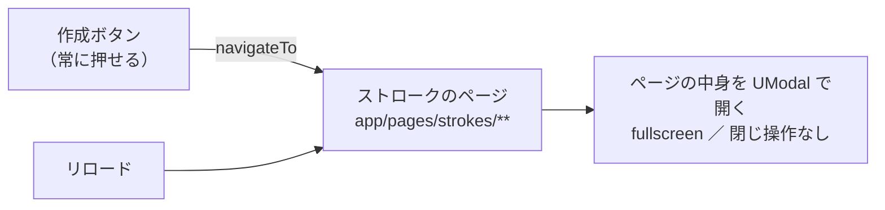
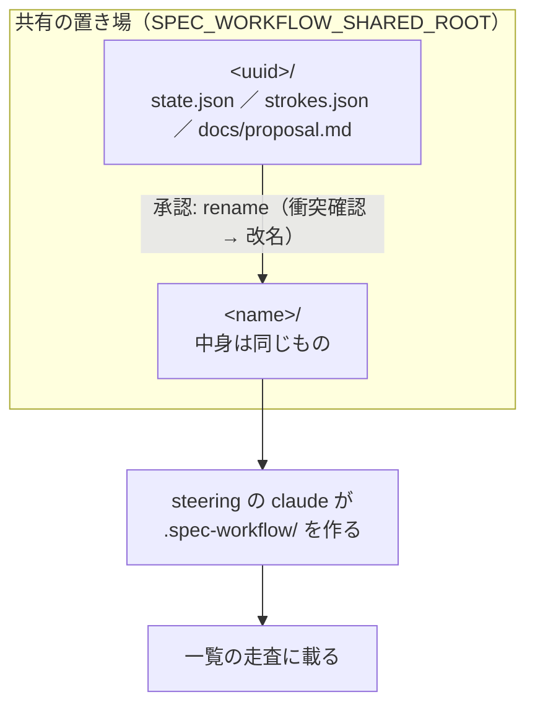
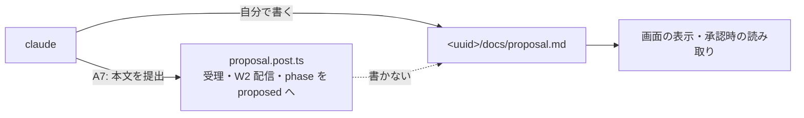
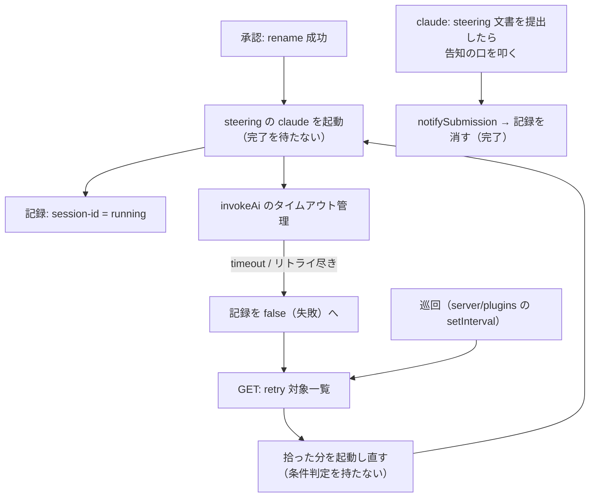

# design — connect-portal-and-strokes

## Context

動機は proposal.md（Why）、決定は ADR-0009 / 0010 / 0011、俯瞰は `docs/specs/plan/portal-stroke-entrance.md` と `portal-stroke-exit.md` が持つ。ここではその2枚を実装の形へ落とす。

現状のコードで、この change が触る所だけを挙げる。

| 場所 | 今の形 |
|---|---|
| `server/utils/control/actions.ts` | `resolveDirectoryActions()` が `register` と `create` の可否を固定値で返す |
| `shared/types.ts` | `DirectoryActions` が `register` / `create` の2つ、理由コードに `target-undecided` |
| `app/pages/projects/index.vue` | 作成ボタンは `:disabled="!actions?.create.available"` |
| `app/pages/strokes/**` | 概要入力・往復・proposal 確認の3ページ（素の独立ページ） |
| `server/utils/stroke/settings.ts` | 置き場が2本（`NUXT_SESSIONS_ROOT` / `NUXT_PROJECTS_ROOT`） |
| `server/utils/stroke/ai.ts` | `invokeAi(sessionId)`。起動定義・定型・cwd を中で導出。失敗を `state.json` に書く |
| `server/utils/stroke/claude.ts` | `runClaude()` が `useRuntimeConfig().public.claude` を中で引く |
| `server/utils/stroke/project.ts` | `generateProject()` が `mkdir` + `docs/proposal.md` を書く |
| `server/api/strokes/[id]/proposal.post.ts` | A7 が `writeProposal()` でセッション直下の `proposal.md` を書く |
| `server/utils/stroke/running.ts` / `submission-signal.ts` | セッション単位の実行中フラグと提出待ちをメモリで持つ |

## Goals / Non-Goals

**Goals:**

- 入口と出口を1本の流れとして通す（一覧の作成 → ストローク → 承認 → 一覧へ戻り、steering が裏で走る）
- AI の起動を1系統に保ったまま、用途の違いを引数の違いだけで表す
- steering の成否をユーザーに見せず、サーバー側だけで完了とリトライを閉じる

**Non-Goals:**

- ストロークの3画面の中身と流れ（不変。器が変わるだけ）
- `relocate-stroke-routes`（`/projects/create/**` への移設）— 別 change のまま。この change では既存のパスを動かさない
- steering 完了後の承認待ち・通知（既存の仕組みに乗るだけ）
- 登録の中身（未決のまま）

## Decisions

### D1: モーダルはパスルーティングで開く（案A）。親子ルートにはしない

作成ボタンは概要入力のページへ遷移し、**そのページ自身が `UModal` で画面全体を占める**。一覧を親ルートにしてその上に子ルートを重ねる形は採らない。



満たすべきは見た目と復帰の3点だけで、実装方式は縛られない（ADR-0009）。

- 画面全体を占める（一覧は見えない）
- 閉じる操作が無い
- リロードで同じ途中画面に戻る

**なぜ案A か**: ADR-0009 が「実装はページ遷移でよく、リロードで同じ途中画面に復帰できる形を採る」と決めており、ページ遷移なら復帰は URL が担う。案B（components 起動）は同じ復帰を満たすためにセッション id の保存先を別に用意することになり、URL が既に持っている情報を二重に持つ。

**なぜ親子にしないか**: 入れ子ルート方式は `portal-stroke-entrance.md` で不採用と決まっている。覆われていて閉じられない以上、背後に一覧が実在するかはユーザーには観測できず、重ねる実装の利得が無い。

**`relocate-stroke-routes` の扱い**: 案A では3画面は pages のまま残る。`/projects/create/**` への移設は構造移行の話なので、この change では行わず ticket に残す（`portal-stroke-entrance.md`「開き方の決定に連動して決める」への回答）。

### D2: 作成の可否は仕組みごと外す。登録だけを残す

`resolveDirectoryActions()` は `register` だけを返し、`DirectoryActions.create` と理由コード `target-undecided` を型ごと消す。画面は作成ボタンについてサーバーの応答を見ない。

**代替案**: `create: { available: true }` を返し続ける（型を触らない）。採らない。常に `true` を返す判定は判定ではなく、「接続先が決まったらここで見る」という `actions.ts` の存在理由（コメントに明記）も既に消えているため、残すと次に読む者を誤らせる。ADR-0010 の「判定箇所を2つに増やさない」とも合う。

前提の欠け（置き場に書けない・起動定義が不正）は、モーダルの中で概要を投稿したときの `invoke-agent` の 503 として現れる。この経路は既存のまま触らない。

### D3: 置き場を1つにし、承認は rename だけにする

`settings.ts` の置き場2本を1本にまとめ、`sessionDir()` と `projectDir()` が同じ親を指すようにする。これで承認は同じ親の下での改名になり、ファイルは1バイトも動かない。



- 衝突確認は `rename` の前に行う。`rename` は空ディレクトリを黙って置き換えうるため、EEXIST 任せにしない（`generateProject` の `mkdir` 非 recursive による衝突検出は使えなくなる）
- セッションは `.spec-workflow/` を持たないので、置き場を共有しても一覧には出ない（`project-directory` の走査条件は無改定）
- `generateProject()` は `promoteSessionToProject(sessionId, name)` に置き換わる。`assertProjectName()` はそのまま使う（置き場の外へ出る名前を通さない）

### D4: proposal.md の書き手を claude に一本化する

A7（proposal 提出）は本文を検証して受理・配信するが、**ファイルを書かない**。ファイルは claude がセッションの時点から `docs/proposal.md` に書く。`readProposal()` の読み先をセッション直下から `docs/proposal.md` へ移す。



**なぜ書き手を1つにするか**: 承認を rename だけにするための前提。サーバーが承認時に書くと、書き出し先が生成先に依存し、rename では済まなくなる。

**副作用**: claude が `docs/proposal.md` を書かずに A7 だけ提出すると、画面に proposal が出ず承認も通らない。書かせるのはセッション側のスキルの責務であり、サーバーはその欠如を「proposal が見つからない」として扱う（既存の 409 経路がそのまま働く）。

### D5: `invokeAi` は起動定義・定型・cwd を受け取り、成否を返す

```mermaid
flowchart TB
  ia["invoke-agent.get.ts<br>設定 JSON を引いて無加工で渡す"] --> call
  ap["approve.post.ts<br>args に --mcp-config を足し<br>定型を steering 用へ替える"] --> call
  call["invokeAi(sessionId, run)<br>run = { launch, cwd, prompts, prepare? }"] --> rc["runClaude<br>渡されたものだけを使う"]
  call -- "'submitted' | 'failed'" --> back["後始末は呼び出し側"]
  back --> st1["ストローク: state.json に invocation: failed"]
  back --> st2["steering: 実行の記録を false へ"]
```

- `run.launch` = `{ command, args }`。`runClaude` は `useRuntimeConfig()` を引かない
- `run.prompts` = `{ first, continue }`。初回／継続の判定は `invokeAi` に残す（`ai-invocation` の既存要件。呼び出し側は判定ではなく定型の候補を渡す）
- `run.prepare?` — 初回に整える実行環境。ストロークは `initSessionOpenspec` を包んで渡し、steering は渡さない。渡されなければ何もしない（用途ごとの分岐を `invokeAi` の中に持たない）
- 返り値を `'submitted' | 'failed'` にし、`markInvocationFailed()`（`state.json` への書き込み）は呼び出し側へ出す。steering には `state.json` を持つセッションディレクトリが無く、共通の後始末が成立しないため

**代替案**: 用途ごとに `invokeStroke` / `invokeSteering` の2入口を作る。採らない。タイムアウト・リトライ・提出待ちという核が二重化し、片方だけ直る事故を招く。

### D6: steering の完了は提出の告知で、失敗は巡回で拾う

実行の記録は `running.ts` と同じ割り切りでメモリに持つ（単一プロセスの MVP）。提出待ちは既存の `submission-signal.ts` をそのまま使い、告知の口が `notifySubmission()` を呼ぶ。



- 告知の口は `phase` を見ない（steering は承認後にしか走らないため、既存 A5・A7 のガードに掛かる）
- **リトライは新しい session-id で起動する。** 同じ id で `--session-id` を再指定すると既存の会話と衝突し、`--resume` では死んだ会話の続きを求めることになる。古い記録は消し、新しい id を running として登録する
- 巡回の間隔は `upstream.ts` の `setInterval` と同じ形で持つ

### D7: mcp-config は生成先パスから導出する

`--mcp-config` は JSON 文字列を直接受け取れる（`claude --help` 実機確認済み）。承認処理が生成先のパスから JSON を組み立てて `args` の末尾に足す。設定には持たず、ファイルも作らない。組み立てる JSON の中身（本家 spec-workflow MCP の起動の形）は実装時に本家（`/home/vagrant/work/repo/spec-workflow-mcp`）の起動方法を見て確定する。

### D8: 承認の成功でモーダルを閉じて一覧へ戻る

`app/pages/strokes/[sessionId]/proposal.vue` は、承認の応答が成功したら `/projects` へ遷移する。承認の応答は steering の起動完了を待たない。

## Risks / Trade-offs

- **承認後のセッションを id で開けなくなる** → rename でセッションディレクトリが消えるため、`readState()` が失敗する。`proposal-review` の既存要件「approved で画面2を開くと承認済みであることと確定したプロジェクト名が表示される」が成立しなくなる。新しい流れでは承認後に画面2へ戻る導線が無いが、**要件としては残っている**。この change の Capabilities には `proposal-review` が挙がっていないため、扱いはユーザーの判断を仰ぐ（この design では変更しない）
- **リトライが止まらない** → 巡回は条件判定を持たない（`portal-stroke-exit.md` の決定）ため、原因が環境側にある失敗は無限に起動し直される。単一ユーザーの MVP として受け入れる。歯止めが要ると判明したら、巡回ではなく記録側（回数を持つ）で足す
- **記録がプロセスのメモリにある** → 再起動で running / false の記録が消え、途中の steering は誰にも拾われない。`running.ts` と同じ割り切り。復旧の口は設けない
- **置き場の共有で人の目には混ざる** → uuid のディレクトリとプロジェクト名のディレクトリが同じ親に並ぶ。一覧は `.spec-workflow/` の有無で分けるので画面には影響しない
- **claude が `docs/proposal.md` を書く保証はサーバーに無い** → D4 の副作用。既存の 409 経路で「proposal が見つからない」として現れる

## Migration Plan

1. 設定（置き場の統一・steering の定型）の改定案を `docs/specs/core/settings-reference.md` に対して出し、ユーザーの承認を取る（ADR-0004）
2. 承認が下りてから `settings.ts` / `nuxt.config.ts` を触る。以降の実装（rename 昇格・steering の起動）は置き場の統一が前提
3. 既存のセッションディレクトリと `/opt/projects` の中身の引っ越しは行わない。統一後の置き場から作られるものだけがこの流れに乗る

## Open Questions

- 共有の置き場（`SPEC_WORKFLOW_SHARED_ROOT`）の既定値をどのパスにするか。設定の値の話であり、`portal-stroke-exit.md` も「ここでは決めない」としている。1 の承認手続きの中で決める
- steering の定型の本文。定型そのものはコードに持たない（`ai-invocation`）ため、設定の改定案と同じ手続きで決める
