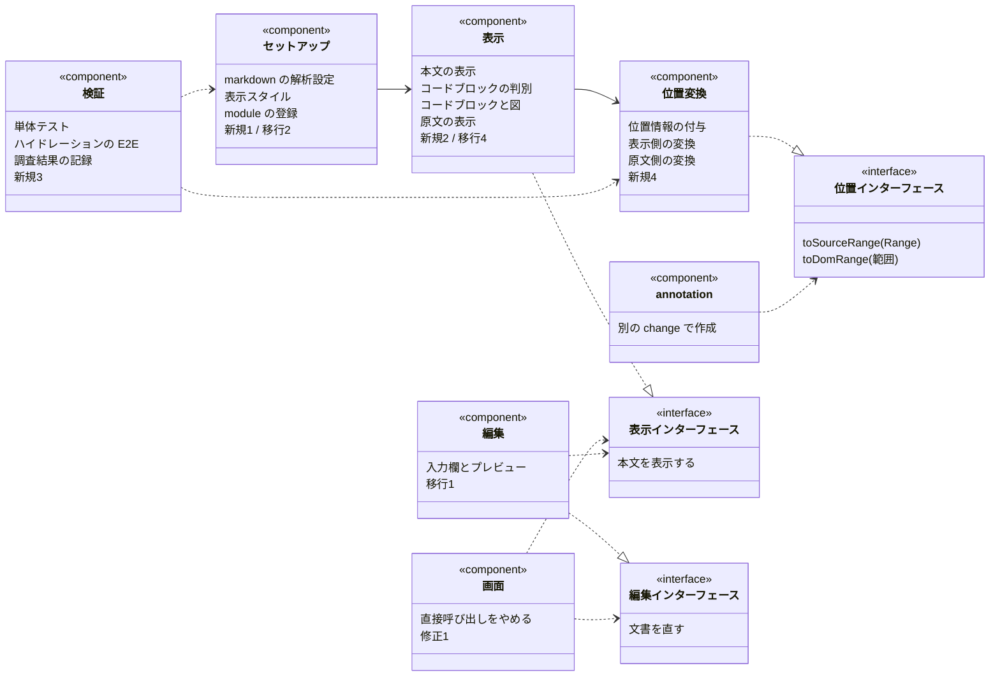

## Context

動機は `proposal.md` の Why、動作の仕様は `specs/markdown/module/`・`specs/app-structure/` を参照。

実装方針を制約する条件が4つある。

**1. 位置情報は取得できるが、取得できる形が箇所によって異なる。** `@nuxtjs/mdc`（0.23.1）のパーサに `keepPosition` を指定して実測した結果は次のとおり。

| 箇所 | 実測結果 |
| --- | --- |
| 通常の文章の text ノード | 位置を持つ。ただし**位置の長さと値の長さが一致するとは限らない**（下記） |
| コードブロック内の text ノード | **位置を持たない**。内側の `code` 要素は `pre` と同一の範囲（記号を含む）を指すため、内容の開始位置を特定できない |
| `pre` ノード | 位置を持つ。開始記号から終了記号までの範囲を正確に指す |
| `pre` の `code` 属性 | コードブロックの内容。原文と文字数が一致しない（下記） |

**記法によって、位置が記号を含むかどうかが異なる。** 判定対象は text ノードの `position` である（ラッパー要素を付けるのは text ノードのみのため、要素側の position は変換に使わない。要素側は一律で記号を含む）。

全記法を確認した結果、**記号を含むのはコード系のみ**だった。

| 記法 | text の `position` が記号を含むか |
| --- | --- |
| 強調・斜体・二重強調・打ち消し | 含まない |
| リンク・参照リンク・自動リンク・裸の URL | 含まない |
| 見出し（`#`・setext）・リスト・チェックボックス・引用・表のセル・MDC ブロック | 含まない |
| リンクの中の強調 | 含まない |
| **インラインコード**（`` ` ``・`` `` ``・前後の空白つき） | **含む** |
| 強調の中のインラインコード | **コードだけ**含む |
| 画像・強い改行（`  \n`・`\`） | text ノードにならない |
| チェックボックスの印が足す空白・脚注参照の番号 | **position を持たない** |
| 脚注定義 | **内容のほうが範囲より長い**（戻りリンク分の空白が追加される）→ 変換できず `null` |
| エスケープ `\*`・実体参照 `&amp;` | **含む**（`\*` / `&amp;` のまま。値は `*` / `&`）→ 照合が一致せず `null` |

したがって `source.slice(start, end)` が `value` と一致すると仮定できない。**ラッパー要素内の文字数と、それが指す原文の範囲の長さは別のものとして扱う。** インラインコードの内部を選択したとき、記号の分だけずれる。

**長さが異なる場合は比例配分しない。照合で開始位置を決定する。** ラッパー要素内の文字列が、そのラッパー要素の指す範囲のどこにあるかを探し、見つかった位置を1文字目として順に数える。差分は記号によるもので内部の文字に均等に配分されるものではないため、比例配分すると内部を選択したときに1〜2文字ずれた位置を返してしまう。

**見つからない場合は変換不能として扱う。** エスケープ（`\*`）や実体参照（`&amp;`）は、表示された文字がその形で原文に存在しない。由来を特定できないものを推測で補完しない。

**位置が取得できない、またはずれる条件が4つある。** いずれも異常が表面化しないため、実装で明示的に扱う。

| 条件 | 発生する問題 |
| --- | --- |
| **原文の先頭（オフセット0）から始まるノード** | `position` が `undefined` になる。`parser/compiler.js` が `node.position?.start?.offset && …` と真偽判定しており、**0 が偽と判定される**。コードブロックに限らず、段落・強調・見出しなど**すべてのノード**が対象 |
| CRLF | `parseMarkdown` が LF へ正規化してから解析する。オフセットは正規化後の文字列を指し、元のファイルとは先行する CRLF の数だけずれる |
| front matter | 除去してから解析する。オフセットは除去後の本文が基準になる。**除去後の本文には区切りの改行が1つ残る** |
| オフセットの単位 | UTF-16 コードユニット。サロゲートペアは2文字として数える |

**`code` 属性と原文の差はタブだけではない。**

| 条件 | 相違点 |
| --- | --- |
| タブ | **4桁のタブストップ**への展開。「タブ→空白4個」ではなく、桁位置によって増加量が変わる |
| リスト内・引用内のコードブロック | 親要素のインデントや `> ` が各行から除去される |
| インデントとタブの併用 | **インデントを除去してからタブを展開する**ため、原文の桁位置とタブ数からは復元できない |
| 最終行に改行がない | 改行が1つ追加される |
| 情報行の付加情報（`title="x"` など） | `code` に含まれず `meta` / `filename` / `highlights` 属性へ分割される |

行頭の空白、末尾の空行、行末の空白、日本語、サロゲートペア、`~~~` 形式、入れ子のコードブロックでは差が発生しない。

**行の順序は保持される。** コードブロック記法である限り、`position` で切り出した範囲から開始行と終了行を除いた行数が `code` の行数と常に一致した。行の増減や入れ替えは発生せず、相違が出るのは行内の桁位置のみである。したがって行単位で対応表を作る設計が成立する。

**例外は4スペースのインデント形式のコードブロック。** 開始・終了の記号行がなく `position` が内容だけを指すため、「開始行と終了行を除く」規則が適用できない。

判別に `language` は使用できない。**言語指定のないコードブロックも `language: 'text'` になる**ため、`'text'` を除外すると通常のコードブロックまで除外してしまう（実測）。判定基準は**切り出した範囲の先頭が記号（``` または ~~~）かどうか**である。インデント形式の切り出しは必ず空白かタブから始まる。

もう1つ、「開始行と終了行を除く」が適用できない形式がある。**終了記号がなく末尾に改行もない**場合は切り出した最終行が内容の行になり、行数が 0 対 1 で一致しない。終了行の判定（同じ記号・開始以上の個数・後続は空白のみ）を実装すれば対応できる。

**除去する文字数は推測せず照合で決定する。** 親要素による前置きを何文字除去するかは、候補を順に試して `detab(line.slice(p))` が表示行と一致した位置を採用する。一致しない場合は変換不能として扱う。リスト内の `␣␣\tconst` は「2文字除去して展開」でも「除去せず展開」でも表示が同じ `␣␣␣␣const` になるため、単純に昇順で決定すると誤る（実測）。

処理順は**親要素の前置きを除去してからタブを展開する**。`@nuxtjs/mdc` が親要素の除去後の値に `detab` を適用しているためである（`parser/handlers/code.js`）。

以上は `modules/markdown/runtime/position/fence.ts` が実装し、`test/modules/markdown/runtime/position/fence.test.ts`（45件）が検証している。入力はすべて `parseMarkdown` を通した実データである。パーサのバージョンを上げて動作が変われば失敗する。

したがって通常の文章は text ノードの位置をそのまま使用でき、コードブロック内は `pre` の位置から原文を切り出したうえで、表示されている文字列との対応を作る必要がある。

**2. 位置情報を渡すには、解析と描画を自分で接続する。** 実測で判明したことが2つある。

- `keepPosition` は**解析の設定**（`MDCParseOptions`）であり、module の設定（`ModuleOptions`）ではない。module 側に記述すると型エラーになる（`dist/module.d.mts` の 63行目と 126行目、TS2353）。`<MDC>` には `parser-options` があり、そこへ渡せば `parseMarkdown` に届く（`MDC.vue:86`）
- ただし `MDCRenderer` は text ノードを `h(Text, node.value)` で出力しており（`MDCRenderer.vue:136`）、**position を DOM に出力せず破棄する**。ここに介入する手段はない

したがって、位置情報を画面まで渡すには `<MDC>` に任せきりにできない。**解析（`parseMarkdown`）と描画（`MDCRenderer`）の間に AST の変換処理を挟む**必要がある。`<MDC>` は両者を内部で接続しているだけなので、同じ処理を自分で並べれば足りる。

**3. コードブロックの差し替え先はコンポーネント名で解決される。** `mdc.components.map` の値は `resolveComponent(名前)` で解決され、Nuxt が `app.component()` で登録するのは `app/components/global/` の分のみである。そのため現状これは `global/` に固定されている。Nuxt module は `addComponent({ global: true })` で同じ登録ができるため、モジュール化すればこの制約は解消する。

**4. 注釈の位置は既に原文の文字オフセットで保持している。** `Annotation` は `startOffset` / `endOffset` / `selectedText` を持ち、差し戻しの送信データにも同じ形式で含まれる。位置の保持形式を変更する必要はなく、**不足しているのは整形済み本文との対応付けのみ**である。

承認画面の構成は既に本家と同じ形になっている。表示は3種類（整形済みのみ／原文のみ／両方を並べる）で、切り替えても**コメント一覧は本文の横に表示されたまま**である。本文上に表示されるのは範囲の色のみで、コメントの文面は一覧側にある。

不足しているのは注釈を付けられる表示である。現状は原文側でしか付けられず、整形済みのみの表示では「切り替えるとコメントを付けられます」という案内が出る。並べて表示する場合も、右側の整形済み表示は閲覧のみとなっている。**この change が解消するのはこの制限であり、画面の構成は変更しない。**

## Goals / Non-Goals

**Goals:**

- 原文の表示と整形済み本文の表示が、**位置変換について同一のインターフェースを実装する**状態にする。利用側がどちらの表示かを意識しない
- markdown を扱う実装を1つのディレクトリにまとめ、外部に公開するインターフェースを絞る

**Non-Goals:**

- markdown の描画そのものの動作を変更しない。生 HTML を要素化しないこと、mermaid を図にすること、コードブロックの表示は `markdown-rendering` の定義どおりとし、移行の前後で変更しない
- 保存・承認・差し戻しの送信処理をモジュールに含めない。これらは文書の保存先と本家の仕様に依存する
- 注釈のデータ形式（`Annotation`）と差し戻しの送信データを変更しない
- 本家（spec-workflow）のエディタ実装を移植しない。本家が React 専用のライブラリ（`react-text-annotate-blend`・MDXEditor）で構成している部分は、同じ動作を別の手段で実現する

## 開発対象

この change が作成するのは `markdown-module` である。markdown 編集機能を stroke-board に提供するモジュールであり、独自の境界と公開インターフェースを持つ。

コンポーネントは1つの役割を持つファイルの集合であり、内部構造を外部に公開しない。«component» がコンポーネント、«interface» が公開インターフェースを表す。白抜き三角の破線はインターフェースの実装、矢印の破線はインターフェースへの依存、実線はコンポーネント間の依存を表す。



開発対象は新規10件・移行7件・修正1件である。移行は module への移動のみで動作を変更しないため、既存のテストが成功したまま実施する。新規作成は位置変換とその検証に集中している。

**セットアップ** は Nuxt module としての登録を担当する。markdown の解析設定、表示スタイル、コードブロックの差し替え先をコンポーネント名で解決できるようにする登録を持ち、外部へは `#markdown` のみを公開する。「モジュールの外部に markdown の設定を置かない」という要件はここが満たす。

**表示** は本文を整形して出力する。コードブロックを判別して通常のコードと図に振り分け、図には必要なときのみ原文を併記する。併記するかどうかは注釈の有無ではなく、外部から渡された表示範囲と該当のコードブロックが重なるかどうかで判定する（決定2）。

**編集** は入力欄とプレビューを提供する。プレビューのために表示インターフェースを内部で利用する。保存処理は含まない。保存関数を受け取って呼び出すだけで、保存先を知らない（Non-Goals）。

**位置変換** は、表示された本文の範囲と原文の文字位置を双方向に変換する。表示は2種類（整形済みの本文と原文）あるが、いずれも同一のインターフェースを提供するため、利用側はどちらを使っているかで処理を分岐しない（決定1）。変換できない箇所は変換不能として返し、推測で補完しない。

**テスト** も開発対象に含める。実装時に前提条件が7件覆り、うち3件は異常が表面化しないまま誤った位置を返す種類のものだった。文書に記載するだけでは同じ問題が再発するため、テストで検出できる状態にするまでを完了条件とする。tasks 74件のうち約半数がこれに該当する。

依存は一方向である。`annotation-module` は位置インターフェースを利用するが、`markdown-module` は annotation を参照しない。表示範囲を範囲の配列として受け取る設計にしたのはこのためで、markdown 側に注釈の概念が入らない。

位置インターフェースは**原文の表示と整形済み本文の表示の両方から提供済みである**。どちらも `defineExpose({ … } satisfies PositionPort)` で口を出しており、利用側は面の違いで分岐しない（整形済み側の公開は `adr0017-sub-create-position-port-preview` が閉じた）。`annotation-module` がこの口の最初の外部の利用者になる。

## Decisions

### 決定1: 2種類の表示が位置変換を共通の口として実装する

原文の表示と整形済み本文の表示が、同じ2つの操作を持つ。

- **DOM の選択範囲 → 原文の位置**（`{ start, end }`）
- **原文の位置 → DOM の範囲**（`Range`）

利用側はこの口のみを参照し、どちらの表示かで処理を分岐しない。原文の表示は文字がそのまま並んでいるため実装は単純で、整形済み本文の実装が決定2になる。

**理由:** 「両方で注釈を付けられ、両方に表示される」を満たす方法は2つある。(a) 表示ごとに注釈の実装を持つ、(b) 表示側で口を揃え、注釈の実装を1つにする。(a) は同じ処理を2箇所に持つことになり、片方だけ修正される事故が起きる。(b) であれば注釈の実装は表示の種類数に依存しない。将来3つ目の表示（差分表示など）が増えても利用側は変更不要である。

**代替案:** 注釈を表示ごとに実装し、共通部分を関数化する — 切り分けが曖昧になり、結局どちらの表示かで分岐が残る。採用しない。

**口は `defineExpose` で公開し、表示コンポーネント自身が `PositionPort` を実装する。** コンテナ要素を外部に公開しない。公開すると利用側が DOM を直接操作することになり、表示ごとの内部事情（ラッパー要素の有無、コードブロックの扱い）が漏れる。

`defineExpose<PositionPort>(…)` ではなく `defineExpose({ … } satisfies PositionPort)` と記述する。interface には暗黙のインデックスシグネチャがなく、前者は `Record<string, any>` の制約で型エラーになる。

**原文の表示でも、`Range` の処理はそのままでは変換できない。** 文字が1対1で対応していても、次の3つで境界の値が想定と異なる（実測）。

- `selectNodeContents(container)` の境界は**コンテナ要素自体**を指し、オフセットは子ノードの番号であって文字数ではない。「すべて選択」が必ずこの形になる
- 境界が text ノードの場合でも、オフセットはそのノード内の文字数であり、コンテナ先頭からの文字数ではない
- text ノードは1つとは限らない。再描画やハイドレーションで分割される

したがってコンテナ内を文書順に走査して対応表を作り、境界を解決する。対応表は**呼び出しのたびに作成する**。表示は再描画されるため、作成時点の DOM を保持すると古い情報を参照してしまう。

境界の扱いも定める。範囲の**開始は後方寄り**（次のノードの先頭）、**終了は前方寄り**（前のノードの末尾）とする。範囲内に空の境界が含まれない。

### 決定2: 位置情報は text ノードをラッパー要素で囲んで DOM へ渡す

`keepPosition` を指定して得た AST を描画する前に、**text ノードを、原文の位置を保持するラッパー要素で囲む**。DOM 上で text ノードは属性を持てないため、位置情報を渡すには親要素が必要になる。

これで変換は双方向とも可能になる。

- DOM の選択範囲 → 選択の境界がある text ノードから親のラッパー要素をたどり、`ラッパー要素の start + ノード内のオフセット`
- 原文の位置 → その位置を含むラッパー要素を検索し、`Range` を構築する

**ラッパー要素が必要な理由:** 囲まずに直近の要素の位置だけを使うと、記号の分だけずれる。`**強調**` は原文では8文字だが表示上は2文字であり、要素内のオフセットは原文のオフセットと一致しない。text ノード単位であれば、原文と表示が同じ文字列なので線形に対応する。

**代替案1: 描画後の DOM の text ノードと AST の text ノードを順番で突き合わせる** — DOM を変更せずに済むが、コードブロックが多数の要素に展開されることや、図が別の要素に置き換わることで順序が崩れる。崩れた場合に異常が表面化しないため採用しない。

**代替案2: 要素単位の位置のみを使い、記号によるずれを文字列の照合で補正する** — 同じ語が近くに複数あると誤る。採用しない。

**コードブロック内は、`pre` の位置から作成した対応表で変換する。** コードブロック内の text ノードは位置を持たないため、ラッパー要素だけでは足りない。`pre` ノードの位置から原文のコードブロック全体を切り出し、その内容と表示されている文字列との対応表を作成する。

**ただし `pre` の位置は DOM に出力されていない**（実測）。`MDCRenderer` は受け側へ `node.props` のみを渡し `node.position` を破棄する。`code` 属性も `MarkdownCode` が props で宣言しているため `v-bind="attrs"` から除外され、`pre` に残らない。

**そこで `pre` にも位置情報を付与する。** text ノードだけでなくコードブロックの `pre` にも `data-src-start` / `data-src-end` を設定すれば、DOM から直接取得できる。

位置情報がない場合の代替経路として、原文を行単位で走査してコードブロックの候補を抽出し、`buildFenceMap` で桁位置まで照合が成功したものだけを採用する処理も持つ。走査は候補を出すだけで、誤りは「対応表を作成できない」という形で検出される。**推測が検出されずに通る経路を作らない。**

対応表が必要なのは、原文と表示が一致しないためである。実測では**タブが空白4個に展開されていた**。表示側の1文字が原文の1文字に対応するとは限らない。対応は行単位で取る。コードブロックの内容は行の順序が保持されるため、原文の行と表示の行を順に対応させ、行内は先頭の空白の扱いだけを補正すれば足りる。

行数が一致しない場合は、その不一致を検出せずに通さない。そのコードブロックは変換不能として扱い、後述の図と同様に原文を併記する形に切り替える。

**図（mermaid）には、注釈のあるコードブロックの原文を併記する。** 図は文字ではなく画像になるため、図の中の特定の文字を指す位置は画像上に存在しない。ここで精度を落として図全体に丸めることはしない。代わりに、**図のコードブロックに注釈が付いているとき、整形済み本文の表示はその図の原文を併記し、注釈をその原文上に表示する**。

- 原文は図に併記する。図を消して置き換えるのではない。閲覧者は画像と指摘箇所の両方を見る
- 併記した原文は、原文の表示と同じ位置変換の口を実装する。したがって注釈の範囲は文字単位のまま保たれる
- 注釈が1件もないコードブロックは、従来どおり図のみを表示する
- 整形済み本文の表示から図のコードブロックに注釈を付けるときも、併記した原文上で範囲を選択する

図は画像として読むもの、原文は指摘の対象、という2つの役割を同じ場所に配置するだけで、どちらも損なわない。

**注釈の有無をモジュールは判定しない。** 外部から渡すのは**原文を併記したい範囲の配列**で、モジュールはそれが自身のコードブロックの範囲と重なるかどうかのみを判定する。注釈を保持する側が、注釈の付いている範囲を渡す。これにより markdown 側は注釈を参照せずに済む。

受け渡しには **provide/inject** を使用する。props では届かない。MDC が `components.map` の値を `resolveComponent` で解決して `MarkdownFence` を生成するため、本文のコンテナから props を渡す経路が存在しないためである。

### 決定3: `markdown-module` は Nuxt module として作成し、口を alias 経由で公開する

`modules/markdown/` を Nuxt 4 標準の `modules/` に配置し、`defineNuxtModule` で構成する。

- 依存する Nuxt module（markdown の解析）の登録と設定はモジュール内で行う。`nuxt.config.ts` からは削除する
- 公開するコンポーネントは `addComponent` で登録する。コードブロックの差し替え先は `global: true` で登録し、名前解決の制約を満たす
- CSS はモジュール自身が追加する
- 外部から使う口は alias（`#markdown`）を定義して明示的な import で参照する。`app-structure` の「明示的な import で参照する」を満たし、内部のファイルを直接指す import を防ぐ

**理由:** 設定・コンポーネント・CSS・依存 module の登録が1つの単位にまとまるのは Nuxt module のみである。ディレクトリを作成してまとめるだけでは `nuxt.config.ts` の設定が外部に残り、「モジュールの外部に markdown の設定を持たない」を満たせない。

**実測で確認した仕様（nuxt 4.5.2）:**

- ローカルモジュールとして自動登録されるのは `modules/<名前>.ts` と `modules/<名前>/index.ts` の2通りのみである（`node_modules/nuxt/dist/index.mjs:8031` の glob）。公開用モジュールで使われる `src/module.ts` は別の形式であり、`modules/` に配置しても認識されない
- `runtime/` の中は**役割で分割する**（`render/` / `edit/`）。`components/` / `composables/` のような種類による分割にしない。`@nuxt/ui` などが `runtime/components/` を採用しているのは部品を提供すること自体が目的のライブラリだからで、条件が異なる
- 公式ドキュメントは `app/` 相当を `runtime/app/` に配置すると記載しているが、**この階層は不要である**。生成される tsconfig の app コンテキストが runtime 配下を包括的に対象とし、個別に指定されるのは `runtime/server` と `shared/` のみである。`@nuxt/ui` / `@nuxtjs/mdc` / `@nuxt/icon` のいずれも `runtime/app/` を使用していない
- 読み込み順は `nuxt.config.ts` の `modules` が先、`modules/` が後である。そのため `@nuxt/ui` の setup 時点で `hasNuxtModule('@nuxtjs/mdc')` が false になり、Prose 一式が登録されなくなった（`@nuxt/ui/dist/module.mjs:121`）。`components.prose: false` により元々使用していなかったため影響はなく、バンドルサイズは 11.2MB から 10.1MB に減少した

### 決定4: モジュール内のクラスを Tailwind の走査対象に明示的に追加する

Tailwind v4 の既定の走査対象に `modules/` は含まれない。追加しないと、モジュール内でのみ使用するクラスのユーティリティが生成されない。

**実測:** 本文の表示をモジュールへ移動した直後、本文が 14px（`prose-sm`）のままで 16px にならなかった。`prose` / `prose-sm` は他の箇所でも使用されているため生成されており、**`sm:prose-base` のみがビルド成果物から欠落していた**（`.output/public/_nuxt/*.css` を検索して該当0件）。

`app/assets/css/main.css` に `@source "../../../modules"` を追加して解決した。

**モジュール側の CSS に `@source` を記述しても機能しない**（実測）。`@import "tailwindcss"` を持つファイルが Tailwind のエントリポイントであり、走査対象の指定はそこに集約される。モジュールが `nuxt.options.css.push` で追加する CSS はエントリポイントとは別の経路で読み込まれるため、そこに記述した `@source` は読まれない。

## Risks / Trade-offs

**text ノードをラッパー要素で囲むことで本文の表示が変わる** → ラッパー要素は表示に影響しない形で追加する。移行の前後で本文の表示が変わらないことを、既存の表示比較テスト（`e2e/upstream-style.spec.ts`）で確認する。変化する場合はラッパー要素のスタイル指定で吸収する。

**コードブロックの表示と原文の差が、タブ以外にもある** → 実測で判明したのはタブの展開だけだが、それがすべてである保証はない。行数の一致を必ず確認し、一致しない場合は変換不能として扱う。差の種類は単体テストで固定する（言語指定あり／なし、タブを含む、行頭に空白を持つ、末尾に空行を持つ、日本語を含む）。パーサのバージョンを上げてここが変われば、テストが失敗する。

**注釈の有無で図の表示が変わる** → 図に注釈が付くと、その図に原文が併記されて縦に伸びる。注釈を付けた時点で本文の他の箇所が移動すると読みにくい。併記の位置と表示方法は、本文の他の箇所が移動しない形にする。

**移行中に描画の動作が変わる** → markdown の描画は既存の仕様（`markdown-rendering`）が動作を定義しており、比較テストがある。移行は動作を変更しない作業として実施し、テストが成功したまま移動する。

**モジュールを追加するたびに Tailwind の走査対象の指定を忘れる** → 症状が「特定のクラスだけ適用されない」という形で出るため気付きにくい。ビルドは成功し、テストも失敗しない。現在の `@source` は `modules/` 全体を対象としているため新しいモジュールは自動的に含まれるが、配置場所を `modules/` の外に作ると同じ問題が発生する。

**`keepPosition` の指定により解析結果のサイズが増加する** → 全ノードに位置情報が付くため、解析結果のオブジェクトが大きくなる。文書1件のサイズは仕様書・ステアリングの範囲であり、実測して問題が出た場合は注釈を扱う表示のみ位置情報付きで解析する。

## Migration Plan

動作を変更しない移行と、機能が増える部分を分けて進める。

1. `modules/markdown/` を作成し、markdown の解析設定・コードブロックの判別・コードブロック・図・本文のコンテナ・編集画面・CSS を移動する。**この時点で動作は変更しない。** 既存のテストが成功したまま進める
2. 描画の呼び出しを `markdown-module` の口に統一する。`<MDC>` を直接呼び出している3箇所が解消される
3. `markdown-module` に位置変換の口を追加する（`keepPosition` と決定2のラッパー要素）。原文の表示にも同じ口を実装する
4. 構造に関する資料（`docs/specs/core/system-structure.md` / `file-components.md` / `file-composables.md`、`docs/specs/plan/structure-migration.md`）を実態に合わせる。**この段階は `adr0017-sub-update-docs-structure` が4件とも引き取った**（ADR-0017「委譲の内訳」→「資料化」）。この change 側に残る作業は無い

段階ごとに戻すことができる。1〜2 は移行のみのため、位置変換が行き詰まってもそこまでは残せる。
