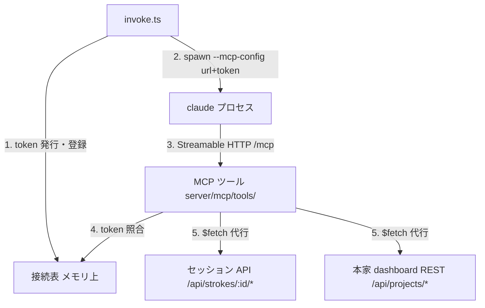

# provide-operations-via-mcp Design

## Context

- claude の起動は invokeAi の1系統で、呼び出し側がフラグを足す構造になっている（`openspec/specs/agent/invocation`）。steering 工程は既に `--mcp-config` へ本家 MCP を JSON 文字列で直渡ししている（`server/utils/stroke/invoke.ts` の `mcpConfigFor`、ADR-0011）
- セッション API（`/api/strokes/:id/*`）と本家 dashboard REST（`/api/projects/*`）は稼働済みで、契約は `openspec/specs/api/**` と本家 2.2.7（ADR-0008）に固定されている
- 動機と範囲は proposal.md を参照。specs は `specs/mcp/**` と `specs/agent/invocation` にある
- 用語: 「MCP サーバー」= stroke-board 自身が `/mcp` で提供する MCP endpoint。「invoke.ts」= claude を spawn する処理（`server/utils/stroke/invoke.ts`）。「本家 dashboard」= 本家 spec-workflow の dashboard。単に「サーバー」とは書かない

## Goals / Non-Goals

**Goals:**

- 現行操作の代行ツール一式を MCP として提供し、両工程の spawn に配線する（`--mcp-config` と MCP ツール分の `--allowedTools` の両方。claude が実際に呼べる状態までを「提供」とする）
- ツール定義をモジュールの規約に載せ、後続 change（実処理化）がハンドラの差し替えだけで済む形にする
- 接続を起動時発行の一時 token で担保し、invoke.ts が起動した claude だけがツールを使える状態にする

**Non-Goals:**

- ワークフロースキーマ側の instruction の作り直し・スキル相当の手順書の整備（`adr0016-sub-switch-workflow-to-mcp-tools`）。MCP ツール分の allowedTools の追加・curl / jq の削除・prompt 3件の向き先変更は、提供したツールで往復が成立するために要るので本 change に含む
- ツールの実処理化・transport の変更（`adr0016-sub-implement-mcp-operations`）
- `docs/` の変更（`adr0016-sub-document-mcp-operations`）

## MCP 提供の全体設計

### 全体像

stroke-board（Nitro）の中に「ツール定義（口）」と「接続の担保（判断）」の2層を足す。ツールは既存 endpoint への HTTP 発行のみで代行し、検証・状態遷移の正は endpoint 側に残す。



### ツールと代行先の対応

| ファイル（=ツール名） | 内容 | 代行先 |
|---|---|---|
| `get-overview.ts` | 概要の取得 | A1 `GET /api/strokes/:id/overview` |
| `get-strokes.ts` | ストローク記録の取得 | U3 `GET /api/strokes/:id/strokes` |
| `get-send-back.ts` | 差し戻しの取得 | A4 `GET /api/strokes/:id/send-back` |
| `send-question.ts` | 問いの提出（構造化引数） | A5 `POST /api/strokes/:id/question` |
| `submit-document.ts` | 文書の提出（種別 flontier / steering） | A7 `POST /api/strokes/:id/proposal` / 本家 `PUT /api/projects/:projectId/steering/:name` |
| `get-steering.ts` | steering 文書の取得（有無 `exists` を結果で告知。値は本家の文書状況から） | 本家 `GET /api/projects/:projectId/steering/:name` / 本家 `GET /api/projects/:projectId/info` |

ツールファイルの形（ハンドラが `(args, event: H3Event)` を受けることはモジュールのソースで検証済み: `nitro-mcp-toolkit/src/runtime/tool.ts`）:

```ts
// server/mcp/tools/get-overview.ts — A1 への代行
import { z } from 'zod'
import { defineMcpTool } from '@nuxtjs/mcp-toolkit/server'

export default defineMcpTool({
  description: '概要（ユーザーが最初に投げた、作りたいシステムの説明）を取得する',
  inputSchema: {},
  handler: async (_args, event) => {
    const conn = resolveConnection(event) // token 照合。不一致は 401 を throw
    const { overview } = await $fetch(`/api/strokes/${conn.sessionId}/overview`)
    return { overview }
  },
})
```

### 接続の担保（token と接続表）

1. invoke.ts が spawn の直前に一時 token（暗号学的に推測困難な乱数）を生成する
2. 接続表に「token → 接続文脈」を登録する
3. mcp-config `{ "type": "http", "url": "<apiBaseUrl>/mcp", "headers": { "x-stroke-token": <token> } }` を組み立てて claude を起動する
4. ツール呼び出しごとに、ヘッダの token を接続表と突き合わせて接続文脈を解決する
5. token の欠落・表に無い token は 401 で拒否し、既定値で補わない（ADR-0014）

接続表のエントリと持ち方:

| 項目 | 内容 |
|---|---|
| token | 照合キー。`x-stroke-token` ヘッダと突き合わせる |
| sessionId | 対象のセッション id |
| projectPath | 対象のプロジェクトパス |

登録は spawn の直前、削除は invokeAi の実行終了時（正常・異常とも）。Nitro プロセス内のメモリのみに保持し永続化しないため、stroke-board 再起動で全エントリが失効し、再起動をまたいで有効な資格情報を作らない。

### 結果の形

各ツールの結果は1階層のフラットな形に統一し、種類の列挙（成功/エラー/不達の排他形）にはしない。項目は次のとおり。

| 項目 | いつ持つか | 意味 |
|---|---|---|
| `status` | 常に | 呼び出しの結果を表す HTTP ステータスコード（endpoint の応答の値を保持する） |
| `errorCode` | 失敗時のみ | 機械可読の失敗種別。endpoint のエラーは応答から導出し、本家 dashboard に到達できない場合は `unreachable` |
| `error` | 失敗時のみ | endpoint が返したエラー本文。書き換え・省略・追加をしない |
| 結果スキーマの項目 | 成功時のみ | 例: `get-overview` は `overview: string` |

## Decisions

### Decision: `@nuxtjs/mcp-toolkit` を採用し、stroke-board 自身が MCP サーバーになる

MCP は Nuxt アプリの route `/mcp`（Streamable HTTP）で提供し、別プロセス・stdio・バンドル配布は行わない。ツール定義の自動発見・zod スキーマ・Nuxt DevTools の MCP Inspector が揃い、実装量が最小になる（nuxt-modules 公式 v0.19.0）。0.x のため lockfile でバージョンを固定し、更新は change として扱う。モジュール調査と採用はユーザー指示（2026-08-27）。代替の自前 stdio サーバー・SDK 手組みは不採用。

### Decision: ツール定義はモジュールの規定配置 `server/mcp/tools/` に置く

`dir` オプションは既定 `'mcp'`（server ディレクトリ基準）のまま変更しない。モジュールが前提とする標準配置に沿い、設定の上書きを持たない（ユーザー判断 2026-08-27「規定に沿う」）。リポジトリ直下への分離（`dir: '../mcp'`）は不採用。

### Decision: ハンドラは既存 endpoint への HTTP 発行のみで代行する

対応する既存 endpoint へ `$fetch` を発行し、その応答だけから結果を作る。セッションディレクトリ・プロジェクトディレクトリのファイルは読み書きしない。検証・状態遷移の正は endpoint 側にあり（ADR-0014）、MCP 層に第2の実装を作らない。同一プロセスでも endpoint を経由するのは busy ガード・前提チェックを通すため（invoke.ts の U13 経由と同じ判断）。

### Decision: 接続は起動時発行の一時 token で担保する

invoke.ts が起動した claude だけが接続できる担保と「どの claude か」の特定を、1つの token で行う。セッション id の直渡しは不採用——特定できるのは flontier 工程だけで steering 工程の文脈はプロジェクトパスとなりヘッダの意味が工程で変わるうえ、id は画面 URL（`/strokes/<uuid>`）に現れる値で担保にならない。永続 token（設定値）も不採用——全 claude で共有になり、漏れても失効できない。

### Decision: 接続表はメモリ上の層とし、capability `server/session-management` で契約を定める

接続の担保はツール個別でなく全ツール共通の関心なので、独立した層にし、契約を capability `server/session-management` に定める（spec は承認済み）。ファイル・DB への永続化は不採用——失効管理が必要になり、漏洩面も増える。

### Decision: 結果は status と errorCode のフラットな形に統一する

すべての結果は1階層で、常に `status`（HTTP ステータスコード）を持つ。失敗はさらに `errorCode`（機械可読の失敗種別）と `error`（endpoint が返したエラー本文。書き換え・省略・追加をしない）を持ち、成功はツールの結果スキーマの項目を持つ。種類の列挙（成功/エラー/不達の排他3形）にはしない（レビュー指示 2026-08-27）。「相手が拒否した」（内容を直して出し直せる）と「相手に届かない」（出し直しても無駄、環境の問題）の区別は `errorCode` で表し、後者は `unreachable` とする。`unreachable` を定めるのは本家 dashboard 向け操作だけ——stroke-board 自身が spawn 元で、停止中にツールが実行される状況が成立しないため（specs `mcp/server`）。MCP サーバー側の事前検証・独自分岐は入れない（ADR-0014）。入れ子の構造化エラーは不採用。

### Decision: MCP の url は既存設定から組み立てる

url の base は nuxt.config の既存値 `runtimeConfig.claude.apiBaseUrl`（エージェント向け base URL、現行 STROKE_BASEURL の元値）から取り、新しい設定は増やさない。本家 dashboard の base URL も既存の `runtimeConfig.upstreamBaseUrl` を使う。projectId は MCP ツールが実行時に本家 `GET /api/projects/list` の応答からプロジェクトパスで引き当てる。

### Decision: ツール名は動詞+対象で内容がわかる名前にする

`get-overview` / `get-strokes` / `get-send-back` / `send-question` / `submit-document` / `get-steering` の6本（ファイル名=ツール名）。スキル名は引き継がない。問いと文書を分けるのは引数の形が別物のため（構造化引数 vs 本文の文章）。capability 名の流用（`overview` 等）は内容が読めず不採用。

## Risks / Trade-offs

- [モジュールが 0.x で破壊的変更があり得る] → lockfile でバージョンを固定し、更新は change として扱う
- [同じ `/mcp` に複数の claude が接続する] → 接続表の token 照合で接続文脈を分離する。ヘッダ欠落・表に無い token は拒否し、既定値で補わない（ADR-0014）
- [`/mcp` が route として外部からも見える] → token 照合により、invoke.ts が起動した claude 以外の呼び出しは拒否される（Decision: 一時 token）
- [本家 dashboard 停止中は steering 系ツールが失敗する] → `errorCode: unreachable` の失敗として返し（Decision: 結果の形）、MCP サーバー側で握りつぶさない
- [操作系のフォールバック先が存在しない] → 操作系のスキルが無く curl / jq も落ちている現状では、取得・提出の入口は MCP ツールだけで、ツールが動かなければ往復は止まる。受け入れ条件を「取得・提出が MCP ツール経由で行われ、往復が成立すること」に置き、実機で確認する（tasks 5.1）。案内・instruction は引き続き Skill が担う

## Migration Plan

1. モジュールを導入し（`nuxt.config.ts` の modules に追加、route は既定 `/mcp`）、`server/mcp/tools/` にツールを置いて Nuxt DevTools の MCP Inspector で列挙を確認する
2. 接続表の層と token 照合を入れ、invoke.ts の両工程の `--mcp-config` に `{ "type": "http", ... }` のサーバー定義を足す（既存フラグ・本家 MCP の並びは変えない）
3. 同じ場所で MCP ツール分の `--allowedTools` をコード内で組み立てて足す（複数指定がマージされるか上書きされるかは実機で確定する）。あわせて `nuxt.config.ts` の既存 allowedTools から `Bash(curl -X POST *)` / `Bash(jq -n *)` を落とし、取得・提出を MCP ツール以外で真似できる余地を消す
4. `nuxt.config.ts` の prompt 3件の向き先を MCP ツールへ改める（スキルは削除済みで指し先が無い）
5. スキルが無くフォールバック先が存在しないため、ロールバックしても旧経路には戻らない。`--mcp-config` / `--allowedTools` / prompt の変更を外すと往復そのものが止まる。この change は戻す前提を持たない
