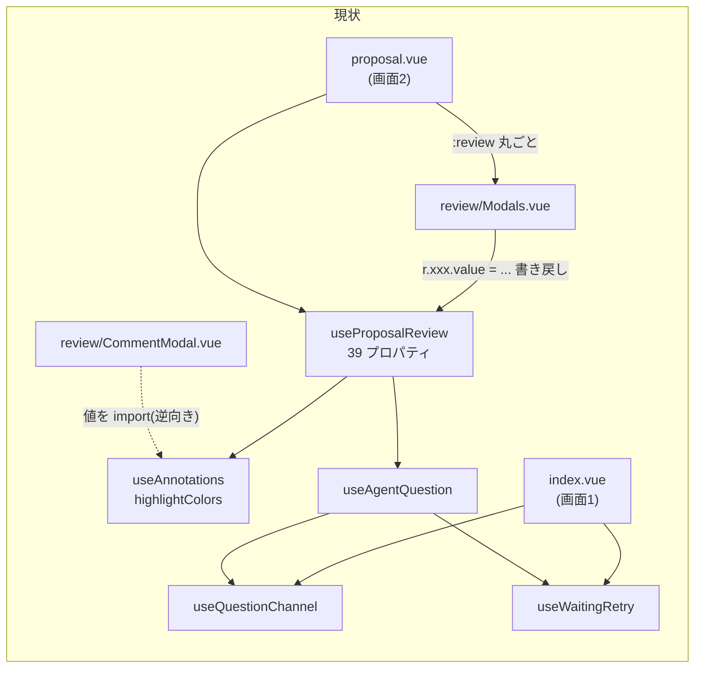
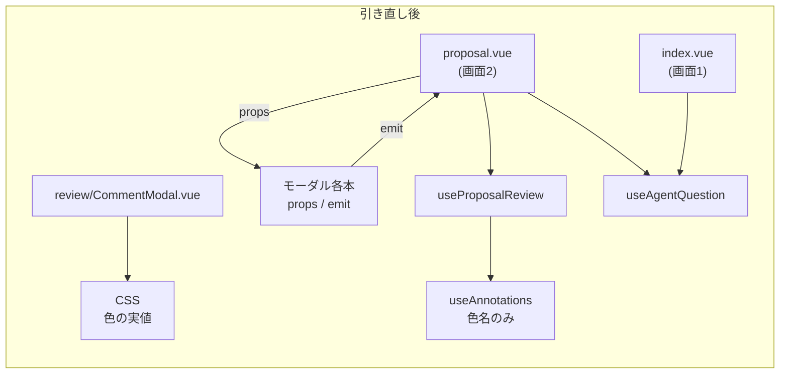

# proposal — realign-component-composable-boundaries

## Why

承認済み仕様書 `docs/specs/core/file-components.md`（spec-workflow、2026-08-24 承認）の**条件付き承認の条件**として起票された。棚卸しで、component と composable の**繋ぎ方が揃っていない**ことが3点、事実として出ている。

- `review/Modals.vue` だけが composable の戻り値（39 プロパティ）を丸ごと受ける。他14本は props と emit
- `review/CommentModal.vue` が composable から値（ハイライト5色）を import している。**依存の向きが逆**
- 画面1 は composable を持たず、ページが `useQuestionChannel` / `useWaitingRetry` / 自前 `answer()` を直に組む。画面2 は同じ往復を `useAgentQuestion` に畳んでいる。**同じ往復に2つの経路がある**

置き場（どのディレクトリに置くか）ではなく、**面と状態の境界をどこに引くか**の問題であり、`reorganize-components` / `flatten-composables` とは別軸。

**順序について**: ticket は `separate-composable-responsibilities`（`useProposalReview` 412行の責務分離）がある程度進んでから着手する前提を置いている。その change は 2026-08-25 時点で artifact が未作成。本 change は**境界の引き直しのみ**を持ち、`useProposalReview` の内部分割には踏み込まない。

## What Changes

### 1. `Modals.vue` の結合を props / emit へ揃える

`Modals.vue` は5つのモーダル（本文コメント・全体コメント・削除確認・停止理由・承認確認）をまとめ、`review.xxx` を配り直している。読むだけでなく `r.deleteId.value = null` / `r.alertMessage.value = null` / `r.approveOpen.value = false` / `v-model="r.projectName.value"` の**書き戻し**も持つ。

- 各モーダルを props（表示に要る値）と emit（操作の通知）だけで繋がる形にする
- 束ね役をページに畳むか component として残すかは design で決める

### 2. 色の逆向き import を断つ

`CommentModal.vue` の `import { defaultHighlightColor, highlightColors } from '~/composables/useAnnotations'` をやめる。色の実値（`bg` / `border`）は CSS へ移し、データ（`Annotation.highlightColor`）は色名のみ持つ。`AnnotateSource.vue` のハイライト描画も同じ経路に揃える。

### 3. 画面1 の往復を composable へ寄せる

画面1 のページに直書きされている `answer()`（U7 → U13 の2連発）・`answered` の計数・`waiting` / `failed` の張り替え・`statusOf` を、画面2 と同じ `useAgentQuestion` の経路へ寄せる。**振る舞いは変えない**（遷移・エラー文言・待機表示は現行のまま）。

- `useAgentQuestion` の送信先 base が `/api/<id>` である既知の不整合は `fix-agent-question-api-path` の担当。本 change は寄せる前にその差を潰す必要があるため、design で扱いを決める

### 非対象（別 change）

- `useProposalReview` の内部分割、`statusOf` / `reasonOf` / `messageOf` の重複解消 → `separate-composable-responsibilities`
- ディレクトリの再編・平置き → `reorganize-components` / `flatten-composables`

## Capabilities

### New Capabilities

なし。

### Modified Capabilities

なし。振る舞いを変えない純粋なリファクタのため、`.openspec.yaml` に `skip_specs: true` を置く（`replace-handrolled-with-libraries` と同じ扱い）。

## Impact

| 対象 | 影響 |
| --- | --- |
| `app/components/review/Modals.vue` | 結合を props / emit へ。束ね役の去就は design |
| `app/components/review/CommentModal.vue` | composable からの値 import を除去。色は CSS |
| `app/components/review/AnnotateSource.vue` | ハイライトの色指定を CSS 経由へ |
| `app/composables/useAnnotations.ts` | `highlightColors` の実値を手放す（色名の定義は残す） |
| `app/pages/strokes/[sessionId]/proposal.vue` | モーダルへの受け渡しを props / emit で書く |
| `app/pages/strokes/[sessionId]/index.vue` | 往復を `useAgentQuestion` 経由へ |
| `app/composables/useAgentQuestion.ts` | 画面1 からも呼べる形にする（引数・返り値の見直し） |
| `docs/specs/core/file-components.md` | 「受け渡しの形」「共有型への依存」「気づいたこと」の記述を追随 |
| `docs/specs/core/file-composables.md` | 「画面1側には composable が無い」の記述を追随 |
| `docs/specs/reference/stroke-modules.md` | `useAgentQuestion` の使い方を両画面ぶんに改める |
| 検証 | `yarn typecheck` / `yarn test` / `yarn test:e2e` 全件 |

依存: `replace-handrolled-with-libraries`（未完・56/65）。`AgentQuestion` の1本化と `useSessionChannel` への集約はその change の成果を前提にする。
