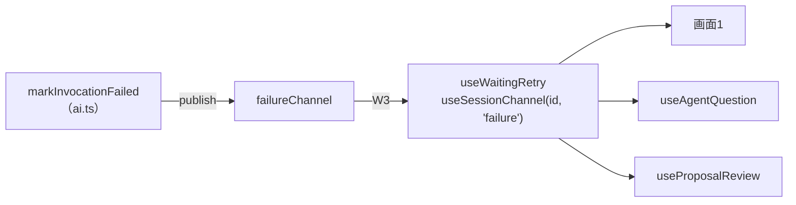
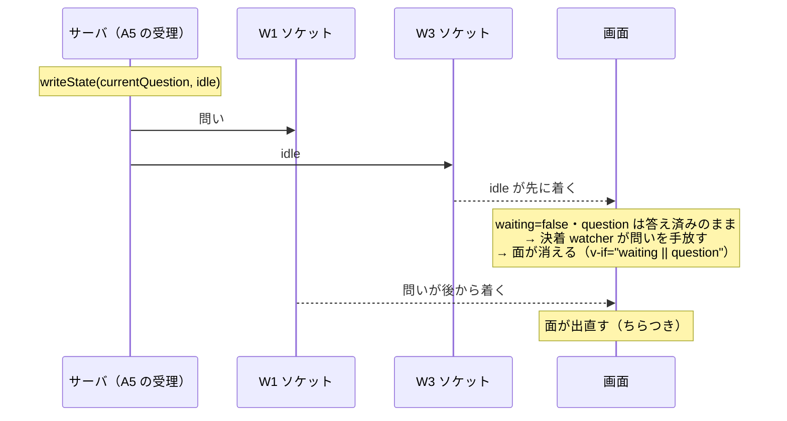
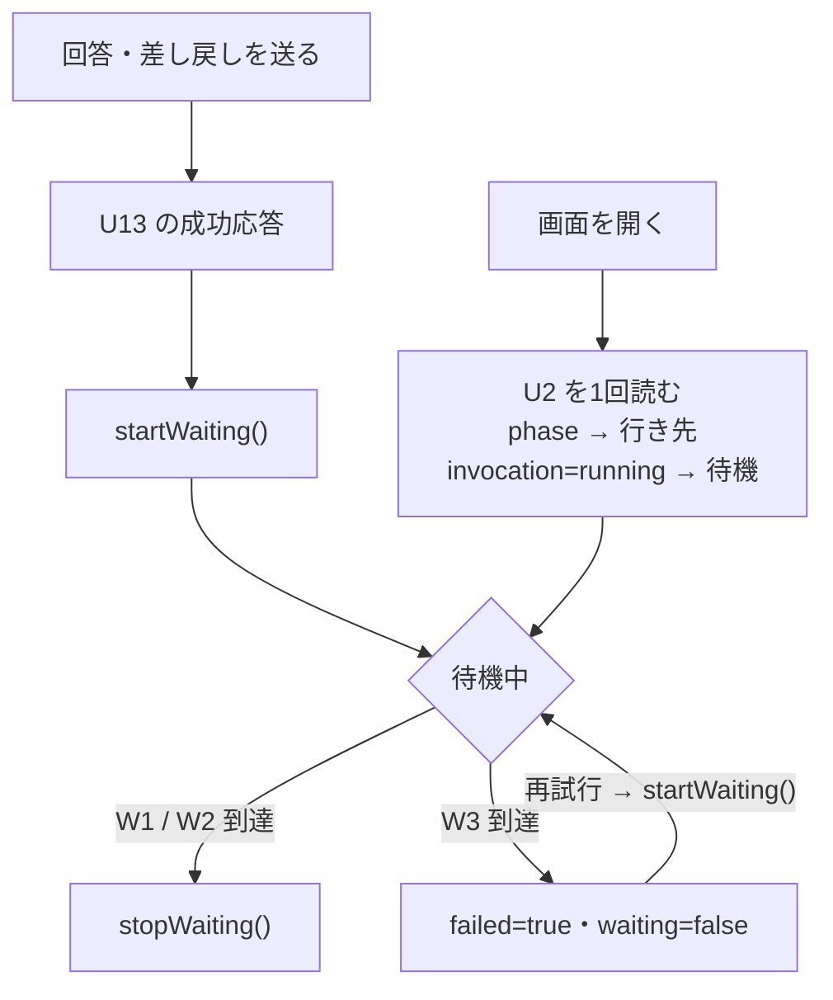
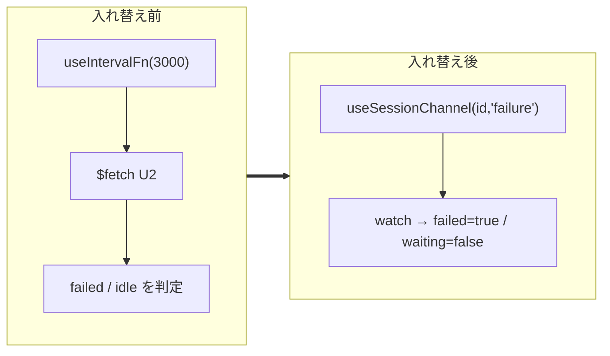
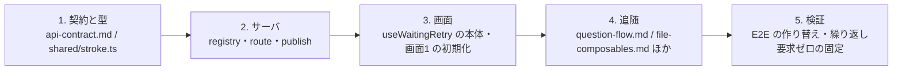

# design — replace-polling-with-push

## Context

動機と範囲は proposal.md。要件は `specs/ai-invocation/spec.md`。ここでは「失敗をどの経路でどう届けるか」と「その結果 `useWaitingRetry` が何になるか」を決める。

現状のコードで、この change が触る所だけを挙げる。

| 場所 | 今の形 |
| --- | --- |
| `server/utils/stroke/ws-channels.ts` | `createRegistry()` を2本（`questionChannel` / `proposalChannel`）。`sessionIdFromUrl(url, channel)` の `channel` は `'question' \| 'proposal'` |
| `server/routes/api/strokes/[id]/ws/{question,proposal}.ts` | 各31行。`sessionExists` → `register` → **接続時配信**（`state.json` / `proposal.md` を読んで1件） |
| `server/utils/stroke/ai.ts:120-124` | `markInvocationFailed` は `readState` → `phase === 'approved'` なら return → `writeState({ invocation: 'failed' })`。publish しない |
| `app/composables/useSessionChannel.ts` | `useWebSocket` + `autoReconnect`。**SSR は `typeof window === 'undefined'` で空 URL を返して繋がない**。`latest.value = JSON.parse(...)` で最後の1件を持つ |
| `app/composables/useWaitingRetry.ts` | `useIntervalFn(3000)` で U2 を読み直す。`import.meta.server` early return。返り値は `{ waiting, failed, startWaiting, stopWaiting }` |
| 参照3箇所 | `pages/strokes/[sessionId]/index.vue:41` / `useAgentQuestion.ts:53` / `useProposalReview.ts:86` |

境界の正は `docs/specs/api/api-contract.md`（endpoint と WS の契約）と `shared/stroke.ts`（型）。W3 を足すとは、まずこの2つを直すことである。

## Goals / Non-Goals

**Goals:**

- 失敗の到達手段を1本に決め、実装が「push で来たか、問い合わせて見つけたか」の分岐を持たない状態にする
- `useWaitingRetry` の参照3箇所を1行も変えずに本体を入れ替えられる形にする
- 「何も起きていない間、サーバへの繰り返し要求が発生しない」をテストで固定できる形にする

**Non-Goals:**

- 待機の開始（U13 の成功応答の直後）と、成功の決着（W1 / W2 の到達）の作り直し
- 画面2 の待機インスタンスの統合、および失敗の知らせ方の設計（`separate-composable-responsibilities` の軸）
- U2（`GET /api/strokes/:id`）そのものの廃止。画面を開いたときの1回読みは残す
- `useAgentQuestion` の `base` が `/api/${sessionId}` になっている件（`fix-agent-question-api-path` の範囲）

## Decisions

### 決定1: 失敗は第3のチャンネル W3 `/api/strokes/:id/ws/failure` で配信する

| 案 | 形 | 判定 |
| --- | --- | --- |
| a | W1 に載せる（`Question \| Failure` の union） | ✗ |
| b | W1 と W2 の両方に載せる | ✗ |
| **c** | **第3のチャンネル W3 を足し、既存の汎用 `useSessionChannel` で購読する** | **採用** |

**案 a を採らない理由。** W1 の購読口は `useSessionChannel<Question>` で、届いたものをそのまま `question` として持つ。失敗を同じ口に載せると型が union になり、受け側（`useAgentQuestion`）が「問いか失敗か」を `if` で振り分ける。**1つの購読口に2つの意味を詰めて分岐で畳む形**になる。加えて W1 の接続時配信ハンドラも `state.currentQuestion` と `invocation` の2つを見ることになる。さらに、画面2 が W1 経由で失敗を受けると `useAgentQuestion.failed` が「問い返しの失敗」と「差し戻しの失敗」の両方を意味してしまい、問いの往復の機構が差し戻しの後始末まで抱える。

**案 b を採らない理由。** 画面2 は W1 と W2 の両方を購読している（`useProposalReview` → `useProposalChannel`、`useAgentQuestion` → `useQuestionChannel`）。両方に載せれば同じ失敗が2回届き、どちらで決着させるかが決まらない。同じ規定を2箇所に書くことにもなる。

**案 c を採る理由。** 増えるのはチャンネル名1つ分である。

- サーバ: `createRegistry()` を1本足し、route ハンドラを既存2本と同型で置く。`sessionIdFromUrl` は `channel` を引数で受けているので、union に `'failure'` を足すだけで `wsPathPattern`（`{channel}` を差し替える正規表現）はそのまま通る
- 画面: `useSessionChannel<T>(sessionId, 'failure')` を呼ぶだけ。**新しい抽象はゼロで、増えるのは引数1つ**
- 型は1種類のまま。購読側に分岐が生まれない

`openspec/specs/` に capability を新設しないことは proposal で決めた。W3 は W1 / W2 と同じ規約の3本目であり、契約の正は `docs/specs/api/api-contract.md` にある。

### 決定2: W3 が運ぶのは「失敗」1種に限る。呼び出しの実行状態は流さない

W3 に `invocation`（`running` / `idle` / `failed`）を流す案を採らない。**別ソケット間の到達順は保証されないため、1つの決着を2つのソケットに分けると壊れる。**

失敗はこの危険を持たない。`markInvocationFailed` が走るのは**提出が1度も届かないままリトライが尽きたとき**だけで、W1 / W2 の配信と同時には起きない。失敗だけを W3 に載せれば、**1つの決着が1つのソケットで完結する**。

したがって決着の担当はこう分かれる。

| 決着 | 経路 | 画面の状態 |
| --- | --- | --- |
| 問いが出た | W1 | `waiting` が下り、次の問いが入る |
| proposal が出た | W2 | `waiting` が下り、proposal が入る |
| リトライが尽きた | **W3** | `waiting` が下り、`failed` が立つ |

メッセージの形は `{ invocation: 'failed' }`（`shared/stroke.ts` に型を1つ足す）。裸の文字列にしない理由は技術的なもので、`useSessionChannel` は `latest.value = JSON.parse(...)` で ref に代入するため、**同じ文字列を2度受け取ると値が変わらず `watch` が発火しない**。オブジェクトなら毎回新しい参照になり、2度目の失敗も決着として届く。

### 決定3: W3 は接続時にも現在の失敗を1件流す（W1 / W2 と同じ規約）

W3 の route ハンドラは `register` の後に `state.json` を読み、`phase !== 'approved'` かつ `invocation === 'failed'` なら1件送る。W1（`ws/question.ts:22-25`）・W2（`ws/proposal.ts:20-25`）と同じ形である。

**接続時配信を持たない案を採らない理由。** WS は接続中に起きたことしか運ばない。接続時配信が無いと「失敗した瞬間に画面が繋がっていなかった」場合だけ別経路（U2 の初期読み）が要り、失敗の到達手段を1本にするという目的が例外を1つ抱えたまま終わる。`autoReconnect` で切れている間に失敗が決着した場合も、再接続時の接続時配信が拾う。

効能は測れる形で1つある。**画面1 の初期化から `invocation === 'failed'` の分岐（`index.vue:52-54`）が消える。**

### 決定4: 待機の開始は U13 の成功応答のまま。U2 は「画面を開いたときの1回読み」だけ残す

待機は「自分が起動を要求したから待っている」という画面側の状態であり、サーバの実行状態そのものではない。リロードで自分の要求を失った画面が待機に戻る手掛かりは U2 の1回読みしかない（`index.vue:18` は phase の行き先判定のためにどのみち1回読む。同じ応答から `invocation: 'running'` も取る）。

ここを W3 に載せると W3 が実行状態チャンネルになり、決定2 の危険に戻る。

消えるのは U2 の**読み直し**だけである。契約の「回答や差し戻しを送って待っている間だけ、数秒おきに読み直す」の一文が落ち、「リロード時に1回読む」が残る。

### 決定5: SSR の配慮は `useSessionChannel` の1箇所に集まる

現行の `import.meta.server` early return は、**SSR で `setInterval` を張ると Nuxt が例外にする**（`useWaitingRetry` のコメントに実測の経緯）ためのものだった。ポーリングが消えると `setInterval` も消え、このガードは要らなくなる。

W3 の購読は `useSessionChannel` を通り、そこには既に `typeof window === 'undefined'` で空 URL を返すガードがある（`useWebSocket` は空 URL では繋がない）。**新しく足すガードは無く、`useWaitingRetry` から1つ減る。**

SSR 中に `waiting` / `failed` がどうなるかは変わらない。`startWaiting()` は SSR でも `waiting.value = true` を立てており（early return は `poll.resume()` の手前）、その挙動は維持される。

### 決定6: `useWaitingRetry` は消さず、本体だけを入れ替える。名前は据え置く

公開インターフェース（`waiting` / `failed` / `startWaiting` / `stopWaiting`）は不変で、参照3箇所は変わらない。

**消す案を採らない理由。** 3箇所が必要とする形は同一（旗2つとその上げ下げ、W3 の購読）で、消せば同じものが3箇所へ逐語で散る。

**改名しない理由。** 「リトライ」が実体を持たないのは本 change より前からで、現行のコメントにも「回復（同じ入力 POST の再送）はここでは行わない。呼び出し側の役割」と書かれている。本 change が作り出した食い違いではないため、直す責任も本 change には無い。**改名の要否はユーザーの判断に委ねる**（tasks 1.1 で確認する）。

### 決定7: 画面2 の `useWaitingRetry` 2インスタンスは畳まない

2つは別の待機である。

| インスタンス | 何を待つ | 決着 |
| --- | --- | --- |
| `useProposalReview.ts:86` | 差し戻しの結果 | 問い返し（W1）・出し直し（W2）・失敗（W3） |
| `useAgentQuestion.ts:53` | 問い返しへの回答の結果 | 次の問い（W1）・出し直し（W2）・失敗（W3） |

畳むには2つを1つの状態機械に統合し、`useAgentQuestion` の公開インターフェース（`startWaiting` を出していない）を変える必要がある。それは責務の設計判断であり `separate-composable-responsibilities` の軸。ポーリング撤去はインスタンス数に触れずに達成できる。

残差は「画面2 で W3 の接続が2本」。配信は `Set` に登録された全接続へ同じ内容が流れるため、機能上の害は無い。**ポーリング時代の残差（毎3秒で2回 GET）が、常時2本の WS 接続に変わる。**

### 決定8: E2E の失敗局面は WS のスタブで作る

`e2e/agent-question.spec.ts:455` は U2 を `page.route` でスタブして `invocation: 'failed'` を返し、ポーリングに拾わせている。W3 へ移ると U2 のスタブでは失敗が作れない。

| 案 | 判定 |
| --- | --- |
| `page.routeWebSocket` で W3 をスタブする | **採用**（`@playwright/test ^1.62.1`。`routeWebSocket` は 1.48 から） |
| `CLAUDE_TIMEOUT_MS`（180000）を短くして実物の失敗を起こす | ✗ 固定値で、E2E から差し替える口が無い。設定として外に出すのは `settings-reference` の改定（ADR-0004）を伴い、この change の範囲を超える |
| 失敗を起こす専用の endpoint を足す | ✗ 検証のためだけに製品の口を増やす |

## Risks / Trade-offs

**[提出と失敗が競り合う]** → 最後の試行のタイムアウトが解けた直後に提出が届くと、A5 が `idle` を書いて W1 へ配信した後で `markInvocationFailed` が `failed` で上書きし、W3 へも配信する。画面には問いと失敗の両方が届く。**この競合は現行にもあり（`state.json` が failed で上書きされる）、本 change で新たに生じるものではない。** 画面の側は失敗のとき問いを手放さない（`useAgentQuestion` の決着 watcher が `failed` で return する）ため、同じ問いに送り直せる状態に落ち着く。

**[接続が切れている間に失敗が決着する]** → `autoReconnect` の再接続時に接続時配信が1件送る（決定3）。取りこぼしは残らない。

**[同じ失敗が接続のたびに届く]** → 再試行して `startWaiting()` が `failed` を落とすまで、開き直すたびに失敗が届く。再試行前は失敗が正しい状態なので害は無い。

**[画面2 は、リロード直後に既に失敗していると `failed` が立つのに表示に至らない]** → 知らせ方が「待機の終わり」の watcher に結び付いているため。**現行も同じで、本 change では直さない**（決定7 と同じ線引き）。`sendBack()` は `waiting` だけを見て弾くので、`failed` が立っていても差し戻しは送れる（`startWaiting()` が `failed` を落とす）。ロックはしない。

**[W3 の接続が画面2 で2本]** → 決定7。

## Migration Plan

契約から先に直す（contract-first）。W3 を足す段までは既存の W1 / W2 に一切触れないため、画面側の入れ替えだけを戻せば元に戻る。

段2 まで入れた状態は、W3 が流れているが誰も購読していない状態で、振る舞いは現行と同一。ロールバックは段3 の差し戻しだけで足りる。
