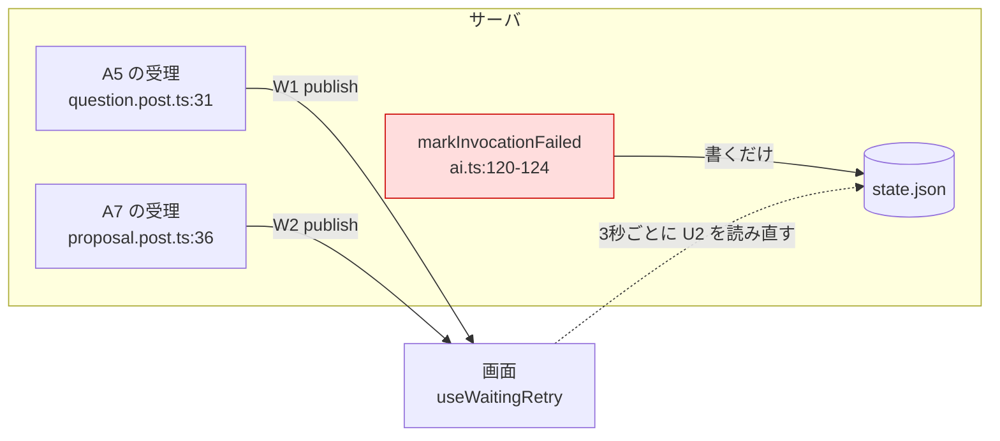
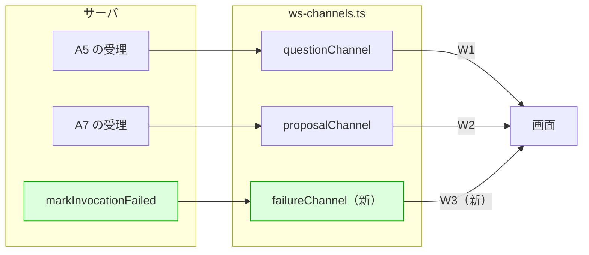

# proposal — replace-polling-with-push

## Why

ストローク側の待機は、成功と失敗で届き方が揃っていない。

`app/composables/useWaitingRetry.ts` の冒頭は、ポーリングを「通常は W1 / W2 の配信が先に届く」ための保険と書いている。**この位置づけは成功パスしか見ていない。**

| 決着 | サーバがすること | 画面への届き方 |
| --- | --- | --- |
| 問いが出た | `state.json` を書き、W1 へ publish | push（即時） |
| proposal が出た | `proposal.md` を書き、W2 へ publish | push（即時） |
| **リトライが尽きた** | **`state.json` に `invocation: 'failed'` を書くだけ** | **3秒ポーリングだけ** |

失敗は保険ではなく、ポーリングが**唯一の検出手段**になっている本体である。そのために、AI が走っている間じゅう（実測: 何も起きていなくても）3秒ごとに `GET /api/strokes/<id>` が飛び続ける。画面2 では `useWaitingRetry` のインスタンスが2つ立つため、待機が重なれば毎3秒で2回叩く。

ポータル側には既に「本家の状態を定期ポーリングで取りに行かない」（`openspec/specs/upstream-connection/spec.md`）がある。**同じ原則がストローク側にだけ通っていない。** 失敗に push の経路を1本与えれば、ポーリングを持つ理由は残らない。

## What Changes

失敗の配信チャンネル W3 を1本足し、`useWaitingRetry` のポーリングをその購読に入れ替える。

### サーバ

- `server/utils/stroke/ai.ts` の `markInvocationFailed` が、`state.json` を書いた後に W3 へ publish する
- `server/routes/api/strokes/[id]/ws/failure.ts` を1本足す。中身は W1 / W2 の route と同型（`sessionExists` の検査 → `register` → 接続時配信）
- `server/utils/stroke/ws-channels.ts` に registry を1本足し、`sessionIdFromUrl` のチャンネル名に `failure` を加える

### 画面

- `app/composables/useWaitingRetry.ts` の本体を、3秒間隔の U2 読み直しから W3 の購読へ入れ替える。**公開インターフェース（`waiting` / `failed` / `startWaiting` / `stopWaiting`）と参照3箇所は変えない**
- 同ファイルの `import.meta.server` early return が消える（`setInterval` を張らなくなり、SSR ガードは `useSessionChannel` の1箇所に集まる）
- `app/pages/strokes/[sessionId]/index.vue` の初期化から `invocation === 'failed'` の分岐が消える（W3 の接続時配信が担う）。`invocation === 'running'` の分岐は残る

### 契約・型・テスト

- `shared/stroke.ts` に W3 のメッセージ型を1つ足す
- `docs/specs/api/api-contract.md`: WS 配信を2本 → 3本にし、U2 の「**回答や差し戻しを送って待っている間だけ**、数秒おきに読み直す」を「リロード時に1回読む」だけに削る
- `docs/specs/architecture/question-flow.md`: 配信の図と「`invocation` は…リトライが尽きたとき `failed`」の記述に W3 を通す
- `e2e/agent-question.spec.ts` の failed 局面の作り方を、U2 のスタブから WS のスタブへ替える

### 範囲の線引き

- **`useWaitingRetry` は消さず、中身を入れ替える。** 参照3箇所（画面1・`useAgentQuestion`・`useProposalReview`）が必要とする形は同一で、消せば同じ2つの ref が3箇所へ散る
- **画面2 に `useWaitingRetry` のインスタンスが2つある件は畳まない。** 2つは「差し戻しの待機」と「問い返しの待機」という別の待機で、畳むには2つを1つの状態機械に統合する設計判断が要る。それは `separate-composable-responsibilities`（責務分離）の軸であって、ポーリング撤去はインスタンス数に触れずに達成できる。本 change 後の残差は「1セッションあたり画面2 で W3 の接続が2本」であり、配信は全接続へ同じ内容が流れるため機能上の害は無い
- `useAgentQuestion` の `base` が `/api/${sessionId}`（`useProposalReview` は `/api/strokes/${sessionId}`）になっている件は `fix-agent-question-api-path` の範囲。触らない

## Capabilities

### New Capabilities

**無し。** W3 は W1 / W2 と同じ「サーバが持つ現在分を、提出時と接続時に1件流す」規約の3本目であり、既存の仕組みの中に収まる。W1 / W2 自体も `openspec/specs/` に capability を持たず、`docs/specs/api/api-contract.md` が契約の正である。W3 のためだけに capability を新設すると、3本のうち1本だけが機能的 spec を持つ非対称ができる。

### Modified Capabilities

- `ai-invocation`: 「リトライしても進めない場合だけエラーを表示する」を改定する。**失敗が決着した瞬間に、待っている画面へ届く**こと、および**その画面が繋いだ時点で既に失敗しているなら、繋いだ瞬間に届く**ことを加える。あわせて「呼び出しの状態を繰り返し問い合わせない」を足す（`upstream-connection` の「本家の状態を定期ポーリングで取りに行かない」と同じ規定を、ストローク側の呼び出しに対して置く）

改定はこの1つに限る。`stroke-session`（待機表示の文言と追加送信の禁止）・`agent-question`（応答が得られなかったとき同じ問いのまま送り直せる）・`api/invoke-agent`（起動の受理）は、届き方が変わっても満たされ続けることが要件であり、Requirement は変わらない。

## Impact

**コード**

| 範囲 | 内容 |
| --- | --- |
| `server/utils/stroke/ws-channels.ts` | registry 1本追加、チャンネル名の union に `failure` |
| `server/routes/api/strokes/[id]/ws/failure.ts` | 新規1本（既存2本と同型） |
| `server/utils/stroke/ai.ts` | `markInvocationFailed` に publish 1行 |
| `app/composables/useWaitingRetry.ts` | 本体の入れ替え。公開インターフェースは不変 |
| `app/pages/strokes/[sessionId]/index.vue` | 初期化の `failed` 分岐が消える |
| `shared/stroke.ts` | メッセージ型1つ追加 |

**設定**

- `wsPathPattern`（`/api/strokes/([^/]+)/ws/{channel}(?:$\|[/?#])`）は `{channel}` の差し替えで足りる。`docs/specs/core/settings-reference.md` に変更は無い

**依存**

- 追加・削除とも無し。W3 は既存の crossws / `useSessionChannel` の上に乗る

**検証**

- `e2e/agent-question.spec.ts:455` の「AI から応答が得られなかったら、面は残って同じ問いに送り直せる」は U2 を `page.route` でスタブして failed を作っている。W3 へ移ると同じ手が使えないため、`page.routeWebSocket`（@playwright/test 1.62 で利用可）で W3 をスタブする
- 「何も起きていない間、待機中の画面からサーバへの繰り返し要求が発生しない」を E2E で固定する

**変えないもの**

- 待機の開始（U13 の成功応答の直後に `startWaiting()`）
- 成功の決着（W1 / W2 の到達）
- `useWaitingRetry` の公開インターフェースと参照3箇所
- U2 そのもの（リロード時の1回読みは残る）

**残る差分（本 change では直さない）**

- 画面2 は、リロード直後に既に失敗していると `failed` は立つが表示までは至らない。知らせ方が「待機の終わり」に結び付いているためで、現行も同じ。表示の設計は `separate-composable-responsibilities` の軸
- `useWaitingRetry` という名前は、ポーリング撤去後も「リトライ」を指し続ける。回復（同じ入力 POST の再送）は現行でも呼び出し側の役割で、この食い違いは本 change より前からある。改名するかはユーザーの判断に委ねる
