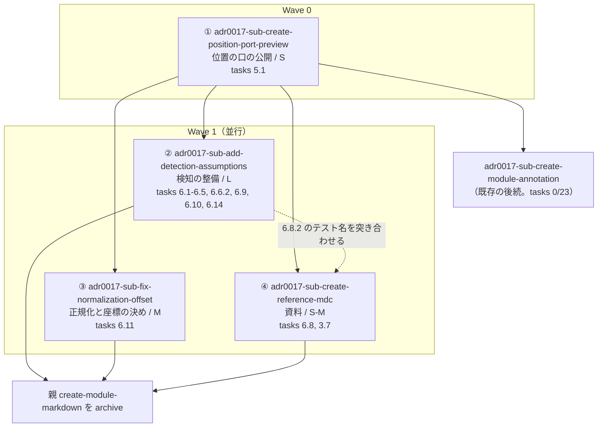

# Epic: create-module-markdown の分割

## Vision

親 change `create-module-markdown` の残 37 タスク（全 74）を、**着手判断が単独で下せる 4 単位**へ割る。整形された本文の面から位置の口が出ていない穴を Wave 0 で塞ぎ、残る「踏んだら止まる状態にする」作業を並走可能にする。

## Success criteria

- 4 単位それぞれが、他の単位の完了を待たずに着手・完了判定できる
- `openspec/specs/markdown/module` の Requirement「描いた本文と生テキストの位置の対応を公開する」が実装で満たされる
- 後続 change `adr0017-sub-create-module-annotation`（tasks 0/23）の着手条件が外れる
- 親 change の残タスクが 0 になり、子が全部終わった時点で親を archive できる

## 現状（実測。2026-08-30）

| 項目 | 結果 |
| --- | --- |
| `yarn test` | 358 passed / 19 files、緑 |
| `yarn typecheck` | exit 0、緑 |
| `yarn test:e2e` | 未実行（tasks の記録では基準と同じ失敗2件のみ） |
| 残タスク | 37 / 74 |

**この worktree に `openspec/` は無い**（sparse-checkout で除外）。change・ticket の実体は `/opt/projects/stroke-board/openspec/` にある。起票はそちらで行う。

---

## Specs

### ① adr0017-sub-create-position-port-preview

**goal** — 注釈の側が、整形された本文の面でも生テキストの面でも同じ口だけを見て済む。

| 項目 | 値 |
| --- | --- |
| Size | S（5〜8 タスク） |
| 依存 | なし（**Wave 0**） |
| 引き取る tasks | 3 章の残なし / **5.1** |

**穴の実体**（tasks.md に項目が無い。この単位の中核）

- `spec.md` は「外から引ける形で公開しなければならない（SHALL）」と定める
- `MarkdownSource.vue:77` は `defineExpose({ toSourceRange, toDomRange } satisfies PositionPort)` を持つ。**`MarkdownView.vue` は口を出していない**
- `createPreviewPositionPort`（`position/preview.ts:366`）の呼び出し元は単体テスト3本のみ
- `design.md:200` が明記:「整形済み本文の表示からは未提供。`annotation-module` の着手前に対応が必要」
- 5.1 は**記帳漏れ**。`MarkdownView.vue:118` が `:parser-options="{ keepPosition: true }"` を渡しており実装は済んでいる

**触るファイル**

- `modules/markdown/runtime/render/MarkdownView.vue` — 器へ `ref` を付け、`createPreviewPositionPort({ container, source })` を `defineExpose({ … } satisfies PositionPort)` で出す
- `modules/markdown/runtime/position/types.ts` — 口が受け取る生テキストの契約を明記（下記）
- `test/modules/markdown/runtime/render/`（新規）— 口が消えたら落ちるテスト
- `/opt/projects/stroke-board/openspec/changes/create-module-markdown/tasks.md` — 5.1 を閉じる

**完了判定** — 次をすべて満たしたとき完了とする。

- `MarkdownView` が `PositionPort` を `defineExpose` で出し、器の要素そのものは外へ出さない
- 本文が空（`v-if` が偽）のとき、口が `null` を返す。器が無いのに黙って答えを返さない
- 口の呼び出し元が単体テストだけでない状態になっている（口が消えたら落ちるテストが在る）
- **口が受け取る生テキストは「正規化後（CRLF → LF、front matter 除去後）」であることが型かコメントで明記されている**（③ が「誰が正規化するか」を決める土台）
- `keepPosition` が `parser-options` から渡っていることが確かめられ、5.1 が閉じている
- `yarn test` / `yarn typecheck` が緑

---

### ② adr0017-sub-add-detection-assumptions

**goal** — 崩れた前提を踏んだ人が、資料を読んでいなくても赤いテストで止まる。

| 項目 | 値 |
| --- | --- |
| Size | L（26 タスク＋再現環境） |
| 依存 | ①（口の形が確定してから検知を書く） |
| 引き取る tasks | **6.1・6.2・6.3・6.4・6.5・6.6.2・6.9・6.10・6.14** |

**内訳**

| 番号 | 中身 | 件数 |
| --- | --- | --- |
| 6.1 | 解析を自前で組み直すとハイドレーションが壊れる（**黙って壊れる**） | 3 |
| 6.2 | offset 0 と `undefined` の取り違え（**黙って壊れる**）。型で分かれていない欠陥3点が特定済み | 4 |
| 6.3 | 記法ごとの `position` 差（**黙って壊れる**） | 3 |
| 6.4 | `keepPosition` の経路 | 2 |
| 6.5 | `pre` の印と逃げ道 | 3 |
| 6.6.2 | 差の一覧がテスト名から読めること | 1 |
| 6.9 | 検証（壊して落ちることの確認・`yarn check`・test / e2e） | 3 |
| 6.10 | AST 構造の固定。**変異させても143本全通過した穴が3件** | 5 |
| 6.14 | ハイドレーション検知が拾えない範囲（属性だけのずれ・当環境で再現しない） | 2 |

**触るファイル**

- `test/modules/markdown/runtime/position/*.test.ts`（`silent-failure` / `edge-cases` / `pre-mark` / `preview` / `plain` / `fence`）
- `test/modules/markdown/runtime/render/`（6.1.1 の形の検知）
- `e2e/markdown-hydration.spec.ts` — 6.14.1 の属性ずれ、6.1.2 のアイコン消失
- `modules/markdown/runtime/position/types.ts` / `preview.ts`（`readOffset`）/ `fence.ts`（`FenceSource.position`）— 6.2.3 の型
- `modules/markdown/runtime/render/MarkdownView.vue` / `modules/markdown/index.ts` — 6.1.3 のコメント確定
- `@nuxt/icon` のカスタムコレクション（404）— 6.14.2 の再現環境

**完了判定** — 次をすべて満たしたとき完了とする。

- 黙って壊れる3件（6.1 / 6.2 / 6.3）それぞれに、踏んだら赤くなるテストが在る
- 6.2.3 の3点が型で塞がっている（`FenceSource.position` の平坦化・`readOffset` の `Number('') === 0`・`MDCNode.position` と `SourceRange` の型の分離）
- 6.10 の3件（`li` の段落ほどき・改行だけの text ノードの除去・見出しの id）を**実際に変異させて**落ちることを確かめている
- 6.14.2 について、**アイコン消失が再現する環境を用意した**か、再現しない前提で検知の設計を見直した結果が記録されている
- 6.9.1 のとおり、追加したテストを壊して落ちることを一件ずつ確かめている
- `yarn check` / `yarn test` / `yarn test:e2e` がこの単位の前と同じ結果

---

### ③ adr0017-sub-fix-normalization-offset

**goal** — CRLF や front matter を含む文書でも、注釈が黙ってずれない。

| 項目 | 値 |
| --- | --- |
| Size | M（8〜10 タスク。**うち2件は実装ではなく「決め」**） |
| 依存 | ①（口の契約が固まってから、誰が正規化するかを決める） |
| 引き取る tasks | **6.11**（5 件） |

**穴の実体**

- `app/pages/projects/[projectId]/approvals/[approvalId].vue:60` の `const source = computed(() => document.value?.content ?? '')` が、`MarkdownView` にも**注釈の基準**にも生文字列のまま渡っている
- 6.7 の実測: 生ファイルを渡すと `null` に倒れず、**黙って別の場所を返す**。本文の `b` を選ぶと front matter の `b` が返る反例あり
- 6.7.3 の実測: 本家は `readFile` / `writeFile` で素通しし、改行を触るコードが `dist` に0件。CRLF も front matter も**含まれうる**

**決めるべきこと（実装の前）**

| 番号 | 決め | 選択肢 |
| --- | --- | --- |
| 6.11.1 | 注釈のオフセットをどの座標で保存するか | 生ファイルの座標 / 正規化後の座標 |
| 6.11.2 | 正規化をどこで行うか | モジュールの内側 / 呼ぶ側 |

6.11.2 の「呼ぶ側が忘れずにやる」は、**いま潰そうとしている黙って壊れる形そのもの**である。

**触るファイル**

- `app/pages/projects/[projectId]/approvals/[approvalId].vue` — 生文字列の経路
- `app/composables/useAnnotations.ts` — オフセットの保存座標
- `modules/markdown/runtime/render/MarkdownView.vue` / `MarkdownSource.vue` — 内側で正規化すると決めた場合
- `e2e/fixtures/upstream-stub.mjs` — `\n` 直書きのみで2件を一切カバーしていない（6.11.5）
- `e2e/approval-annotation.spec.ts` — 6.11.4 の E2E
- `openspec/specs/markdown/module/spec.md` — 口の契約に座標の基準を足す delta
- 上位資料への整合反映（design.md で提案し、ユーザー承認を経る）

**完了判定** — 次をすべて満たしたとき完了とする。

- 保存座標が決まり、**本家に保存された注釈を誰が読むかを調べた結果**が決めの根拠として残っている
- 正規化を行う場所が決まり、「呼ぶ側が忘れずにやる」形になっていない
- 生ファイルの座標で保存すると決めた場合、正規化後 ↔ 生ファイル の対応が在る
- CRLF と front matter を含む文書で注釈が正しい位置に付くことを E2E で確かめている
- `e2e/fixtures/upstream-stub.mjs` が CRLF と front matter の2件を返す
- `yarn test` / `yarn test:e2e` が緑

---

### ④ adr0017-sub-create-reference-mdc

**goal** — change が archive された後も、`@nuxtjs/mdc` について調べて分かった事実が残る。

| 項目 | 値 |
| --- | --- |
| Size | S〜M（5 タスク） |
| 依存 | ①（記録する口の形が確定してから書く）。② とは**弱い依存**（6.8.2 のテスト名の突き合わせのみ） |
| 引き取る tasks | **6.8**（4 件）/ **3.7** |

**触るファイル**

- `docs/specs/reference/mdc-observations.md`（**新規**）— `upstream-observations.md` と同じ「調べて分かった事実」の枠。決定ではないので ADR にしない
- `CLAUDE.md` の Docs 節 — 目録へ追加
- `docs/specs/reference/stroke-modules.md` — 新設した資料から参照させる
- `test/app/components/workspace/markdown-roundtrip.test.ts` / `markdown-sanitize.test.ts` — 移設先に合わせる（3.7）
- `test/app/components/workspace/markdown-fence-position.test.ts` — **3.7 に項目が無いが、モジュールのコードを見ているのに `app/` の下に居る**。同じ移設の対象

**完了判定** — 次をすべて満たしたとき完了とする。

- `docs/specs/reference/mdc-observations.md` が在り、実測で崩れた前提7件が事実として書かれている
- 7件それぞれについて、**どのテストが固定しているか**が書かれている（踏んだときに落ちる先が示されている）
- `CLAUDE.md` の Docs 節と `stroke-modules.md` から辿れる
- `test/` の markdown 系3本が、写し元（`modules/markdown/`）と同じ構造の位置に居る
- 移設は移動のみで、テストの中身と結果が変わっていない

---

## 依存グラフ



**親は残す。** 子が全部終わってから archive する。1〜5章（実装完了・テスト緑）は子の完了まで開いたままになる。

## Interface contracts

| 契約 | 定義元 | 確定する単位 | 使う側 |
| --- | --- | --- | --- |
| `PositionPort`（`toSourceRange(Range): SourceRange \| null` / `toDomRange(SourceRange): Range \| null`） | `modules/markdown/runtime/position/types.ts` | ①（形） | ②（検知）・`adr0017-sub-create-module-annotation` |
| 口へ渡す生テキストの基準（正規化後 / 生ファイル） | 同上 | ①が**明記**し、③が**誰が守るか**を決める | ③・注釈の側 |
| `SOURCE_START_ATTR` / `SOURCE_END_ATTR`（`data-src-start` / `data-src-end`） | `position/source-span.ts` | 既定（変えない） | ② |
| `SOURCE_SHOWN_KEY`（provide/inject で「ソースを見せたい範囲」を降ろす） | `render/source-shown.ts` | 既定（変えない） | `adr0017-sub-create-module-annotation` |
| 注釈のオフセットの保存座標 | `app/composables/useAnnotations.ts` ＋ 本家の送信データ | ③ | 注釈の側・本家に保存された注釈を読む道具 |

**① が口の形を確定し、③ が口が受け取る座標の基準を確定する。** ① の完了判定に「正規化後を受け取る」を明記させることで、③ の決めが ① の型を動かさない。

## Risks / Trade-offs

| # | リスク | 影響 | 緩和 |
| --- | --- | --- | --- |
| R1 | **親を残すため、1〜5章（実装完了・テスト緑）が子の完了まで archive されず開いたままになる** | 親 tasks の完了率が実態より低く見え、どこまで済んでいるか読めない | 引き取った tasks の番号を epic.md と ADR-0017 に明示し、どの子が持つか辿れるようにする |
| R2 | **② が `@nuxt/icon` の 404 という環境整備に引きずられる** | 6.14.2（当環境でアイコン消失が再現しない）の解決に外部要因が入り、② のサイズが読めなくなる | 6.14.2 を「再現環境を用意する」/「再現しない前提で検知の設計を見直す」の二択にし、着手時にどちらかを選んで記録する |
| R3 | 3.7 が既存の委譲先と重複する。ADR-0017 は `adr0017-sub-update-docs-structure` の触るファイルに `test/app/components/workspace/markdown-*.test.ts` を挙げている | 同じ移設が2つの change に載る | ④ が引き取ると ADR-0017 に明記し、`adr0017-sub-update-docs-structure` の該当行を落とす（ADR 追記時に併せて行う） |
| R4 | ③ の 6.11.1 は「本家に保存された注釈を誰が読むか」の調査結果で決まる。読み手が特定できないと決めが止まる | ③ が調査で止まる | 調査で決め手が出なければ「正規化後の座標で保存し、生ファイルとの対応を持たない」を既定案として design.md でユーザーへ提案する |
| R5 | ② の 6.10 が塞ぐのはパーサのマイナーリリースで壊れる層だが、`@nuxtjs/mdc@0.23.1` が最新で**上げ先が無い**（実測） | 検知を足しても、上げたときに効くかを実地で測れない | 6.6.1 と同じく**パーサを直接変異させて**測る。6.10.4 がこれを完了条件に持つ |
| R6 | ① が `MarkdownView.vue` を触る。`<MDC>` のスロットだけを差し替えている形から外れると**アプリ全体のアイコンが消える**（実測。本文には症状が出ない） | 黙って壊れる | ① では解析の段（`<MDC>` と `parser-options`）に触れず、器の `ref` と `defineExpose` だけを足す。② の 6.1.1 が後からこの形を固定する |

---

## ADR-0017 へ追記する内訳の下書き

`/opt/projects/stroke-board/docs/adr/0017-delegate-create-module-markdown.md` の「## 委譲の内訳」の後、「## 経緯の記録」の前に挿入する。

```markdown
## 分割の内訳

上の5件は**別の関心事へ委譲**したものである。これとは別に、親 change 自身の残作業を**分割**した4件がある。委譲先ではなく親の範囲そのものなので、親は子が全部終わるまで archive しない。

分割の区分は次の3つ。`資料化` は委譲の内訳と同じ定義を使う。

- **口** — モジュールが外へ公開する口が増えるもの
- **検知** — 振る舞いを変えず、踏んだら止まる状態を作るもの
- **不具合** — 黙って壊れる経路を塞ぎ、振る舞いが直るもの

### 口

#### adr0017-sub-create-position-port-preview

- **種別**: 口
- **状態**: 未着手
- **成果物**: 未作成
- **触るファイル**: `modules/markdown/runtime/render/MarkdownView.vue`、`modules/markdown/runtime/position/types.ts`、`test/modules/markdown/runtime/render/`（新規）
- **引き取る tasks**: 5.1

**対応内容** — 整形された本文の面から位置の口を出す。`specs/markdown/module` の「描いた本文と生テキストの位置の対応を公開する」が「外から引ける形で公開しなければならない（SHALL）」と定めているが、`MarkdownView` は口を出しておらず、`createPreviewPositionPort` の呼び出し元は単体テストのみである（実測）。生テキストの面（`MarkdownSource.vue:77`）は既に `defineExpose({ … } satisfies PositionPort)` で出しており、整形された本文の面だけが揃っていない。

5.1 は記帳漏れである。`keepPosition` は `MarkdownView.vue:118` の `parser-options` から既に渡っている。

**解析の段には触れない。** `<MDC>` のスロットだけを差し替えている形から外れると、クライアントの再解析で shiki の色が SSR とずれ、アプリ全体のアイコンが消える（実測）。この単位で足すのは器の `ref` と `defineExpose` だけである。

**完了判定** — 次をすべて満たしたとき完了とする。

- `MarkdownView` が `PositionPort` を `defineExpose` で出し、器の要素そのものは外へ出さない
- 本文が空のとき、口が `null` を返す
- 口が消えたら落ちるテストが在る
- 口が受け取る生テキストは「正規化後（CRLF → LF、front matter 除去後）」であることが明記されている
- 5.1 が閉じている

**親との関係** — 分割。親の Wave 0 であり、他の3件と `adr0017-sub-create-module-annotation` の前提になる。`design.md` が「`annotation-module` の着手前に対応が必要になる」と記していたのはこの穴である。

### 検知

#### adr0017-sub-add-detection-assumptions

- **種別**: 検知
- **状態**: 未着手
- **成果物**: 未作成
- **触るファイル**: `test/modules/markdown/runtime/position/*.test.ts`、`e2e/markdown-hydration.spec.ts`、`modules/markdown/runtime/position/types.ts` / `preview.ts` / `fence.ts`、`modules/markdown/runtime/render/MarkdownView.vue`（コメント）、`modules/markdown/index.ts`（コメント）
- **引き取る tasks**: 6.1・6.2・6.3・6.4・6.5・6.6.2・6.9・6.10・6.14

**対応内容** — 実装で崩れた前提7件を、踏んだら止まる状態にする。うち3件は**黙って壊れる**（症状が出ないまま誤った位置を返す、別の場所が壊れる）。資料に書くだけでは、読まなかった人が同じ穴に落ちる。

6.10 は検知力の測定で見つかった穴である。テストはフェンスの幾何と text ノードの位置をよく固めているが、**AST の構造を何も固めていない**。出力が実際に変わったのに143本すべてが通過した変異が3件あった。

6.14.2 は当環境でアイコン消失そのものが再現しない（`@nuxt/icon` のカスタムコレクションが 404）。再現環境の用意も完了条件に含める。

**完了判定** — 次をすべて満たしたとき完了とする。

- 黙って壊れる3件（6.1 / 6.2 / 6.3）それぞれに、踏んだら赤くなるテストが在る
- 6.2.3 の3点が型で塞がっている
- 6.10 の3件を実際に変異させて落ちることを確かめている
- 6.14.2 について、再現環境を用意したか、再現しない前提で検知の設計を見直した結果が記録されている
- 追加したテストを壊して落ちることを一件ずつ確かめている

**親との関係** — 分割。`adr0017-sub-create-position-port-preview` の後続。6.1.1 と 6.4.2 が `MarkdownView` の形を固定するため、口が出そろってから書く。

### 不具合

#### adr0017-sub-fix-normalization-offset

- **種別**: 不具合
- **状態**: 未着手
- **成果物**: 未作成
- **触るファイル**: `app/pages/projects/[projectId]/approvals/[approvalId].vue`、`app/composables/useAnnotations.ts`、`modules/markdown/runtime/render/`、`e2e/fixtures/upstream-stub.mjs`、`e2e/approval-annotation.spec.ts`
- **引き取る tasks**: 6.11

**対応内容** — 本番の呼び出し側が、正規化していない生文字列を渡している。`approvals/[approvalId].vue:60` の `source` が `MarkdownView` にも注釈の基準にもそのまま渡っており、CRLF を含む文書が来ると、いま在る注釈機能が黙ってずれる。生ファイルを渡すと `null` には倒れず、**黙って別の場所を返す**（実測）。本家は `readFile` / `writeFile` で素通しするため、CRLF も front matter も含まれうる（実測）。

**決めが2件ある。** 注釈のオフセットは本家へ送られて保存される。正規化した座標で保存すると、ディスク上の生ファイルとずれた値が残る。

- 注釈のオフセットをどの座標で保存するか（生ファイル / 正規化後）。本家に保存された注釈を誰が読むかを調べてから決める
- 正規化をどこで行うか（モジュールの内側 / 呼ぶ側）。「呼ぶ側が忘れずにやる」は、いま潰そうとしている黙って壊れる形そのものである

**完了判定** — 次をすべて満たしたとき完了とする。

- 保存座標が決まり、本家に保存された注釈を誰が読むかを調べた結果が根拠として残っている
- 正規化を行う場所が決まり、「呼ぶ側が忘れずにやる」形になっていない
- 生ファイルの座標で保存すると決めた場合、正規化後 ↔ 生ファイル の対応が在る
- CRLF と front matter を含む文書で注釈が正しい位置に付くことを E2E で確かめている
- `e2e/fixtures/upstream-stub.mjs` が CRLF と front matter の2件を返す

**親との関係** — 分割。`adr0017-sub-create-position-port-preview` の後続。口の形が固まってから、口が受け取る座標の基準を決める。

### 資料化

#### adr0017-sub-create-reference-mdc

- **種別**: 資料化
- **状態**: 未着手
- **成果物**: 未作成
- **触るファイル**: `docs/specs/reference/mdc-observations.md`（新規）、`CLAUDE.md` の Docs 節、`docs/specs/reference/stroke-modules.md`、`test/app/components/workspace/markdown-*.test.ts`
- **引き取る tasks**: 6.8・3.7

**対応内容** — change が archive されても消えない記録を残す。`docs/specs/reference/mdc-observations.md` を `upstream-observations.md` と同じ「調べて分かった事実」の枠で新設する。決定ではないので ADR にしない。

7件それぞれについて、どのテストが固定しているかを書く。踏んだときに落ちる先を示すためである。

3.7（`test/app/components/workspace/markdown-roundtrip.test.ts` と `markdown-sanitize.test.ts` の移設）をここが引き取る。**`adr0017-sub-update-docs-structure` の「触るファイル」から `test/app/components/workspace/markdown-*.test.ts` の行を落とすこと。** 同じ移設が2つの change に載る。`markdown-fence-position.test.ts` も同じ移設の対象である（3.7 に項目が無いが、モジュールのコードを見ているのに `app/` の下に居る）。

**完了判定** — 次をすべて満たしたとき完了とする。

- `docs/specs/reference/mdc-observations.md` が在り、崩れた前提7件が事実として書かれている
- 7件それぞれについて、どのテストが固定しているかが書かれている
- `CLAUDE.md` の Docs 節と `stroke-modules.md` から辿れる
- `test/` の markdown 系3本が、写し元と同じ構造の位置に居る
- 移設は移動のみで、テストの中身と結果が変わっていない

**親との関係** — 分割。`adr0017-sub-create-position-port-preview` の後続。6.8.2（どのテストが固定しているか）は `adr0017-sub-add-detection-assumptions` が加える検知の名前を突き合わせる必要があるため、その完了後に一度だけ確認する。
```

**親 change の archive 条件**（ADR の「## 影響」へ足す1行）

```markdown
- 親 `create-module-markdown` は分割した4件が全部終わってから archive する。親の残タスクは4件が引き取ったので、親自身に開いた作業は無い
```

---

## Unresolved questions

- ③ の 6.11.1 の決め手（本家に保存された注釈を誰が読むか）は未調査。③ の着手時に調べる
- 6.14.2 を「再現環境を用意する」で行くか「再現しない前提で検知の設計を見直す」で行くかは、② の着手時に選ぶ

## Next Steps

1. epic.md をユーザーが承認する
2. `/opt/projects/stroke-board/openspec/changes/` に4件の change ディレクトリを起票する（この worktree に `openspec/` は無い。sparse-checkout で除外されている）
3. `/opt/projects/stroke-board/openspec/tickets/<change-id>.md` を4本作る。frontmatter は `status`（`docs/agents/triage-labels.md` の5つ）と `change` が必須。本文は起票時点の概要のみで、以後追記しない
4. `/opt/projects/stroke-board/docs/adr/0017-delegate-create-module-markdown.md` に上の「## 分割の内訳」を追記し、`adr0017-sub-update-docs-structure` の触るファイルから `test/app/components/workspace/markdown-*.test.ts` の行を落とす
5. ① `adr0017-sub-create-position-port-preview` に着手する（Wave 0）
6. ① の完了後、②③④ を並走させる
7. 4件が全部終わったら 6.9.2 / 6.9.3 相当（`yarn check` / `yarn test` / `yarn test:e2e`）を再実行し、親 `create-module-markdown` を archive する
